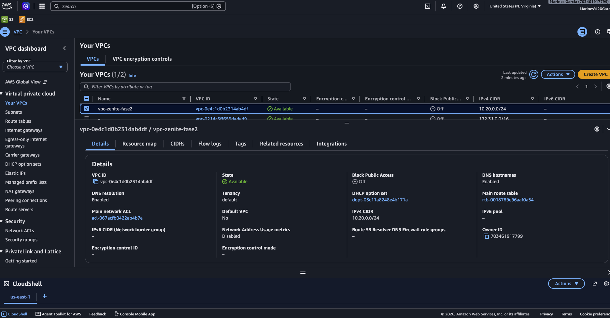

# Preparación de AWS y creación de la VPC

*Sección del reporte de Fase 2 · parte AWS y VPC (MD_1) · corresponde a los apartados "Arquitectura heredada de Fase 1",
"Plan de direccionamiento" e "Implementación de la VPC" de la estructura sugerida en el MD_6.*

## 1. Objetivo de esta parte

Dejar listo el entorno de AWS para el prototipo de Fase 2: una Amazon VPC `10.20.0.0/24` en `us-east-1`, con nomenclatura y
etiquetas consistentes, usando el direccionamiento VLSM aprobado en Fase 1 sin modificar ningún bloque. Esta VPC es la base sobre
la que se crean después las subredes, los Security Groups y las instancias de prueba.

## 2. Arquitectura heredada de Fase 1

| Parámetro | Valor |
|---|---|
| Proveedor | Amazon Web Services |
| Región | `us-east-1` (US East, N. Virginia) |
| VPC | `10.20.0.0/24` |
| Segmentos activos | Ventas, Visitantes, Servidores, TI, DMZ, VPN e Infraestructura |
| Bloques reservados | `10.20.0.160/27` (Reserva A) y `10.20.0.192/26` (Reserva B) |

Fase 1 modela una sola VPC con siete subredes activas. Fase 2 conserva esa estructura y los mismos CIDR.

### Alcance del prototipo respecto al diseño completo

Fase 2 es un prototipo de la segmentación, no el despliegue productivo de Fase 1. Por eso, en esta etapa:

| Elemento de Fase 1 | En el prototipo de Fase 2 |
|---|---|
| NAT Gateway, pfSense y OpenVPN | No se despliegan. |
| Servicios internos (BIND9, OpenLDAP, PostgreSQL, Nginx) | No se despliegan; solo se prueban instancias de Ventas y TI. |
| Administración de instancias | EC2 Instance Connect Endpoint: sin IPv4 pública en las instancias y sin mantener un NAT Gateway encendido. |
| Reservas A y B | Siguen apartadas; no se crean como subredes. |

Esto evita costos de cómputo y de red innecesarios y no cambia el subnetting. La implementación completa de pfSense, la DMZ y la
VPN corresponde a fases posteriores.

## 3. Plan de direccionamiento: direcciones reservadas por AWS

AWS reserva en cada subred las cuatro primeras direcciones y la última. Por eso, las direcciones que el diseño de Fase 1 llama
"gateway" (`.1`, `.33`, `.65`, `.97`, `.113`, `.129`, `.145`) se interpretan en AWS como la dirección del **VPC Router**:
pertenecen al router administrado por AWS y no se asignan a una instancia ni a una interfaz de pfSense.

| Segmento | CIDR | VPC Router AWS | Rango asignable a instancias |
|---|---|---|---|
| Ventas | `10.20.0.0/27` | `10.20.0.1` | `10.20.0.4 – 10.20.0.30` |
| Visitantes | `10.20.0.32/27` | `10.20.0.33` | `10.20.0.36 – 10.20.0.62` |
| Servidores | `10.20.0.64/27` | `10.20.0.65` | `10.20.0.68 – 10.20.0.94` |
| TI | `10.20.0.96/28` | `10.20.0.97` | `10.20.0.100 – 10.20.0.110` |
| DMZ | `10.20.0.112/28` | `10.20.0.113` | `10.20.0.116 – 10.20.0.126` |
| VPN | `10.20.0.128/28` | `10.20.0.129` | `10.20.0.132 – 10.20.0.142` |
| Infraestructura | `10.20.0.144/28` | `10.20.0.145` | `10.20.0.148 – 10.20.0.158` |

En consecuencia, en la DMZ no se pueden asignar `10.20.0.114` ni `10.20.0.115` (reservadas por AWS); el servidor web queda en
`10.20.0.116` y el proxy TLS en `10.20.0.117`. Las direcciones de las instancias de prueba (`10.20.0.10`, `10.20.0.11` y
`10.20.0.102`) están dentro de los rangos asignables.

## 4. Implementación de la VPC

La VPC se creó con el script `configuracion/01_crear_vpc.sh`, ejecutado en AWS CloudShell, y se verificó en la consola de AWS.
El script es idempotente: si la VPC ya existe con el nombre y el CIDR correctos, la reutiliza; si encuentra un conflicto, se
detiene sin modificar nada. No se usaron ni se guardaron credenciales en los archivos del proyecto.

Configuración creada:

| Atributo | Valor |
|---|---|
| Name | `vpc-zenite-fase2` |
| VPC ID | `vpc-0e4c1d0b2314ab4df` |
| IPv4 CIDR | `10.20.0.0/24` |
| IPv6 | Sin bloque IPv6 |
| Tenancy | Default |
| DNS resolution | Habilitado |
| DNS hostnames | Habilitado |
| Estado | `Available` |
| Etiquetas | `Project=ZenitePrestige` · `Phase=Fase2` · `Environment=Prototype` · `Owner=Grupo30` |

*Figura E01. Consola de AWS (N. Virginia): `vpc-zenite-fase2`, `10.20.0.0/24`, estado `Available`, DNS resolution y DNS hostnames habilitados.*

### Validación

El script comprobó los siguientes puntos (`configuracion/vpc-validacion.txt`, ejecutado el 2026-10-10 00:32 UTC, es decir, el
9 de octubre a las 18:32 hora de Guatemala):

| Comprobación | Esperado | Resultado |
|---|---|---|
| Estado | `available` | Correcto |
| CIDR | `10.20.0.0/24` | Correcto |
| VPC con ese CIDR | 1 | Correcto |
| Bloques IPv6 | 0 | Correcto |
| Tenancy | `default` | Correcto |
| DNS resolution / DNS hostnames | Habilitados | Correcto |
| Etiquetas Name, Project, Phase, Environment, Owner | Según el plan | Correcto |

La cuenta también conserva la VPC predeterminada de AWS (`172.31.0.0/16`). No forma parte del prototipo y no se solapa con
`10.20.0.0/24`.

## 5. Control de costos en esta etapa

Al finalizar esta parte no existe ninguna instancia EC2, NAT Gateway, Elastic IP ni conexión VPN Site-to-Site (el script
verificó los cuatro recursos en cero). Una VPC, sus subredes, tablas de rutas, Security Groups y Network ACL no generan cargo por
cómputo. Antes y después de cada sesión de trabajo se revisa AWS Billing (créditos y gasto acumulado).

## 6. Archivos de configuración de esta parte

| Archivo | Contenido |
|---|---|
| `configuracion/00_verificar_entorno.sh` | Verificación de solo lectura: región, VPC existentes y recursos con costo. |
| `configuracion/01_crear_vpc.sh` | Creación y validación de `vpc-zenite-fase2` (modo `--validar` solo revisa). |
| `configuracion/vpc.json` | Exportación de la VPC mediante `aws ec2 describe-vpcs`. |
| `configuracion/vpc-validacion.txt` | Resultado de la validación. |
