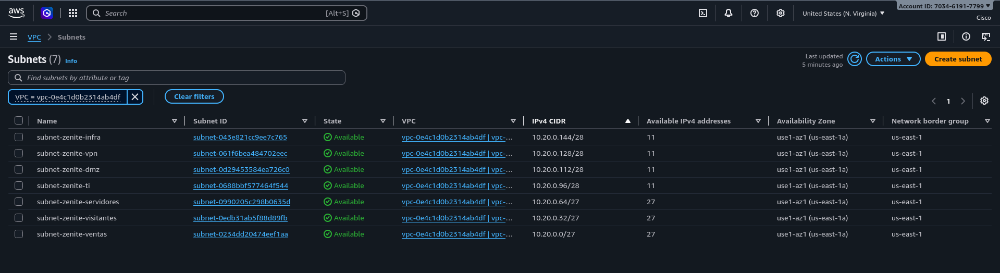
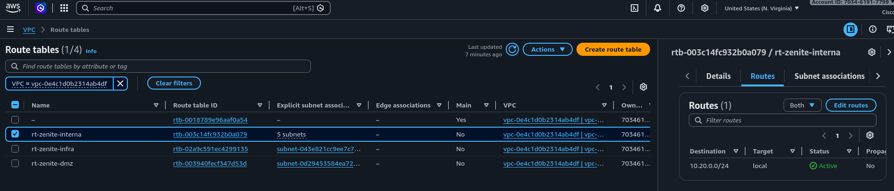
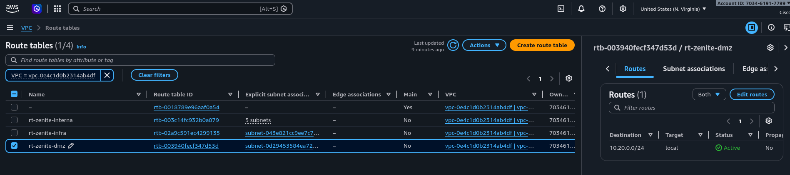
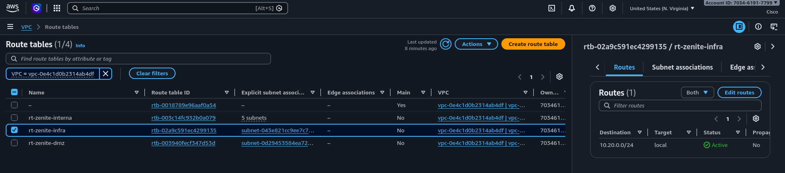

# Subredes y tablas de rutas

*Sección del reporte de Fase 2 · parte subredes y rutas (MD_2) · corresponde a los apartados "Implementación de subredes" y
"Tablas de rutas" de la estructura sugerida en el MD_6.*

## 1. Objetivo de esta parte

Trasladar a AWS la segmentación VLSM aprobada en Fase 1: siete subredes activas dentro de `vpc-zenite-fase2`
(`10.20.0.0/24`), sin solapamientos, con los dos bloques de crecimiento libres y con tablas de rutas que solo permiten el
tránsito interno de la VPC. Es la evidencia principal de que el subnetting de Fase 1 se implementó tal como se diseñó.

## 2. Decisiones del prototipo

| Decisión | Justificación |
|---|---|
| Una sola Availability Zone (`us-east-1a`) | En AWS una subred vive en una sola AZ. Usar una sola AZ para las siete evita introducir una segunda variable de diseño (alta disponibilidad) que no hace falta para demostrar la segmentación. |
| Sin IPv4 pública automática en ninguna subred | Las instancias de prueba son privadas y se administran con EC2 Instance Connect Endpoint. |
| Reservas A y B sin crear | `10.20.0.160/27` y `10.20.0.192/26` quedan como espacio de crecimiento, igual que en Fase 1. |
| Tres tablas de rutas propias, solo con la ruta local | Separa desde ahora los dominios de enrutamiento (interno, DMZ, infraestructura) sin abrir salida a Internet. La política de qué tráfico se permite se aplica con Security Groups (MD_3). |
| Sin Internet Gateway, NAT Gateway ni Elastic IP | No se necesitan para la prueba interna y evitan costos. |

## 3. Implementación de las subredes

Las subredes se crearon con `configuracion/02_crear_subredes_rutas.sh` en AWS CloudShell. El script es idempotente: reutiliza
lo que ya existe con el nombre y el CIDR correctos, y se detiene sin modificar nada si encuentra una subred fuera del plan, una
subred en otra AZ o un uso de los bloques de reserva. Cada subred lleva las etiquetas `Name`, `Project=ZenitePrestige`,
`Phase=Fase2`, `Environment=Prototype` y `Owner=Grupo30`.

| Name tag | CIDR | Hosts útiles en AWS | Uso |
|---|---|---|---|
| `subnet-zenite-ventas` | `10.20.0.0/27` | 27 | Prueba de usuarios de Ventas |
| `subnet-zenite-visitantes` | `10.20.0.32/27` | 27 | Segmento de invitados |
| `subnet-zenite-servidores` | `10.20.0.64/27` | 27 | Servicios internos |
| `subnet-zenite-ti` | `10.20.0.96/28` | 11 | Administración |
| `subnet-zenite-dmz` | `10.20.0.112/28` | 11 | Servicios publicados |
| `subnet-zenite-vpn` | `10.20.0.128/28` | 11 | Segmento lógico de VPN |
| `subnet-zenite-infra` | `10.20.0.144/28` | 11 | Gestión e infraestructura |
| *(Reserva A)* | `10.20.0.160/27` | – | Crecimiento futuro; no se crea |
| *(Reserva B)* | `10.20.0.192/26` | – | Crecimiento futuro; no se crea |

Los Subnet IDs reales asignados por AWS están en `configuracion/segmentacion.md` y en `configuracion/subnets.json`.

*Figura E02. VPC > Subnets filtrado por `vpc-0e4c1d0b2314ab4df` y ordenado por IPv4 CIDR: nombre, Subnet ID, VPC, IPv4 CIDR,
direcciones disponibles (27 en las `/27` y 11 en las `/28`) y Availability Zone `us-east-1a` de las siete subredes.*

## 4. Direcciones reservadas por AWS

AWS reserva en cada subred las cuatro primeras direcciones (red, VPC Router, DNS de AWS y uso futuro) y la última (broadcast).
Por eso una `/27` deja 27 direcciones asignables y una `/28` deja 11. Ninguna instancia puede usar esas direcciones.

| Subred | Reservadas por AWS | Asignables |
|---|---|---|
| Ventas | `.0 .1 .2 .3 .31` | `.4 – .30` |
| Visitantes | `.32 .33 .34 .35 .63` | `.36 – .62` |
| Servidores | `.64 .65 .66 .67 .95` | `.68 – .94` |
| TI | `.96 .97 .98 .99 .111` | `.100 – .110` |
| DMZ | `.112 .113 .114 .115 .127` | `.116 – .126` |
| VPN | `.128 .129 .130 .131 .143` | `.132 – .142` |
| Infraestructura | `.144 .145 .146 .147 .159` | `.148 – .158` |

Las direcciones planificadas para las instancias de prueba (`10.20.0.10` y `10.20.0.11` en Ventas, `10.20.0.102` en TI) y para
la DMZ (web `10.20.0.116`, proxy TLS `10.20.0.117`) están dentro de los rangos asignables.

## 5. Tablas de rutas

Toda VPC tiene la ruta local `10.20.0.0/24 -> local`, que da un camino de capa 3 entre cualquier par de subredes de la VPC.
Las tres tablas del prototipo contienen únicamente esa ruta:

| Route table | Subredes asociadas | Rutas |
|---|---|---|
| `rt-zenite-interna` | ventas, visitantes, servidores, ti, vpn | `10.20.0.0/24 -> local` |
| `rt-zenite-dmz` | dmz | `10.20.0.0/24 -> local` |
| `rt-zenite-infra` | infra | `10.20.0.0/24 -> local` |

- **DMZ sin ruta por defecto.** La publicación del sitio sigue el flujo `Internet -> pfSense -> Proxy TLS 10.20.0.117 -> Web 10.20.0.116`,
  con DNAT en pfSense. Agregar ahora `0.0.0.0/0 -> Internet Gateway` en la DMZ contradiría ese flujo, así que se deja para la
  ampliación del prototipo que despliegue pfSense.
- **Infraestructura sin salida.** EC2 Instance Connect Endpoint funciona dentro de la VPC y no requiere hacer públicas las
  instancias de Ventas ni de TI.
- **Tabla principal.** AWS crea una tabla principal con la VPC. Ninguna subred depende de ella: las siete tienen asociación
  explícita a una de las tres tablas anteriores.

Los Route Table IDs reales están en `configuracion/segmentacion.md` y en `configuracion/route-tables.json`.

*Figura E03a. `rt-zenite-interna` (`rtb-003c14fc932b0a079`): única ruta `10.20.0.0/24 -> local` y 5 subredes asociadas.*

*Figura E03b. `rt-zenite-dmz` (`rtb-003940fecf347d53d`): única ruta `10.20.0.0/24 -> local`, asociada a `subnet-zenite-dmz`; sin ruta por defecto a Internet.*

*Figura E03c. `rt-zenite-infra` (`rtb-02a9c591ec4299135`): única ruta `10.20.0.0/24 -> local`, asociada a `subnet-zenite-infra`.*

En las tres capturas se ve también la tabla principal de la VPC (`Main = Yes`) sin subredes asociadas explícitamente.

## 6. Verificación de la segmentación

El script valida automáticamente cada punto y deja el resultado en `configuracion/subredes-validacion.txt` (ejecutado el
2026-10-12 07:28 UTC, es decir, el 12 de octubre a la 01:28 hora de Guatemala):

| Comprobación | Esperado | Resultado |
|---|---|---|
| Subredes en `vpc-zenite-fase2` | 7 | Correcto |
| CIDR, nombre y etiquetas de cada subred | Según el plan | Correcto |
| Availability Zone | `us-east-1a` en las siete | Correcto |
| IPv4 pública automática | Desactivada en las siete | Correcto |
| Solapamiento entre subredes | Ninguno | Correcto |
| `10.20.0.160/27` y `10.20.0.192/26` | Sin usar | Correcto |
| Asociación de cada subred | La tabla de rutas indicada en la sección 5 | Correcto |
| Rutas de cada tabla | Solo `10.20.0.0/24 -> local` | Correcto |
| Internet Gateway, NAT Gateway, Elastic IP, instancias | 0 | Correcto |

Las direcciones disponibles que reporta AWS (27 en cada `/27` y 11 en cada `/28`) confirman las cinco direcciones reservadas
por subred.

Los IDs asignados por AWS fueron:

| Subred | Subnet ID | Route table | Route Table ID |
|---|---|---|---|
| `subnet-zenite-ventas` | `subnet-0234dd20474eef1aa` | `rt-zenite-interna` | `rtb-003c14fc932b0a079` |
| `subnet-zenite-visitantes` | `subnet-0edb31ab5f88d89fb` | `rt-zenite-interna` | `rtb-003c14fc932b0a079` |
| `subnet-zenite-servidores` | `subnet-0990205c298b0635d` | `rt-zenite-interna` | `rtb-003c14fc932b0a079` |
| `subnet-zenite-ti` | `subnet-0688bbf577464f544` | `rt-zenite-interna` | `rtb-003c14fc932b0a079` |
| `subnet-zenite-dmz` | `subnet-0d29453584ea726c0` | `rt-zenite-dmz` | `rtb-003940fecf347d53d` |
| `subnet-zenite-vpn` | `subnet-061f6bea484702eec` | `rt-zenite-interna` | `rtb-003c14fc932b0a079` |
| `subnet-zenite-infra` | `subnet-043e821cc9ee7c765` | `rt-zenite-infra` | `rtb-02a9c591ec4299135` |

## 7. Archivos de configuración de esta parte

| Archivo | Contenido |
|---|---|
| `configuracion/02_crear_subredes_rutas.sh` | Creación y validación de subredes y tablas de rutas (modo `--validar` solo revisa). |
| `configuracion/subnets.json` | Exportación de `aws ec2 describe-subnets` de la VPC. |
| `configuracion/route-tables.json` | Exportación de `aws ec2 describe-route-tables` de la VPC. |
| `configuracion/subredes-validacion.txt` | Resultado de la validación. |
| `configuracion/segmentacion.md` | Registro con nombre lógico, CIDR, Subnet ID, Route Table ID, AZ y uso. |
