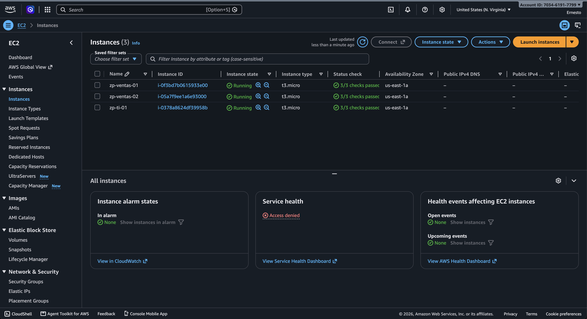
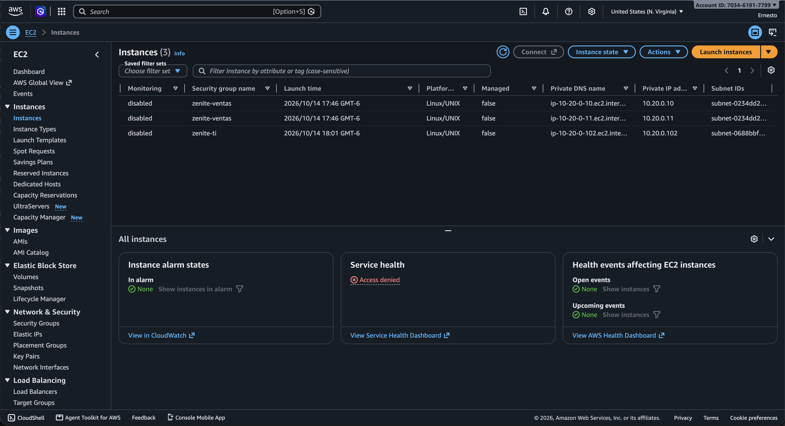
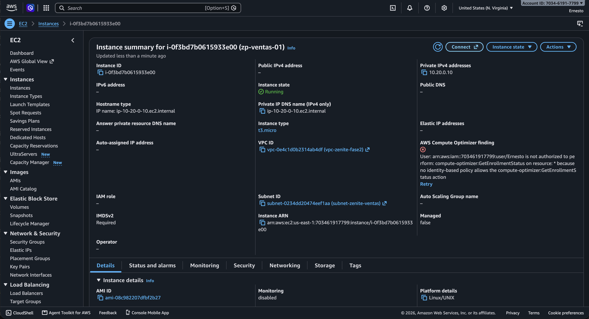
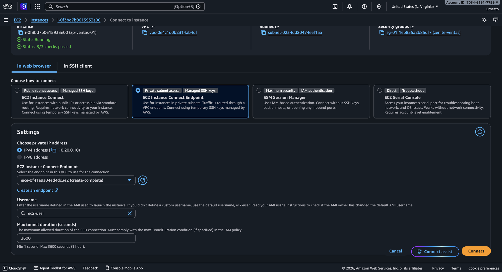
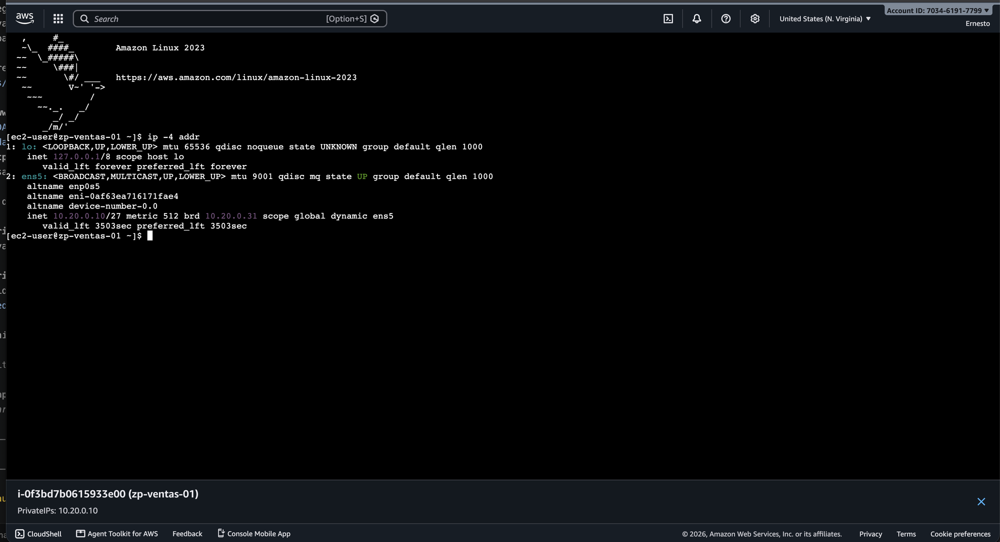

# Instancias de prueba

*Sección del reporte de Fase 2 · parte instancias de prueba (MD_4) · corresponde al despliegue de las instancias que se usan
en las pruebas de conectividad (MD_5).*

## 1. Objetivo de esta parte

Desplegar las instancias EC2 mínimas para demostrar la conectividad y la segmentación de Fase 2: dos hosts en la subred de
Ventas y uno en la de TI, con las direcciones privadas del plan, sin IPv4 pública y administrables desde la consola por
EC2 Instance Connect Endpoint. No se encienden los servidores productivos de Fase 1.

| Instancia | Subred | IP privada | Security Group | Rol |
|---|---|---|---|---|
| `zp-ventas-01` | `subnet-zenite-ventas` (`10.20.0.0/27`) | `10.20.0.10` | `zenite-ventas` | Usuario de Ventas |
| `zp-ventas-02` | `subnet-zenite-ventas` (`10.20.0.0/27`) | `10.20.0.11` | `zenite-ventas` | Usuario de Ventas |
| `zp-ti-01` | `subnet-zenite-ti` (`10.20.0.96/28`) | `10.20.0.102` | `zenite-ti` | Administración (TI) |

Las tres direcciones están dentro de los rangos asignables de cada subred (Ventas `.4 – .30`, TI `.100 – .110`; ver la sección
de subredes).

## 2. Decisiones del prototipo

| Decisión | Justificación |
|---|---|
| Amazon Linux 2023 estándar | Imagen oficial de AWS que ya trae `ec2-instance-connect`; la variante *minimal* no lo incluye. |
| `t3.micro` | El tipo más pequeño razonable para la prueba; AWS lo reporta como Free Tier en la cuenta. |
| Sin IPv4 pública y sin key pair | Las instancias no son alcanzables desde Internet. El acceso administrativo es solo por EC2 Instance Connect Endpoint, con llaves SSH temporales que genera AWS. |
| Sin Internet Gateway ni NAT Gateway | Las pruebas son internas a la VPC; la ruta local `10.20.0.0/24 -> local` basta. |
| IMDSv2 obligatorio (`HttpTokens=required`) | Endurece el acceso al servicio de metadatos de la instancia. |
| Créditos de CPU en modo `standard` | En `unlimited` (valor por defecto de T3) un uso alto de CPU puede generar cargos; en `standard` no. |
| Hostname por *user data* | Cada instancia toma su nombre (`zp-ventas-01`, …) al arrancar, y `preserve_hostname: true` evita que cloud-init lo regrese a `ip-10-20-0-x` después de detenerla y encenderla. |
| Disco raíz de 8 GiB gp3 | Tamaño por defecto de la AMI; suficiente para la prueba. |

## 3. Implementación

Las instancias se crearon con `configuracion/04_crear_instancias.sh` (AWS CLI). El script:

1. Comprueba, sin modificar nada, que existan las subredes y los Security Groups del plan, que el EC2 Instance Connect
   Endpoint de la VPC esté disponible y que ninguna de las tres IP esté ocupada. Si algo falla, se detiene sin crear nada.
2. Busca la AMI de Amazon Linux 2023 más reciente para la arquitectura del tipo de instancia.
3. Lanza cada instancia con su IP privada fija, sin IPv4 pública, con IMDSv2 obligatorio, créditos `standard`, el *user
   data* del hostname y las etiquetas `Name`, `Project=ZenitePrestige`, `Phase=Fase2`, `Environment=Prototype`,
   `Owner=Grupo30` y `Role` (también en el disco raíz).
4. Espera el estado `running` y los status checks, y valida el resultado.

Es idempotente: si una instancia ya existe con su nombre, la reutiliza (y la enciende si está detenida).

Las dos instancias de Ventas se lanzaron el 14 de octubre a las 17:46 (hora de Guatemala). Al lanzar `zp-ti-01`, AWS
respondió `PendingVerification`: la cuenta estaba en la verificación que AWS hace la primera vez que se lanzan varias
instancias en una región, y durante ese proceso no permite crear más recursos. El script se detuvo sin dejar nada a medias;
al reintentarlo a las 18:01 reutilizó las dos de Ventas y creó `zp-ti-01`.

| Instancia | Instance ID | Interfaz de red | Disco raíz |
|---|---|---|---|
| `zp-ventas-01` | `i-0f3bd7b0615933e00` | `eni-0af63ea716171fae4` | `vol-0ae108ad7ae01a32d` |
| `zp-ventas-02` | `i-05a7f9ee1a6e93000` | `eni-0b17c997e932167aa` | `vol-062cfbc10cb3165ad` |
| `zp-ti-01` | `i-0378a8624df39958b` | `eni-0cf9665a821001d81` | `vol-0de07358b4abb21b5` |

Las tres usan la AMI `ami-08c982207dfbf2b27` (`al2023-ami-2023.12.20261013.0-kernel-6.1-x86_64`) en `us-east-1a`.



*Figura E07a. EC2 > Instances en `us-east-1`: las tres instancias con su nombre, Instance ID, estado `Running`, `t3.micro`,
status checks `3/3 checks passed`, AZ `us-east-1a` y sin Public IPv4 DNS ni Public IPv4.*



*Figura E07b. Misma tabla desplazada a la derecha: Security Group (`zenite-ventas`, `zenite-ventas`, `zenite-ti`), IP
privada (`10.20.0.10`, `10.20.0.11`, `10.20.0.102`) y Subnet ID (`subnet-0234dd2…` Ventas, `subnet-0688bbf…` TI).*



*Figura E07c. Detalle de `zp-ventas-01`: IP privada `10.20.0.10`, sin IPv4 pública ni Elastic IP, VPC `vpc-zenite-fase2`,
subred `subnet-zenite-ventas`, sin rol IAM e IMDSv2 `Required`.*

## 4. Acceso por EC2 Instance Connect Endpoint

Como las instancias no tienen IP pública, el acceso pasa por el endpoint `eice-zenite-fase2` (`eice-0f41a9a04ed4dc3e2`),
ubicado en `subnet-zenite-infra` (`10.20.0.150`):

```text
Consola de AWS / AWS CLI -> eice-zenite-fase2 (10.20.0.150) -> TCP/22 -> 10.20.0.10 | 10.20.0.11 | 10.20.0.102
```

- AWS genera una llave SSH temporal y abre un túnel desde el endpoint hasta la IP privada de la instancia.
- `zenite-ventas` y `zenite-ti` permiten TCP/22 solo desde el Security Group `zenite-eice`, y `zenite-eice` permite salida
  TCP/22 hacia ambos. No hay SSH abierto a `0.0.0.0/0`.
- El tráfico entre la subred de infraestructura y las de Ventas y TI usa la ruta local de la VPC.

En la consola: *Instancia > Connect > EC2 Instance Connect > Connect using EC2 Instance Connect Endpoint*, endpoint
`eice-0f41a9a04ed4dc3e2`, usuario `ec2-user`. Desde la AWS CLI el equivalente es
`aws ec2-instance-connect ssh --instance-id <id> --os-user ec2-user --connection-type eice`. Las tres instancias aceptaron la
conexión por el endpoint (`zp-ventas-01` desde la consola; las tres desde la AWS CLI para generar `~/info-fase2.txt`).



*Figura. Pantalla de conexión de `zp-ventas-01`: opción EC2 Instance Connect Endpoint, IP privada `10.20.0.10`, endpoint
`eice-0f41a9a04ed4dc3e2 (create-complete)`, usuario `ec2-user`, Security Group `zenite-ventas`.*

## 5. Verificación en cada host

En cada instancia se ejecutaron `hostname`, `ip -4 addr`, `ip route` y `cat /etc/os-release`, y el resultado quedó en
`~/info-fase2.txt` (copias en `evidencias/04_instancias/info-fase2_<instancia>.txt`, tomadas el 14 de octubre a las 18:21).

| Instancia | `hostname` | Dirección en `ens5` | Ruta por defecto | Sistema |
|---|---|---|---|---|
| `zp-ventas-01` | `zp-ventas-01` | `10.20.0.10/27` | `via 10.20.0.1` | Amazon Linux 2023.12.20261013 |
| `zp-ventas-02` | `zp-ventas-02` | `10.20.0.11/27` | `via 10.20.0.1` | Amazon Linux 2023.12.20261013 |
| `zp-ti-01` | `zp-ti-01` | `10.20.0.102/28` | `via 10.20.0.97` | Amazon Linux 2023.12.20261013 |

- La máscara (`/27` en Ventas, `/28` en TI) coincide con el VLSM de Fase 1.
- La ruta por defecto apunta al VPC Router de cada subred (`.1` en Ventas, `.97` en TI), la dirección que en el diseño de
  Fase 1 aparece como gateway.
- `10.20.0.2` es el DNS de AWS (base de la VPC + 2), una de las direcciones reservadas.
- El nombre alterno de la interfaz (`eni-…`) coincide con la interfaz de red que AWS asignó a cada instancia.



*Figura E08. Terminal de `zp-ventas-01` abierta por EC2 Instance Connect Endpoint: el prompt muestra el hostname
`zp-ventas-01` e `ip -4 addr` muestra `10.20.0.10/27` en `ens5`, con broadcast `10.20.0.31`.*

## 6. Validación automática

El script deja el resultado en `configuracion/instancias-validacion.txt` (14 de octubre de 2026, 18:04 hora de Guatemala):

| Comprobación | Esperado | Resultado |
|---|---|---|
| Instancias del plan | 3 | Correcto |
| Estado | `running` en las tres | Correcto |
| Status checks (sistema / instancia) | `ok` / `ok` | Correcto |
| Subred e IP privada | Según la tabla de la sección 1 | Correcto |
| IPv4 pública | Ninguna | Correcto |
| Security Group | `zenite-ventas` / `zenite-ti` | Correcto |
| TCP/22 desde `zenite-eice` | Permitido | Correcto |
| IMDSv2 | `required` | Correcto |
| Etiquetas `Name`, `Project`, `Phase`, `Role` | Según el plan | Correcto |
| EC2 Instance Connect Endpoint | `create-complete` | Correcto |
| Salida TCP/22 de `zenite-eice` hacia `zenite-ventas` y `zenite-ti` | Permitida | Correcto |
| Internet Gateway, NAT Gateway, Elastic IP | 0 | Correcto |
| Instancias encendidas en la VPC | 3 | Correcto |

La consola muestra `3/3 checks passed` porque, además de los checks de sistema e instancia, incluye el del volumen EBS.

## 7. Control de costos

Las instancias se detuvieron al terminar las pruebas de conectividad (MD_5), el 14 de octubre a las 18:41 hora de Guatemala
(`2026-10-15 00:41:34 GMT`, según `StateTransitionReason` de AWS):

| Instancia | Encendida (UTC) | Detenida (UTC) | Tiempo encendida |
|---|---|---|---|
| `zp-ventas-01` | 2026-10-14 23:46:15 | 2026-10-15 00:41:34 | 55 min |
| `zp-ventas-02` | 2026-10-14 23:46:21 | 2026-10-15 00:41:34 | 55 min |
| `zp-ti-01` | 2026-10-15 00:01:26 | 2026-10-15 00:41:34 | 40 min |
| **Total** | | | **≈ 2.5 horas-instancia** |

- `t3.micro` es Free Tier en la cuenta. Como referencia, a precio On-Demand en `us-east-1` (USD 0.0104/h) 2.5 horas
  costarían unos USD 0.03.
- Detenidas no cobran cómputo, pero sí el almacenamiento EBS: 3 × 8 GiB gp3 = 24 GiB.
- EC2 Instance Connect Endpoint no tiene costo propio.
- Comprobado después de detenerlas: 0 instancias en `running` en `us-east-1`, 0 NAT Gateway, 0 Elastic IP y 0 Internet
  Gateway en la VPC.
- La captura de AWS Billing la toma la dueña de la cuenta, porque el usuario IAM del despliegue no tiene permisos de Billing.

## 8. Archivos de configuración y evidencias de esta parte

| Archivo | Contenido |
|---|---|
| `configuracion/04_crear_instancias.sh` | Creación y validación de las instancias (modo `--validar` solo revisa). |
| `configuracion/instances.json` | Exportación de `aws ec2 describe-instances` de las tres instancias. |
| `configuracion/instancias-validacion.txt` | Resultado de la validación. |
| `evidencias/04_instancias/E07_Instancias_Privadas.png` · `E07_Instancias_Privadas_IP_Subred.png` · `E07_Detalle_zp-ventas-01.png` | Capturas E07. |
| `evidencias/04_instancias/E08_IP_Ventas01.png` | Captura E08. |
| `evidencias/04_instancias/info-fase2_zp-ventas-01.txt` · `info-fase2_zp-ventas-02.txt` · `info-fase2_zp-ti-01.txt` | Salida de `~/info-fase2.txt` de cada host. |
| `evidencias/04_instancias/extra/` | Capturas de apoyo (pantallas de conexión, terminal, tabla con otras columnas). |
