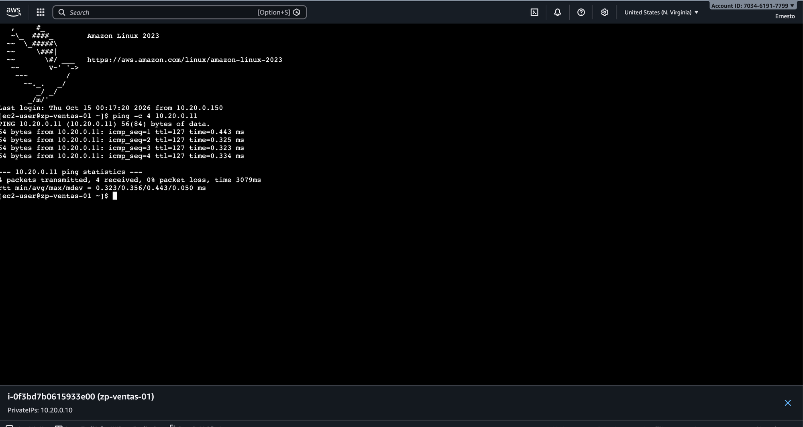
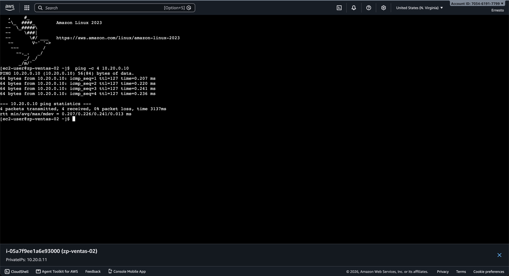
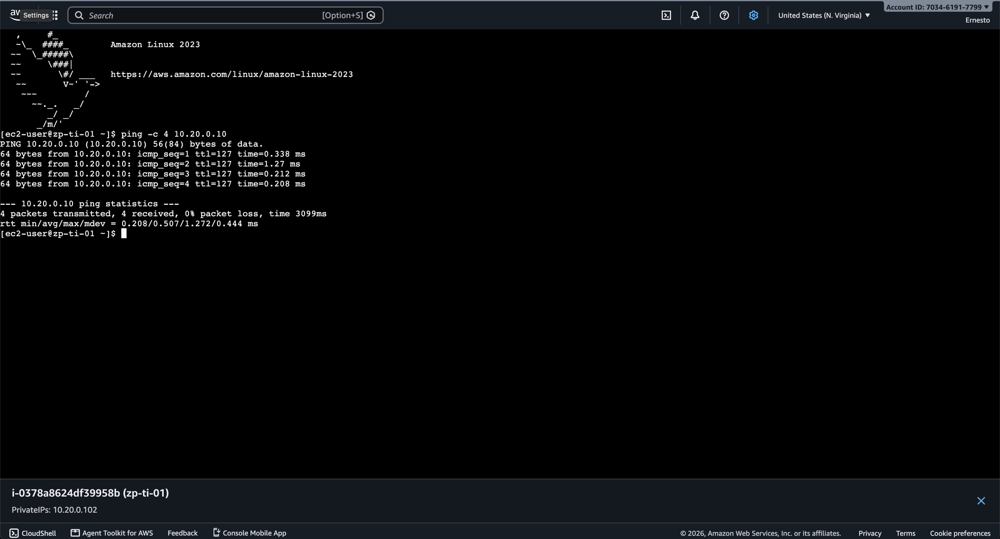
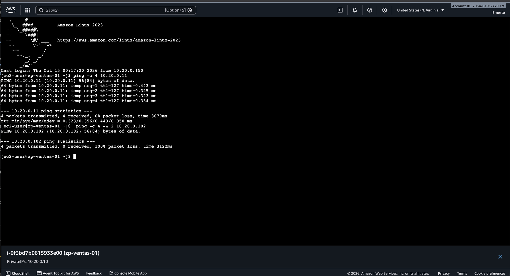

# Pruebas de conectividad

*Sección del reporte de Fase 2 · pruebas de conectividad y segmentación entre las instancias de prueba (MD_5).*

## 1. Objetivo

Demostrar con las instancias de `reporte/04_instancias_de_prueba.md` que:

- dos hosts de la misma subred (Ventas) se comunican entre sí;
- TI, como segmento de administración, alcanza a Ventas;
- Ventas **no** alcanza a TI, aunque la ruta local de la VPC une ambas subredes.

## 2. Por qué se espera ese resultado

Las tres subredes comparten la tabla `rt-zenite-interna` con la única ruta `10.20.0.0/24 -> local`, así que a nivel de capa 3
existe camino entre todas. La segmentación la aplican los Security Groups, que funcionan como firewall con estado en la
interfaz de cada instancia:

| Security Group | Entrada permitida | Salida |
|---|---|---|
| `zenite-ventas` (`sg-01f1eb855a2b85df7`) | ICMP desde `zenite-ventas` y `zenite-ti`; TCP/22 desde `zenite-eice` | Todo |
| `zenite-ti` (`sg-0e73e9942dd403016`) | ICMP desde `zenite-ti`; TCP/22 desde `zenite-eice` | Todo |
| `zenite-eice` (`sg-0697e7f5646e28ab4`) | Nada | TCP/22 hacia `10.20.0.0/24` |

- Ventas ↔ Ventas: `zenite-ventas` acepta ICMP de su propio grupo.
- TI → Ventas: `zenite-ventas` acepta ICMP desde `zenite-ti`; la respuesta regresa porque el Security Group tiene estado.
- Ventas → TI: `zenite-ti` no tiene ninguna regla de entrada desde `zenite-ventas`, así que el eco ICMP se descarta en la
  interfaz de `zp-ti-01` sin respuesta.

## 3. Resultados

Pruebas del 14 de octubre de 2026 entre las 18:32 y las 18:41 (hora de Guatemala), en terminales abiertas por EC2 Instance
Connect Endpoint:

| Evidencia | Origen | Destino | Comando | Resultado | Esperado |
|---|---|---|---|---|---|
| E09 | `zp-ventas-01` (`10.20.0.10`) | `zp-ventas-02` (`10.20.0.11`) | `ping -c 4 10.20.0.11` | 4/4, 0% pérdida | Permitido |
| E10 | `zp-ventas-02` (`10.20.0.11`) | `zp-ventas-01` (`10.20.0.10`) | `ping -c 4 10.20.0.10` | 4/4, 0% pérdida | Permitido |
| E11 | `zp-ti-01` (`10.20.0.102`) | `zp-ventas-01` (`10.20.0.10`) | `ping -c 4 10.20.0.10` | 4/4, 0% pérdida | Permitido |
| E12 | `zp-ventas-01` (`10.20.0.10`) | `zp-ti-01` (`10.20.0.102`) | `ping -c 4 -W 2 10.20.0.102` | 0/4, 100% pérdida | Bloqueado |

Pruebas complementarias (solo en texto): `zp-ti-01 -> 10.20.0.11` 4/4 y `zp-ventas-02 -> 10.20.0.102` 0/4, 100% pérdida.

El tiempo de ida y vuelta fue de 0.2 a 1.3 ms, propio de tráfico dentro de la misma Availability Zone.

*Figura E09. `zp-ventas-01` hace ping a `10.20.0.11`: 4 paquetes enviados, 4 recibidos.*

*Figura E10. `zp-ventas-02` hace ping a `10.20.0.10`: 4 paquetes enviados, 4 recibidos.*

*Figura E11. `zp-ti-01` hace ping a `10.20.0.10`: 4 paquetes enviados, 4 recibidos. TI puede administrar Ventas.*

*Figura E12. En `zp-ventas-01`, el ping a `10.20.0.11` responde y el ping a `10.20.0.102` (TI) pierde el 100% de los
paquetes: la segmentación bloquea Ventas -> TI.*

## 4. Conclusión

La conectividad dentro de Ventas y de TI hacia Ventas funciona, y el tráfico de Ventas hacia TI se bloquea. Esto reproduce en
AWS la política de Fase 1 (el segmento de administración alcanza a los usuarios, pero los usuarios no alcanzan al segmento
de administración) usando Security Groups en lugar de reglas de pfSense, sin cambiar las tablas de rutas.

## 5. Archivos de esta parte

| Archivo | Contenido |
|---|---|
| `evidencias/05_pruebas/E09_…png` – `E12_…png` | Capturas de las cuatro pruebas en la consola. |
| `evidencias/05_pruebas/E09_…txt` – `E12b_…txt` | Salida completa de cada prueba con hostname y hora (UTC), incluidas las dos complementarias. |
