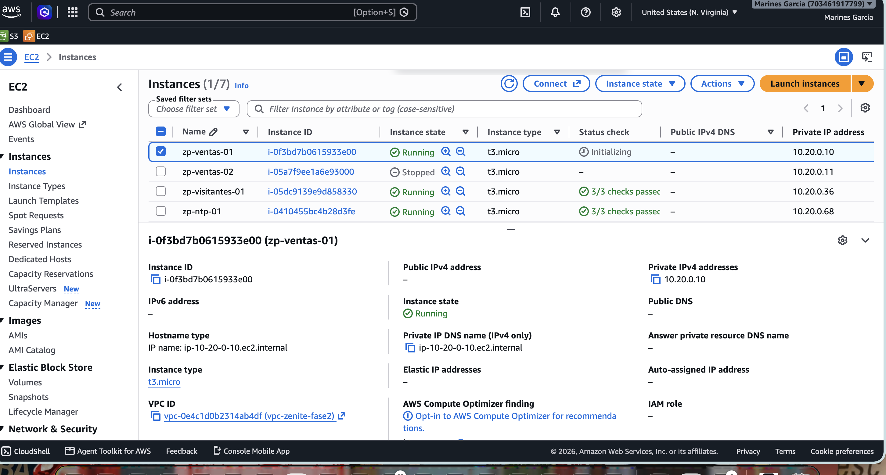
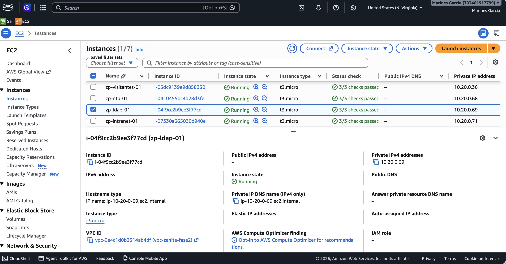
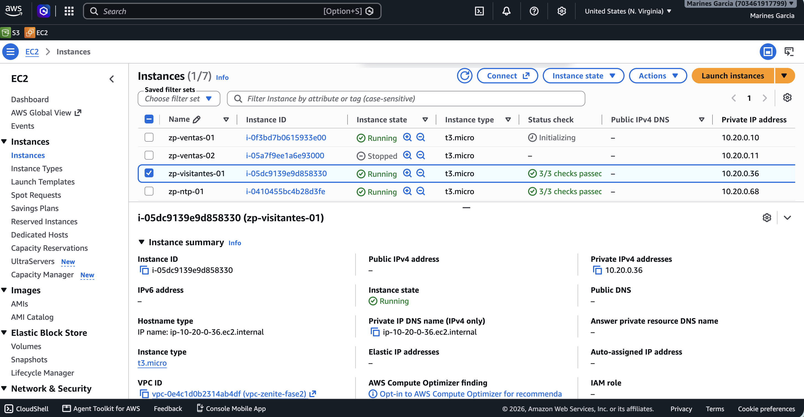
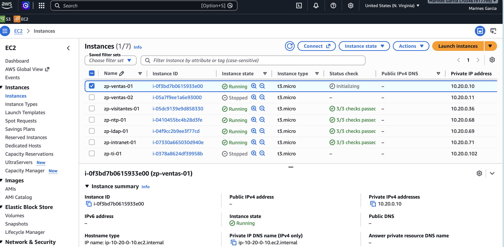

# Infraestructura de red en AWS: salida a Internet e instancias de servicios

*Sección del reporte de Fase 3 · Persona 1 · corresponde a la infraestructura que sostiene el resto de la fase: Internet Gateway, NAT Gateway,
rutas, Security Groups base e instancias de los servicios.*

## 1. Objetivo de esta parte

Dejar listo en AWS lo que necesitan los demás paquetes de Fase 3 (DHCP y NTP, LDAP, Intranet web, seguridad):

- **Salida a Internet con NAT** para las instancias privadas, que no tienen IPv4 pública. Es un requisito de la fase y, además, es lo que permite
  instalar paquetes (Chrony, OpenLDAP, Nginx).
- **Cuatro instancias nuevas** con las direcciones del plan de Fase 1, en las subredes que les corresponden.
- **Security Groups base** para esas subredes.
- **Control de costos**: la cuenta no tiene créditos activos (Billing → Credits, 21 de octubre de 2026), de modo que todo recurso encendido se cobra.

## 2. Recursos que se agregan a la VPC de Fase 2

| Recurso | Nombre | Detalle |
|---|---|---|
| Internet Gateway | `igw-zenite-fase3` | `igw-00f6efb87a444f270`, adjunto a `vpc-zenite-fase2`. Se conserva entre sesiones (no cobra). |
| Elastic IP | `eip-nat-zenite-fase3` | IPv4 pública del NAT. Se reserva y se libera en cada sesión. |
| NAT Gateway | `nat-zenite-fase3` | En `subnet-zenite-infra`, IP privada `10.20.0.148`. Se crea y se elimina en cada sesión. |
| Ruta | `rt-zenite-infra` | `0.0.0.0/0 → igw-zenite-fase3` (permanente; el NAT necesita estar en una subred con salida al IGW). |
| Ruta | `rt-zenite-interna` | `0.0.0.0/0 → nat-zenite-fase3` (solo mientras el NAT existe). Aplica a Ventas, Visitantes, Servidores, TI y VPN. |
| `rt-zenite-dmz` | – | Sin cambios: solo la ruta local. La DMZ y la publicación del sitio corresponden a una fase posterior. |
| Security Group | `zenite-servidores` | `sg-0bd52634dd2e6bb61`. Entrada: solo TCP/22 desde `zenite-eice`. |
| Security Group | `zenite-visitantes` | `sg-017872344baac8a39`. Entrada: solo TCP/22 desde `zenite-eice`. |

| Instancia | Instance ID | IP privada | Subred | Security Group | Sistema |
|---|---|---|---|---|---|
| `zp-ntp-01` | `i-0410455bc4b28d3fe` | `10.20.0.68` | Servidores | `zenite-servidores` | Amazon Linux 2023 |
| `zp-ldap-01` | `i-04f9cc2b9ee3f77cd` | `10.20.0.69` | Servidores | `zenite-servidores` | Ubuntu 24.04 LTS |
| `zp-intranet-01` | `i-07330a665030d940e` | `10.20.0.71` | Servidores | `zenite-servidores` | Amazon Linux 2023 |
| `zp-visitantes-01` | `i-05dc9139e9d858330` | `10.20.0.36` | Visitantes | `zenite-visitantes` | Amazon Linux 2023 |

Las IP están dentro de los rangos asignables de cada subred (Servidores `.68 – .94`, Visitantes `.36 – .62`). Todas las instancias, `t3.micro`, usan la AMI más
reciente publicada al momento de crearlas (Amazon Linux 2023 `ami-0856027a77429315a`, versión 2023.12.20261016; Ubuntu `ami-02a9cdd4e98bc3c78`, 20261017).

## 3. Decisiones

| Decisión | Justificación |
|---|---|
| NAT Gateway de AWS en lugar de pfSense | Decisión del equipo para Fase 3: es el servicio administrado de AWS para la función de NAT y reduce el riesgo de la demostración. pfSense queda para la fase final. |
| NAT en `subnet-zenite-infra` con IP `10.20.0.148` | Es la subred de infraestructura del diseño. Fase 1 asignaba `.150` al NAT, pero esa dirección ya la usa el EC2 Instance Connect Endpoint (Fase 2); `.148` quedó libre porque pfSense no se despliega. |
| NAT creado y destruido en cada sesión de trabajo | Cobra por hora (≈ US$0.045 por hora, más ≈ US$0.005 por hora de su IPv4 pública) aunque no tenga tráfico y la cuenta no tiene créditos. Como no se sabe cuándo trabajará cada integrante, se enciende solo cuando alguien lo necesita. |
| Internet Gateway permanente | No genera cargo y su ruta en `rt-zenite-infra` solo sirve de salida para el NAT; ninguna instancia tiene IPv4 pública, así que no expone nada. |
| Ruta por defecto de `rt-zenite-interna` hacia el NAT | Todas las subredes privadas comparten esa tabla; la restricción de qué subred puede salir y a dónde queda a cargo de los Security Groups y las ACL (paquete de seguridad). |
| Ubuntu 24.04 para `zp-ldap-01` | El Lab 5 de LDAP se hizo en Ubuntu y `slapd` está disponible en sus repositorios; no se pudo confirmar el paquete del servidor en Amazon Linux 2023. El resto, en Amazon Linux 2023 como Fase 2. En Ubuntu el usuario de conexión es `ubuntu`. |
| Instancias sin IPv4 pública ni llave SSH | Igual que en Fase 2: acceso solo por EC2 Instance Connect Endpoint; IMDSv2 obligatorio y créditos de CPU en modo `standard`. |
| Security Groups nuevos solo con SSH desde `zenite-eice` | Es la base mínima; las reglas de cada servicio las agrega el paquete de seguridad, con aprobación. Los scripts no modifican las reglas de un Security Group que ya existe. |

## 4. Implementación

Todo se hizo con scripts de AWS CLI ejecutados en AWS CloudShell (`us-east-1`), sin guardar credenciales. Los tres siguen el estilo de Fase 2: comprobaciones
previas sin cambios, idempotencia, búsqueda de recursos por nombre, confirmación (`si`) antes de crear o destruir, modo de solo validación y registro en
`~/fase3-config/`.

- `P1_estado_inicial.sh` (solo lectura): informe de la VPC, subredes, rutas, Security Groups, ACL, instancias y EICE; barrido de recursos con costo en todas las
  regiones; AMI candidatas y comprobación de permisos con `--dry-run`.
- `P1_gateways.sh`: `crear`, `destruir`, `--validar` y `--validar-apagado`.
  - `crear` comprueba que la IP del NAT sea asignable (AWS reserva las cuatro primeras y la última de la subred) y no esté ocupada, que no haya otro Internet Gateway
    adjunto ni rutas por defecto ajenas; luego crea el IGW, reserva la Elastic IP, crea el NAT, espera a que esté `available` y agrega las dos rutas.
  - `destruir` quita primero la ruta del NAT, elimina el NAT, espera a que quede `deleted` y **solo entonces** libera la Elastic IP.
  - El NAT y la Elastic IP llevan las etiquetas `Creador` e `Inicio`; `destruir` muestra quién lo creó y hace cuánto, y `--validar` avisa si lleva 8 horas o más encendido.
    Cada encendido y apagado queda en `gateways-sesiones.log`.
- `P1_instancias.sh`: `crear`, `encender`, `detener` y `--validar`. Crea los Security Groups y las instancias con IP fija, etiquetas
  (`Project`, `Phase=Fase3`, `Environment`, `Owner`, `Role`) y user data que fija el hostname y lo conserva tras detener y encender.

Los scripts se probaron antes contra un AWS simulado local (creación, reejecución sin duplicados, destrucción, conflictos de IP y de rutas); esa prueba encontró un
fallo en la comprobación previa de `P1_instancias.sh` (marcaba como ocupada una IP libre), que se corrigió antes de la ejecución real. La ejecución real en AWS no
requirió cambios.

**Sesión del 21 de octubre de 2026** (hora UTC; Guatemala es UTC−6):

| Hora | Acción |
|---|---|
| 21:59 | `P1_gateways.sh crear`: IGW, Elastic IP (`3.95.121.55`), NAT `nat-02a62a4b46102f109` y rutas. Validación en `[OK]`. |
| 22:06 | `P1_instancias.sh crear`: dos Security Groups y cuatro instancias. Validación en `[OK]` (running 2/2, subred, IP, sin IPv4 pública, IMDSv2, etiquetas). |
| 22:23 – 22:25 | Pruebas de Internet desde las instancias (sección 5). |
| 22:27 | `P1_gateways.sh --validar`: estado encendido guardado (`*_encendido.json`). |
| 22:31 | `P1_instancias.sh detener` y `P1_gateways.sh destruir`; `--validar-apagado` en `[OK]` (NAT 0, Elastic IP 0). |

## 5. Pruebas y evidencia

Las pruebas se hicieron **dentro de las instancias**, conectadas por EC2 Instance Connect Endpoint. La IP de salida que informa `checkip.amazonaws.com` debe ser la
Elastic IP del NAT (`3.95.121.55`, ver `nat-gateways_encendido.json`).

| ID | Servicio | Origen → destino | Esperado | Obtenido | Hora (UTC) | Estado | Fig. |
|---|---|---|---|---|---|---|---|
| INF-01 | NAT | `zp-ventas-01` → `https://aws.amazon.com` | Responde por el NAT Gateway | `HTTP/2 200`; salida por `3.95.121.55` | 22:24:19 | PASS | INF-01 |
| INF-02 | NAT | `zp-ldap-01` → repositorios de Ubuntu | Instalación de paquetes posible | `apt-get update`: descargó 33.6 MB en 5 s | 22:25:07 | PASS | INF-02 |
| INF-03 | NAT | `zp-visitantes-01` → `https://aws.amazon.com` | Responde | `HTTP/2 200`; salida por `3.95.121.55` | 22:23:02 | PASS | INF-03 |
| INF-04 | IP pública | Las siete instancias `zp-*` | Sin IPv4 pública | Ninguna tiene IPv4 pública (consola y validación automática) | ≈ 22:06 (validación) | PASS | INF-04 |

*Figura INF-01. Terminal de `zp-ventas-01` (prompt `[ec2-user@zp-ventas-01 ~]$`): `HTTP/2 200` de `aws.amazon.com` y salida por `3.95.121.55`.*

*Figura INF-02. Terminal de `zp-ldap-01` (`ubuntu@zp-ldap-01`): `apt-get update` descarga 33.6 MB de los repositorios de Ubuntu.*

*Figura INF-03. Terminal de `zp-visitantes-01`: `HTTP/2 200` y la misma IP de salida, `3.95.121.55`. Que dos subredes distintas salgan por la misma IP indica que usan el mismo NAT.*

*Figura INF-04. EC2 → Instances en `us-east-1`: las siete instancias `zp-*` con sus IP privadas y sin IPv4 pública.*

### Fallos y correcciones

| Prueba | Error encontrado | Acción correctiva | Repetición |
|---|---|---|---|
| INF-01 (1) | El comando se corrió en el propio AWS CloudShell (prompt `~ $`, host `ip-10-139-181-189`, salida por `44.200.21.53`) y no en una instancia, así que no probaba el NAT de la VPC. Además, `hostname` no existe en Amazon Linux 2023. | Descartar esa salida; repetir dentro de la instancia por EICE y usar `uname -n` en lugar de `hostname`. | INF-01 (2): PASS |
| INF-03 (1) | El mismo error que INF-01 (1). | Igual. | INF-03 (2): PASS |

## 6. Control de costos

| Concepto | Resultado |
|---|---|
| Duración del NAT Gateway | 32 min 18 s (21:59:20 – 22:31:38 UTC), según `gateways-sesiones.log`. |
| NAT e IPv4 pública | ≈ US$0.05 (se factura por hora o fracción: una hora). |
| Datos procesados por el NAT | Despreciable (≈ 34 MB; ≈ US$0.002). |
| Instancias | Cinco `t3.micro` encendidas entre 16 y 32 minutos (≈ 2.5 horas-instancia ≈ US$0.03). |
| Discos nuevos | 4 discos gp3 de tamaño por defecto de la AMI (≈ 8 GiB): ≈ US$0.64 al mes cada uno, aunque la instancia esté apagada. |
| **Estimado de la sesión** | **≈ US$0.10 + discos.** Por confirmar en Billing, que tarda hasta 24 horas en reflejar el consumo. |

Los precios unitarios son los de la estimación de costos de Fase 1 (NAT Gateway ≈ US$0.045/h, IPv4 pública ≈ US$0.005/h, `t3.micro` ≈ US$0.0104/h, EBS gp3 ≈ US$0.08/GiB-mes).
Al cerrar la sesión se comprobó con `--validar-apagado` que no quedó NAT ni Elastic IP, y que las siete instancias estaban detenidas. Una observación de Fase 3: antes de esta
sesión las tres instancias de Fase 2 estaban encendidas desde hacía días y explicaban casi todo el gasto de octubre (US$4.22 al 21 de octubre); se detuvieron.

## 7. Limitaciones y observaciones

- El NAT Gateway es zonal y está en una sola zona de disponibilidad (`us-east-1a`), igual que el resto del prototipo; no hay alta disponibilidad.
- La IPv4 pública del NAT cambia en cada sesión, porque la Elastic IP se libera al destruirlo. No debe usarse como dato fijo.
- Con el NAT encendido, **todas** las subredes que comparten `rt-zenite-interna` tienen ruta a Internet; la restricción (por ejemplo, que Visitantes solo salga a Internet y no
  hacia otras subredes) la aplican los Security Groups y las ACL de la fase de seguridad.
- Los scripts de validación de Fase 2 (`02_crear_subredes_rutas.sh --validar` y `04_crear_instancias.sh --validar`) exigen cero Internet Gateway, NAT y rutas distintas de la
  local, por lo que marcarán `[FALLA]` mientras existan los gateways de Fase 3. Es esperado y no es un error de la infraestructura.
- Los Security Groups `zenite-servidores` y `zenite-visitantes` solo permiten SSH desde el EICE; los servicios de P2, P3 y P4 aún no son accesibles entre instancias hasta que se
  agreguen las reglas.

## 8. Documentación consultada

- AWS, *NAT gateways*: https://docs.aws.amazon.com/vpc/latest/userguide/vpc-nat-gateway.html
- AWS, *Internet gateways*: https://docs.aws.amazon.com/vpc/latest/userguide/VPC_Internet_Gateway.html
- AWS, *Route tables*: https://docs.aws.amazon.com/vpc/latest/userguide/VPC_Route_Tables.html
- AWS, *Connect using EC2 Instance Connect Endpoint*: https://docs.aws.amazon.com/AWSEC2/latest/UserGuide/connect-using-eice.html
- AWS CLI, `create-nat-gateway`: https://docs.aws.amazon.com/cli/latest/reference/ec2/create-nat-gateway.html
- AWS, *Amazon VPC pricing* (NAT Gateway e IPv4 pública): https://aws.amazon.com/vpc/pricing/

*Las direcciones son de la documentación oficial de AWS; conviene comprobar que sigan vigentes antes de entregar el reporte.*

## 9. Archivos y evidencias de esta parte

| Archivo | Contenido |
|---|---|
| `Fase3/configuracion/P1_estado_inicial.sh` | Informe de solo lectura del estado de AWS. |
| `Fase3/configuracion/P1_gateways.sh` | IGW, Elastic IP, NAT y rutas (`crear`, `destruir`, validaciones). |
| `Fase3/configuracion/P1_instancias.sh` | Security Groups, instancias, encender y detener. |
| `Fase3/configuracion/P1_sesiones.md` | Guía para el equipo: cómo encender y apagar el NAT y las instancias. |
| `Fase3/configuracion/gateways-validacion_encendido.txt` y `_apagado.txt` | Validaciones con el NAT encendido y apagado. |
| `Fase3/configuracion/instancias-fase3-validacion.txt` | Validación de las cuatro instancias nuevas. |
| `Fase3/configuracion/gateways-sesiones.log` | Registro de encendido y apagado del NAT. |
| `Fase3/configuracion/nat-gateways_encendido.json`, `addresses_encendido.json`, `route-tables_encendido.json`, `internet-gateways.json` | Exportaciones de AWS con el NAT encendido. |
| `Fase3/evidencias/01_infra/FASE3_INF-01` a `INF-04` | Capturas de las pruebas. |
