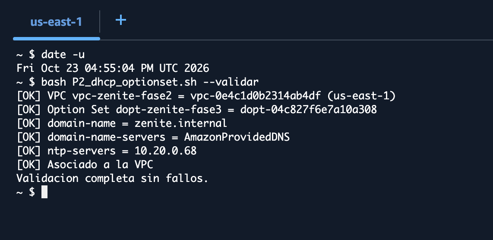
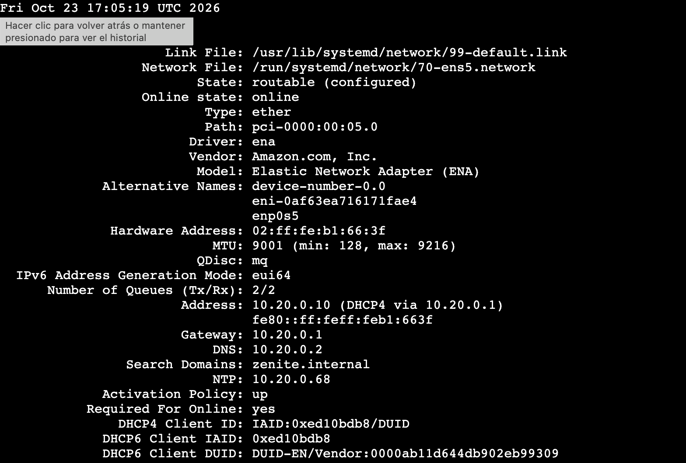
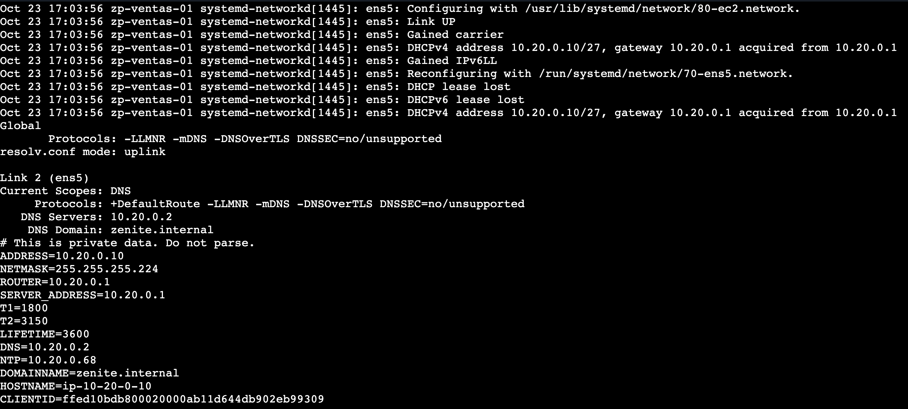
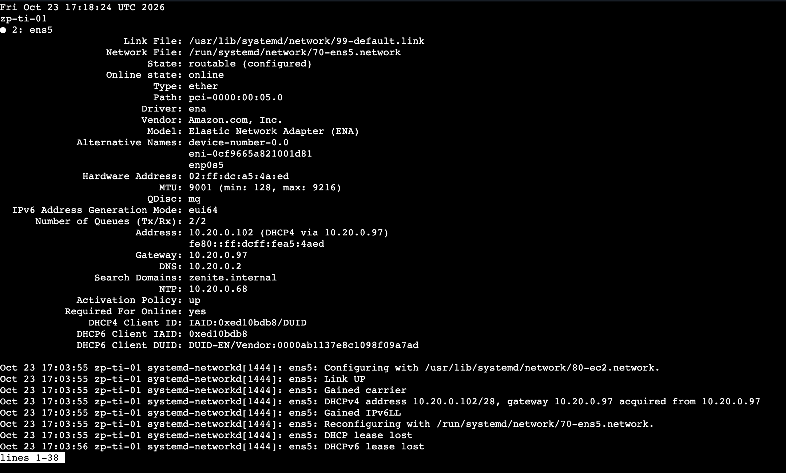
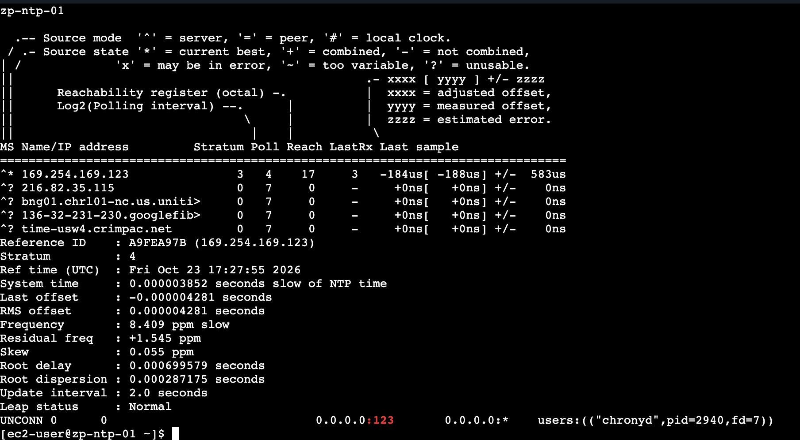
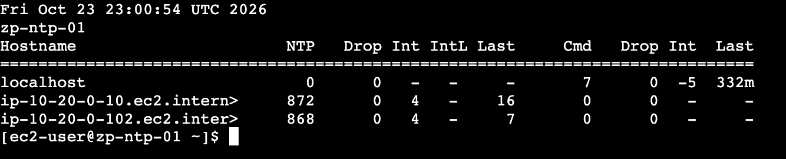
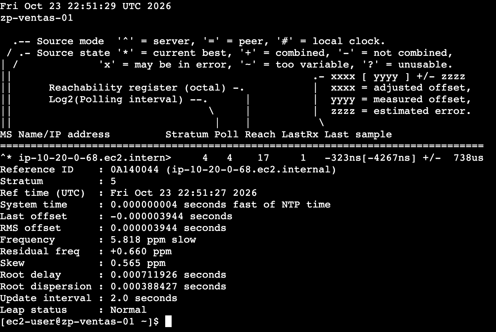
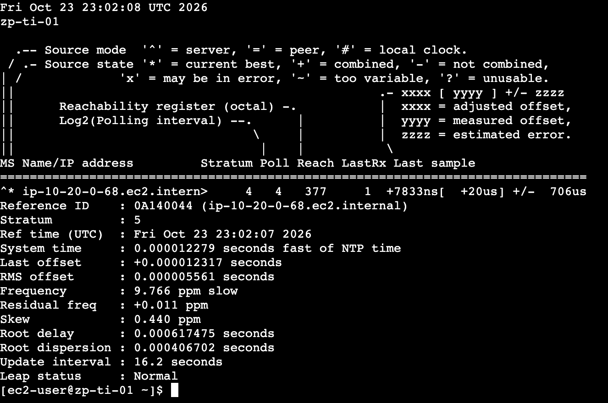
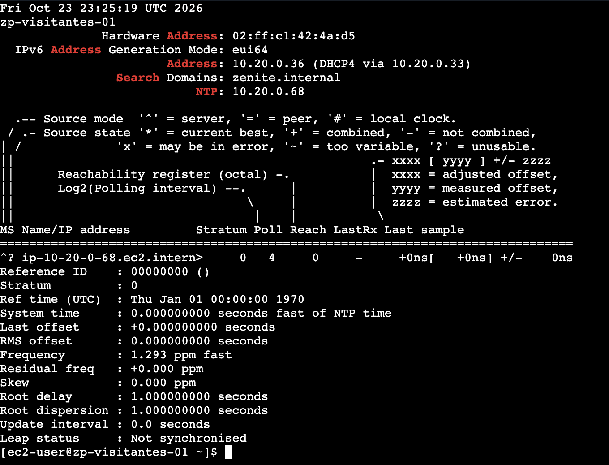

# DHCP y NTP: configuración de red y sincronización de hora

*Sección del reporte de Fase 3 · Persona 2 · servicios de administración de la red: entrega automática de configuración (DHCP) y hora común para todas las instancias (NTP).*

## 1. Objetivo de esta parte

- **DHCP:** que las instancias reciban su configuración de red de forma automática, incluidos el dominio, el servidor DNS y el servidor NTP.
- **NTP:** que todas las instancias mantengan la hora sincronizada con un servidor NTP interno (`10.20.0.68`), que a su vez se sincroniza con una fuente externa.

## 2. Recursos y servicios

| Elemento | Detalle |
|---|---|
| DHCP Option Set | `dopt-zenite-fase3` (`dopt-04c827f6e7a10a308`), asociado a `vpc-zenite-fase2` (`vpc-0e4c1d0b2314ab4df`). Reemplaza al conjunto anterior, `dopt-03c11a8248e4b171a` (dominio `ec2.internal`, sin servidor NTP). |
| Opciones del Option Set | `domain-name = zenite.internal` · `domain-name-servers = AmazonProvidedDNS` · `ntp-servers = 10.20.0.68` |
| Servidor NTP | `zp-ntp-01` · `10.20.0.68` · subred Servidores · Amazon Linux 2023 · Chrony |
| Clientes probados | `zp-ventas-01` (`10.20.0.10`, subred Ventas) y `zp-ti-01` (`10.20.0.102`, subred TI) |
| Regla de red necesaria | UDP 123 de entrada en `zenite-servidores` desde `zenite-ventas`, `zenite-ti` y `zenite-servidores` (la aplicó la Persona 5) |

## 3. Decisiones

| Decisión | Justificación |
|---|---|
| DHCP de Amazon VPC con un Option Set propio | En una VPC de AWS no se puede ejecutar un servidor DHCP propio; el servicio DHCP lo presta la VPC y se personaliza con un Option Set. |
| Dominio `zenite.internal` | `.internal` es un sufijo reservado para redes privadas; se evita `.local`, que en Linux se usa para mDNS. Se acordó con la Persona 3 para que coincida con el dominio de LDAP. |
| `AmazonProvidedDNS` como DNS | El DNS interno propio (BIND9) no se despliega en Fase 3. El dominio funciona solo como sufijo de búsqueda; no se crearon registros DNS. |
| Fuentes del servidor NTP: Amazon Time Sync y un pool de Internet | Amazon Time Sync (`169.254.169.123`) es accesible desde la VPC sin NAT. El pool demuestra una fuente externa, pero requiere el NAT Gateway, que solo se enciende cuando se necesita (costo por hora). |
| Los clientes no se configuran manualmente | Chrony en Amazon Linux 2023 ya consume los servidores NTP entregados por DHCP (ver sección 4). |
| El servidor NTP usa su propia configuración de Chrony | El DHCP también le entrega a `zp-ntp-01` su propia IP como NTP; se omite `sourcedir /run/chrony.d` en su configuración para que no intente sincronizarse consigo mismo. |

## 4. Implementación

### DHCP
1. Script `P2_dhcp_optionset.sh` (AWS CloudShell, `us-east-1`), con el mismo estilo que los de Fase 2 y Persona 1: modo `--validar` de solo lectura, búsqueda de la VPC por nombre, confirmación (`si`) antes de cambiar AWS y registro en `~/fase3-config/`.
2. `crear` registra el Option Set anterior en `dhcp-optionset-anterior.txt` (para poder revertir), crea `dopt-zenite-fase3` con las tres opciones y las etiquetas del proyecto, lo asocia a la VPC y exporta su configuración a `dhcp-options.json`.
3. Un Option Set no se puede editar una vez creado; si hubiera un error, se crea otro y se reasocia.
4. El cambio afecta a **toda** la VPC: cada instancia lo toma al arrancar o al renovar su lease. El lease dura 3600 s y se renueva a los 1800 s.

### NTP
1. `zp-ntp-01` usa `chrony-servidor.conf` en lugar de `/etc/chrony.conf` (se conservó la original como `/etc/chrony.conf.orig`): fuente principal Amazon Time Sync, pool de Internet como segunda fuente y `allow 10.20.0.0/24` como única red autorizada a consultarlo.
2. En los clientes **no se cambió ninguna configuración**: la configuración por defecto de Amazon Linux 2023 incluye `sourcedir /run/chrony.d` bajo el comentario «Use NTP servers from DHCP», por lo que Chrony adoptó `10.20.0.68` automáticamente.

## 5. Pruebas y evidencia

Las pruebas de instancia se hicieron **dentro de cada instancia**, conectadas por EC2 Instance Connect Endpoint; DHCP-01 se hizo en CloudShell y en la consola de AWS (región N. Virginia). Las horas son UTC (Guatemala es UTC−6).

| ID | Servicio | Origen → destino | Esperado | Obtenido | Hora (UTC) | Estado | Fig. |
|---|---|---|---|---|---|---|---|
| DHCP-01 | DHCP | Option Set asociado a la VPC | Dominio, DNS y NTP `10.20.0.68` configurados | Consola: `dopt-zenite-fase3` con `zenite.internal`, `AmazonProvidedDNS` y `10.20.0.68`. Script `--validar`: `[OK]` en cada comprobación y asociado a la VPC | 16:55:04 (validación) | PASS | DHCP-01 |
| DHCP-02 | DHCP | `zp-ventas-01` | Recibe las opciones del Option Set | `networkctl`: `NTP 10.20.0.68`, `Search Domains zenite.internal`, `DNS 10.20.0.2`. Lease: `NTP=10.20.0.68`, `DOMAINNAME=zenite.internal` | 17:05:19 | PASS | DHCP-02 |
| DHCP-03 | DHCP | `zp-ti-01` | Recibe las opciones del Option Set | `networkctl` en `10.20.0.102`: `NTP 10.20.0.68`, `Search Domains zenite.internal`, `DNS 10.20.0.2` | 17:18:24 | PASS | DHCP-03 |
| NTP-01 | NTP | `zp-ntp-01` | `chronyc sources` con fuente válida; sirve a `10.20.0.0/24` | `^*` en `169.254.169.123` (stratum 3, Reach 17); `tracking`: stratum 4, `Leap status Normal`; chronyd escucha en UDP 123. `chronyc clients`: atiende a `10.20.0.10` y `10.20.0.102`. Las cuatro fuentes del pool quedaron sin alcanzar (NAT apagado) | ≈ 17:28 y 23:00:54 | PASS | NTP-01 |
| NTP-02 | NTP | `zp-ventas-01` → `10.20.0.68` | `chronyc tracking` sincronizado con el servidor | `^*` en `10.20.0.68` (Reach 17); Reference ID `0A140044`, stratum 5, `Leap status Normal`, offset 3.9 µs | 22:51:29 | PASS | NTP-02 |
| NTP-03 | NTP | `zp-ti-01` → `10.20.0.68` | Sincronizado con el servidor | `^*` en `10.20.0.68` (Reach 377); Reference ID `0A140044`, stratum 5, `Leap status Normal`, offset 2.5 µs | 23:00:00 | PASS | NTP-03 |

*Figura DHCP-01 (a). Consola de AWS, región N. Virginia: `dopt-zenite-fase3` con las tres opciones, junto al Option Set anterior.*

*Figura DHCP-01 (b). CloudShell: `P2_dhcp_optionset.sh --validar` con todas las comprobaciones en `[OK]`.*

*Figura DHCP-02 (a). `networkctl status ens5` en `zp-ventas-01`: DNS, dominio de búsqueda y NTP recibidos por DHCP.*

*Figura DHCP-02 (b). Archivo de lease de `systemd-networkd`: `NTP=10.20.0.68` y `DOMAINNAME=zenite.internal`.*

*Figura DHCP-03. `networkctl status ens5` en `zp-ti-01` (subred TI): las mismas opciones que en Ventas.*

*Figura NTP-01 (a). `zp-ntp-01`: `^*` en Amazon Time Sync, pool sin alcanzar, `tracking` normal y chronyd escuchando en UDP 123.*

*Figura NTP-01 (b). `chronyc clients` en `zp-ntp-01`: atiende a `10.20.0.10` y `10.20.0.102`.*

*Figura NTP-02. `zp-ventas-01`: `^*` en `10.20.0.68`, stratum 5, `Leap status Normal`.*

*Figura NTP-03. `zp-ti-01`: `^*` en `10.20.0.68` (Reach 377), stratum 5, `Leap status Normal`.*

### Observaciones de comportamiento (fuera de la matriz)

| Instancia | Qué se observó | Hora (UTC) | Fig. |
|---|---|---|---|
| `zp-visitantes-01` (`10.20.0.36`, subred Visitantes) | Recibe por DHCP `NTP 10.20.0.68` y `Search Domains zenite.internal`, pero `chronyc sources` muestra `10.20.0.68` como `^?` con Reach 0 y `tracking` indica `Leap status Not synchronised` (stratum 0). Es consecuencia esperada del aislamiento: `zenite-servidores` no permite UDP 123 desde Visitantes. | 23:25:19 | NTP-OBS |
| `zp-ldap-01` (`10.20.0.69`, Ubuntu 24.04) | Recibe por DHCP `NTP 10.20.0.68` y `Search Domains zenite.internal`, pero se sincroniza con Amazon Time Sync (`^*` en `169.254.169.123`, stratum 3); `10.20.0.68` no aparece entre sus fuentes. No se modificó su configuración (instancia de la Persona 3). | por completar | – |

*Figura NTP-OBS. `zp-visitantes-01`: la fuente `10.20.0.68` no responde (`^?`, Reach 0) y el reloj figura como no sincronizado.*

### Fallos y correcciones

| Prueba | Error encontrado | Acción correctiva | Repetición |
|---|---|---|---|
| – | Ninguna prueba falló: las seis se aprobaron a la primera. | – | – |

## 6. Limitaciones y observaciones

- **Dependencia de un solo servidor de hora.** Desde que se asoció el Option Set, todas las instancias de la VPC usan `10.20.0.68` como única fuente; si `zp-ntp-01` está apagada, no sincronizan. Para la fase final se recomienda agregar Amazon Time Sync como respaldo (un archivo `.sources` en `/etc/chrony.d/`). No se implementó en esta fase.
- **Pool de Internet no verificado.** Con el NAT Gateway apagado, las cuatro fuentes del pool aparecen como inalcanzables (`^?`, Reach 0); la sincronización del servidor se hizo con Amazon Time Sync.
- **El dominio `zenite.internal` es solo un sufijo.** No existe un servidor DNS que resuelva nombres de ese dominio; el DNS interno corresponde a una fase posterior.
- **Efecto sobre toda la VPC.** El nuevo Option Set se aplica a las instancias de los demás paquetes al arrancar o al renovar su lease.
- El servicio NTP depende de la regla UDP 123 en `zenite-servidores`; sin ella los clientes aparecen con `Reach 0`.
- **Visitantes no sincroniza su hora.** Recibe el servidor NTP `10.20.0.68` por DHCP, pero no tiene permiso para llegar a él (aislamiento de la subred); su única fuente configurada queda inalcanzable. Una opción para la fase final es darle a esa subred un respaldo con Amazon Time Sync, sin abrirle acceso a la red interna (que este tráfico no lo filtren los Security Groups es lo que indica la documentación de AWS; por verificar).
- **Ubuntu 24.04 (`zp-ldap-01`) no adopta el NTP del DHCP.** La instancia recibe la opción, pero su Chrony se sincroniza con Amazon Time Sync. Amazon Linux 2023 sí la adopta (`sourcedir /run/chrony.d`). Si se quiere que use el servidor interno, hay que configurarlo explícitamente en esa instancia (la administra la Persona 3).
- Solo se verificaron los clientes `zp-ventas-01` y `zp-ti-01` (más las observaciones anteriores); `zp-ventas-02` y `zp-intranet-01` no se incluyeron en las pruebas.
- Errores sin consecuencia durante el trabajo (no son fallos de prueba): un comando de CloudShell escrito sin `bash P2_dhcp_optionset.sh` delante, y un comando `aws` ejecutado dentro de una instancia (sin credenciales, por diseño); ambos se repitieron en el lugar correcto.

## 7. Documentación consultada

- AWS, *DHCP option sets*: https://docs.aws.amazon.com/vpc/latest/userguide/VPC_DHCP_Options.html
- AWS CLI, `create-dhcp-options`: https://docs.aws.amazon.com/cli/latest/reference/ec2/create-dhcp-options.html
- AWS CLI, `associate-dhcp-options`: https://docs.aws.amazon.com/cli/latest/reference/ec2/associate-dhcp-options.html
- AWS, *Set the time for your Linux instance* (Amazon Time Sync): https://docs.aws.amazon.com/AWSEC2/latest/UserGuide/set-time.html
- Chrony, documentación y manual de `chrony.conf`: https://chrony-project.org/documentation.html

*Las direcciones deben comprobarse antes de entregar el reporte (no se verificó su vigencia).*

## 8. Archivos y evidencias de esta parte

| Archivo | Contenido |
|---|---|
| `Fase3/configuracion/P2_dhcp_optionset.sh` | Crea y asocia el Option Set (`crear`, `--validar`). |
| `Fase3/configuracion/dhcp-options.json` | Exportación del Option Set creado. |
| `Fase3/configuracion/chrony/chrony-servidor.conf` | Configuración de Chrony de `zp-ntp-01`. |
| `Fase3/evidencias/02_dhcp_ntp/FASE3_DHCP-01` a `NTP-03`, `FASE3_NTP-OBS_...` | Capturas de las pruebas y de la observación de Visitantes. |
| `Fase3/bitacora/P2.md` | Bitácora de la Persona 2. |
