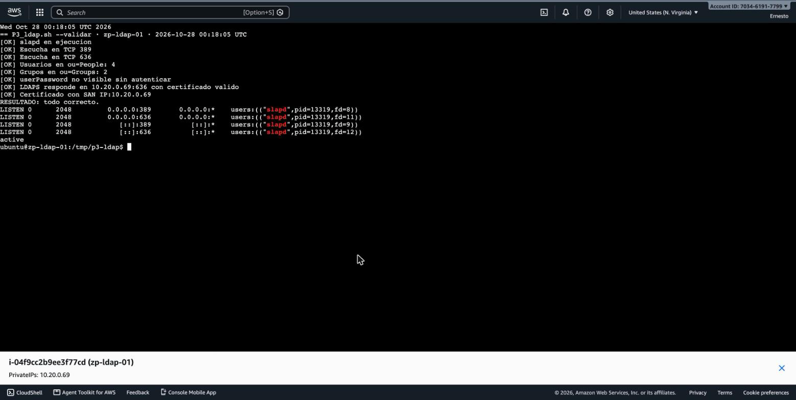
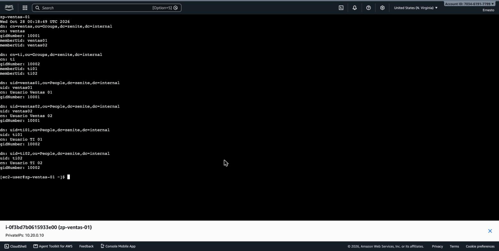
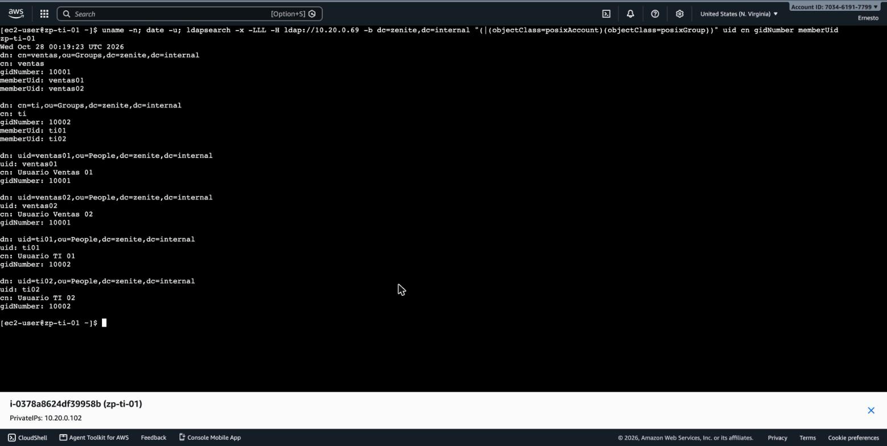
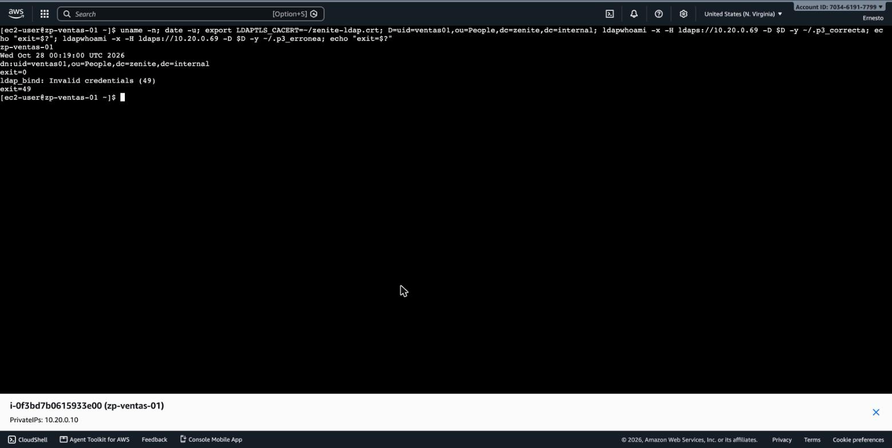
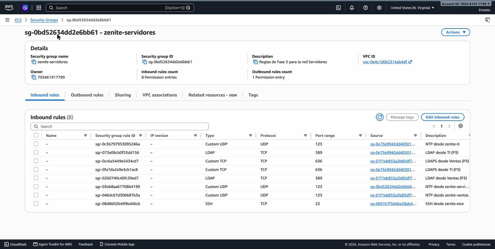

# LDAP: directorio de usuarios y grupos con OpenLDAP

*Sección del reporte de Fase 3 · Persona 3 · servicio de directorio de la red: usuarios y grupos de la empresa, consultables con autenticación desde Ventas y TI.*

## 1. Objetivo de esta parte

- Instalar un servidor **OpenLDAP** (`slapd`) en `zp-ldap-01` con el dominio de la red (`zenite.internal`), los grupos **Ventas** y **TI** y usuarios de prueba.
- Que el directorio se pueda consultar y que los usuarios se autentiquen (`bind`) desde **Ventas** y **TI**, con la contraseña cifrada en tránsito (**LDAPS**, como pedía Fase 1).
- Que **Visitantes** no llegue al servicio.

## 2. Recursos y servicios

| Elemento | Detalle |
|---|---|
| Servidor | `zp-ldap-01` · `i-04f9cc2b9ee3f77cd` · `10.20.0.69` · subred Servidores · Ubuntu 24.04.5 LTS · `slapd` y `ldap-utils` de los repositorios de Ubuntu |
| Base DN | `dc=zenite,dc=internal` (mismo dominio que el DHCP Option Set de la Persona 2) · administrador `cn=admin,dc=zenite,dc=internal` |
| Árbol | `ou=People` (4 usuarios) y `ou=Groups` (2 grupos) |
| Grupos | `cn=ventas` (`posixGroup`, gid 10001, miembros `ventas01` y `ventas02`) · `cn=ti` (gid 10002, miembros `ti01` y `ti02`) |
| Usuarios | `ventas01`, `ventas02`, `ti01`, `ti02` (`inetOrgPerson` + `posixAccount`, uid 10101 – 10202). Ficticios, solo de laboratorio |
| Puertos | TCP 389 (`ldap://`) y TCP 636 (`ldaps://`) |
| Certificado | Autofirmado, RSA 2048, SHA-256, `CN=zp-ldap-01.zenite.internal`, SAN `IP:10.20.0.69` y `DNS:zp-ldap-01.zenite.internal`, válido hasta el 28 de octubre de 2027 |
| Clientes | `zp-ventas-01` (`10.20.0.10`), `zp-ti-01` (`10.20.0.102`) y `zp-visitantes-01` (`10.20.0.36`), con `openldap-clients` 2.4.57 (Amazon Linux 2023) y el certificado en `~/zenite-ldap.crt` |
| Reglas de red | En `zenite-servidores`: TCP 389 y 636 de entrada **solo** desde `zenite-ventas` y `zenite-ti` (sección 4) |

## 3. Decisiones

| Decisión | Justificación |
|---|---|
| Ubuntu 24.04 para `zp-ldap-01` | Decisión de la Persona 1 al crear la instancia: `slapd` está en los repositorios de Ubuntu y así se hizo el Lab 5. |
| Base `dc=zenite,dc=internal` | Coincide con el `domain-name` del DHCP Option Set (`zenite.internal`), acordado con la Persona 2. |
| LDAPS (636) además de 389 | Fase 1 definió LDAPS 636 hacia el LDAP. Los `bind` con contraseña de las pruebas van por LDAPS; 389 queda para consultas anónimas (sin contraseñas). |
| Certificado autofirmado con SAN de IP | No hay DNS interno en Fase 3 (los clientes usan la IP). Sin una CA del proyecto, el propio certificado hace de CA; los clientes lo verifican con `LDAPTLS_CACERT`. La llave no sale del servidor (`root:openldap`, 0640). |
| `posixGroup`/`posixAccount` | Atributos POSIX (uid, gid, home) para que, en la fase final, los mismos usuarios puedan iniciar sesión en las instancias (`sssd`) sin cambiar el árbol. |
| Contraseñas fuera del repositorio | `zenite.ldif` solo lleva el marcador `@@HASH_USUARIOS@@`; el script genera un hash `{SSHA}` con sal distinta para cada usuario al instalar. Las contraseñas de laboratorio están en el `.env` local (ignorado por git) y viajan a la instancia por la entrada estándar de SSH: no aparecen en argumentos de comandos, archivos versionados ni capturas. |
| Regla de LDAP en `zenite-servidores` aplicada por la Persona 3 | Las pruebas LDAP-02 a LDAP-04 no podían hacerse sin ella (ver *Fallos y correcciones*). Se aplicó con aprobación del equipo, solo desde los Security Groups de Ventas y TI; la Persona 5 la conserva al aplicar las ACL. |

## 4. Implementación

Sesión del 28 de octubre de 2026 (horas UTC; en Guatemala, 27 de octubre, UTC−6). NAT Gateway encendido con `P1_gateways.sh crear` (00:04:05) para instalar paquetes y destruido al terminar (00:16:27).

1. **Script `P3_ldap.sh`** (en `Fase3/configuracion/ldap/`, con `zenite.ldif` y `tls.ldif`), con el estilo de los scripts de las Personas 1 y 2: `--validar` de solo lectura, confirmación (`si`) antes de cambiar nada, `[OK]`/`[FALLA]` por comprobación y registro en `~/fase3-config/P3_ldap.log`. Se ejecuta dentro de `zp-ldap-01`; `instalar` se detiene sin cambios si el host no es `zp-ldap-01` con la IP `10.20.0.69`.
2. **Instalación** (`sudo bash P3_ldap.sh instalar`): preconfigura `debconf` (dominio `zenite.internal`, organización *Zenite Prestige*, contraseña del administrador) e instala `slapd` y `ldap-utils` sin preguntas; después borra la contraseña de la base de `debconf` (se comprobó: 0 valores guardados).
3. **TLS:** genera el certificado con `openssl req -x509` y SAN de IP, aplica `tls.ldif` en `cn=config` con `ldapmodify -Y EXTERNAL -H ldapi:///` y agrega `ldaps:///` a `SLAPD_SERVICES` en `/etc/default/slapd` (procedimiento de la documentación de Ubuntu).
4. **Árbol:** carga `zenite.ldif` con `ldapadd -c` como administrador (contraseña leída de un archivo temporal 0600 con `-y`).
5. **Idempotencia:** se ejecutó `instalar` una segunda vez: no reinstaló `slapd`, no regeneró el certificado, no duplicó entradas y terminó en `RESULTADO: todo correcto.`
6. **Clientes:** `sudo dnf install -y openldap-clients` en Ventas, TI y Visitantes y copia del certificado público (`zenite-ldap.crt`, versionado en `Fase3/configuracion/ldap/`).
7. **Regla de red** (00:14 aprox., `aws ec2 authorize-security-group-ingress` sobre `sg-0bd52634dd2e6bb61`):

   | Regla | Puerto | Origen | Descripción |
   |---|---|---|---|
   | `sgr-0260740c40fc39ed7` | TCP 389 | `zenite-ventas` (`sg-01f1eb855a2b85df7`) | LDAP desde Ventas (P3) |
   | `sgr-072e06cb0f53dd156` | TCP 389 | `zenite-ti` (`sg-0e73e9942dd403016`) | LDAP desde TI (P3) |
   | `sgr-0cc6a5449e5434cd7` | TCP 636 | `zenite-ventas` | LDAPS desde Ventas (P3) |
   | `sgr-0fa7da2e9e3cb1ac8` | TCP 636 | `zenite-ti` | LDAPS desde TI (P3) |

   Ninguna regla desde `0.0.0.0/0` ni desde `zenite-visitantes`.

**Acceso:** las instancias se administraron por EC2 Instance Connect Endpoint (`eice-zenite-fase2`): las instalaciones y las salidas de texto, con `aws ec2-instance-connect` desde la AWS CLI (llave temporal de 60 s); las capturas, desde la consola (*Connect → EC2 Instance Connect Endpoint*).

## 5. Pruebas y evidencia

Cada prueba tiene su salida de texto (`.txt`, con el comando, el host y la hora) y su captura (`.png`) en `Fase3/evidencias/03_ldap/`. La hora de la tabla es la de la salida de texto; la captura repite el comando unos minutos después.

| ID | Servicio | Origen → destino | Esperado | Obtenido | Hora (UTC) | Estado | Fig. |
|---|---|---|---|---|---|---|---|
| LDAP-01 | LDAP | `zp-ldap-01` | `slapd` activo y escuchando en 389 y 636 | `systemctl`: `active`; `ss -tlnp`: `slapd` en 389 y 636 (IPv4 e IPv6). `P3_ldap.sh --validar`: 8 `[OK]` (4 usuarios, 2 grupos, `userPassword` oculto sin autenticar, LDAPS con certificado válido, SAN `IP:10.20.0.69`) | 00:10:07 | PASS | LDAP-01 |
| LDAP-02 (1) | LDAP | `zp-ventas-01` → `10.20.0.69:389` | `ldapsearch` devuelve usuarios y grupos | `ldap_sasl_bind(SIMPLE): Can't contact LDAP server (-1)` | 00:13:17 | FAIL | – |
| LDAP-02 (2) | LDAP | `zp-ventas-01` → `10.20.0.69` | `ldapsearch` devuelve usuarios y grupos | Por 389: grupos `ventas` y `ti` con sus `memberUid` y los 4 usuarios. Por `ldaps://` (636): los 2 grupos | 00:15:32 | PASS | LDAP-02 |
| LDAP-03 | LDAP | `zp-ti-01` → `10.20.0.69` | `ldapsearch` devuelve usuarios y grupos | Las mismas 6 entradas por 389 y los 2 grupos por `ldaps://` | 00:15:35 | PASS | LDAP-03 |
| LDAP-04 | LDAP | Usuario `ventas01` desde `zp-ventas-01` (LDAPS) | `bind` correcto; contraseña errónea rechazada | Contraseña correcta: `dn:uid=ventas01,ou=People,dc=zenite,dc=internal` (exit 0). Errónea: `ldap_bind: Invalid credentials (49)` (exit 49) | 00:16:11 | PASS | LDAP-04 |
| LDAP-05 | LDAP | `zp-visitantes-01` → `10.20.0.69` | Bloqueado | 389 y 636: `Can't contact LDAP server (-1)` con `nettimeout=5`; `/dev/tcp/10.20.0.69/389`: tiempo agotado (exit 124) | 00:16:21 | PASS | LDAP-05 |

*Figura LDAP-01. Terminal de `zp-ldap-01` (`ubuntu@zp-ldap-01`): `P3_ldap.sh --validar` con todo en `[OK]`, `slapd` escuchando en 389 y 636 y `active`.*

*Figura LDAP-02. `zp-ventas-01`: `ldapsearch` a `ldap://10.20.0.69` devuelve los grupos `ventas` y `ti` y los cuatro usuarios.*

*Figura LDAP-03. `zp-ti-01` (`[ec2-user@zp-ti-01 ~]$`): la misma consulta, con el mismo resultado.*

*Figura LDAP-04. `zp-ventas-01`: `ldapwhoami` por LDAPS con la contraseña correcta devuelve el DN de `ventas01`; con una contraseña errónea, `Invalid credentials (49)`. Las contraseñas se leen de archivos (`-y`) y no aparecen en pantalla.*

*Figura LDAP-05. `zp-visitantes-01`: tanto `ldap://` como `ldaps://` terminan en `Can't contact LDAP server (-1)`.*

*Figura LDAP-SG. Consola de AWS, N. Virginia: reglas de entrada de `zenite-servidores` con LDAP (389) y LDAPS (636) solo desde los grupos de Ventas y TI.*

### Fallos y correcciones

| Prueba | Error encontrado | Acción correctiva | Repetición |
|---|---|---|---|
| LDAP-02 (1) | `Can't contact LDAP server (-1)`: `zenite-servidores` solo permitía SSH (22) y NTP (UDP 123); no tenía reglas para 389 ni 636. | Reglas TCP 389 y 636 desde `zenite-ventas` y `zenite-ti` (sección 4, punto 7). | LDAP-02 (2): PASS |

Ajustes del script durante la sesión (no son fallos de prueba): el archivo temporal de la contraseña se creaba con permisos 0644 dentro de un directorio 0700 (`slappasswd` lo advertía) y el registro de `~/fase3-config/` quedaba de `root` tras usar `sudo`. Se corrigieron (archivo creado con `umask 077`; registro devuelto al usuario) y se volvió a validar.

## 6. Limitaciones y observaciones

- **El puerto 389 acepta `bind` sin cifrar.** Las pruebas con contraseña usan LDAPS, pero `slapd` no obliga a usar TLS en 389. Para la fase final se recomienda exigirlo (`olcSecurity`, por ejemplo `simple_bind=128`) o cerrar 389. No se implementó en esta fase.
- **Lectura anónima del directorio.** La configuración por defecto de Ubuntu permite leer usuarios y grupos sin autenticar (las contraseñas no). Desde la red solo pueden llegar Ventas y TI.
- **Certificado autofirmado de un año** (vence el 28 de octubre de 2027): cada cliente necesita `zenite-ldap.crt`; sin él, `ldaps://` falla (`Can't contact LDAP server (-1)`, se comprobó). Una CA del proyecto y DNS interno corresponden a la fase final.
- **Un solo servidor**, sin réplica ni respaldo automático del directorio.
- **Misma contraseña de laboratorio** para los cuatro usuarios de prueba (hashes con sal distinta).
- **Hora de `zp-ldap-01`:** se sincroniza con Amazon Time Sync y no con `10.20.0.68` (observación de la Persona 2); no se cambió en esta fase.
- **Dependencia de la Persona 5:** si las ACL de las subredes se aplican sin permitir TCP 389/636 hacia Servidores y el tráfico de retorno (puertos efímeros), LDAP-02 a LDAP-04 dejan de funcionar.
- Al reejecutar `instalar`, `ldapadd` imprime `adding new entry` también para las entradas que ya existían (y las rechaza con `Already exists`); es solo un mensaje.
- No se hizo la parte opcional (inicio de sesión SSH con usuarios LDAP mediante `sssd`).

## 7. Control de costos

| Concepto | Resultado |
|---|---|
| NAT Gateway | ≈ 12 min (00:04:05 – 00:16:27 UTC): ≈ US$0.05 (se factura la hora). Solo para instalar paquetes. |
| Instancias | `zp-ldap-01`, `zp-ventas-01`, `zp-ti-01` y `zp-visitantes-01` encendidas ≈ 15 min (≈ US$0.01). Detenidas con `P1_instancias.sh detener` al terminar. |

## 8. Documentación consultada

- Ubuntu Server, *LDAP and Transport Layer Security (TLS)*: https://ubuntu.com/server/docs/how-to/openldap/ldap-and-tls/
- Ubuntu Server, *Install and configure LDAP*: https://ubuntu.com/server/docs/how-to/openldap/install-openldap/
- OpenLDAP, *Administrator's Guide* (2.6): https://www.openldap.org/doc/admin26/
- Páginas de manual de `slapd-config`, `ldapsearch`, `ldapwhoami`, `ldapadd` y `slappasswd` (instaladas con `slapd` y `ldap-utils`).
- AWS CLI, `ec2-instance-connect open-tunnel`: https://docs.aws.amazon.com/cli/latest/reference/ec2-instance-connect/open-tunnel.html
- AWS CLI, `authorize-security-group-ingress`: https://docs.aws.amazon.com/cli/latest/reference/ec2/authorize-security-group-ingress.html

*Solo la primera dirección se consultó durante el trabajo; las demás deben comprobarse antes de entregar el reporte.*

## 9. Archivos y evidencias de esta parte

| Archivo | Contenido |
|---|---|
| `Fase3/configuracion/ldap/P3_ldap.sh` | Instalación (`instalar`) y validación (`--validar`) de OpenLDAP. |
| `Fase3/configuracion/ldap/zenite.ldif` | Árbol, grupos y usuarios (sin contraseñas). |
| `Fase3/configuracion/ldap/tls.ldif` | Certificado y llave en `cn=config`. |
| `Fase3/configuracion/ldap/zenite-ldap.crt` | Certificado público del servidor (para los clientes). |
| `Fase3/configuracion/ldap/README.md` | Instalación y comandos de prueba. |
| `Fase3/evidencias/03_ldap/FASE3_LDAP-01` a `LDAP-05` (`.png` y `.txt`), `FASE3_LDAP-02_intento1_sin_regla.txt`, `FASE3_LDAP-SG_reglas_zenite-servidores.png` | Capturas y salidas de las pruebas. |
| `Fase3/bitacora/P3.md` | Bitácora de la Persona 3. |
