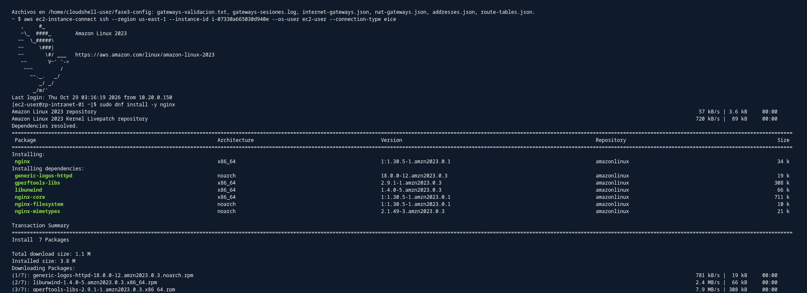
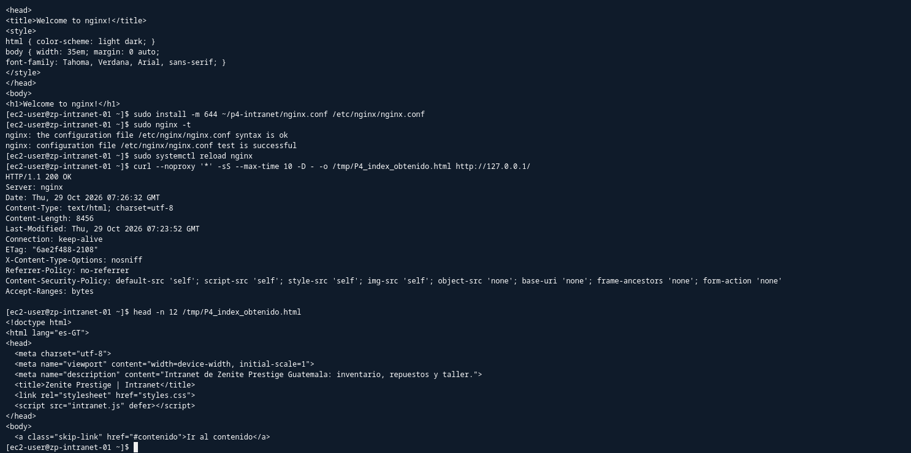
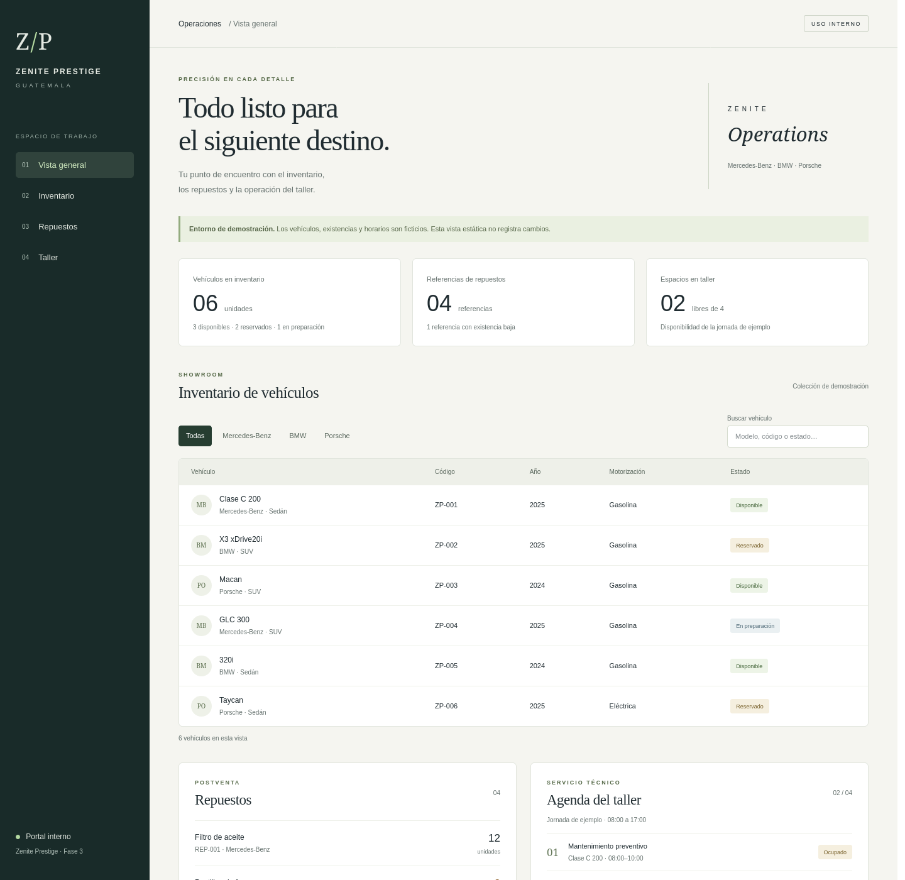
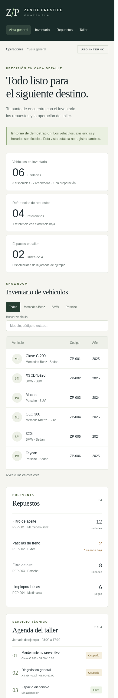

# Intranet web: portal interno de Zenite Prestige

*Sección del reporte de Fase 3 · Persona 4 · servicio web interno para consultar inventario, repuestos y disponibilidad de taller.*

## 1. Objetivo de esta parte

- Instalar **Nginx** en `zp-intranet-01` y publicar una página interna de Zenite Prestige, sin depender de recursos externos.
- Permitir su consulta desde **Ventas, TI y Servidores**, y bloquear el acceso desde **Visitantes e Internet** mediante la seguridad de red de P5, complementada por restricciones de Nginx.
- Entregar configuración, página, evidencia de funcionamiento y una guía de operación para la siguiente persona.

**Estado de validación:** instalación y respuesta HTTP del HTML desde localhost verificadas. Las pruebas WEB-01 a WEB-05 de la matriz siguen pendientes; todavía no se acredita el acceso entre subredes ni el aislamiento completo.

## 2. Recursos y servicios

| Elemento | Detalle |
|---|---|
| Servidor | `zp-intranet-01` · `i-07330a665030d940e` · `t3.micro` · Amazon Linux 2023 |
| Dirección / subred | `10.20.0.71` · `subnet-zenite-servidores` · `10.20.0.64/27` |
| VPC / región | `vpc-zenite-fase2` (`vpc-0e4c1d0b2314ab4df`) · `us-east-1` (N. Virginia) |
| Servicio | Nginx 1.30.5, identificado en la captura de instalación y en la cabecera del primer intento HTTP |
| URL / puerto | `http://10.20.0.71/` · HTTP TCP 80 |
| Configuración instalada | `/etc/nginx/nginx.conf` |
| Directorio público | `/usr/share/nginx/zenite/`: `index.html`, `styles.css` e `intranet.js` |
| Acceso administrativo | EC2 Instance Connect Endpoint `eice-zenite-fase2`; usuario del sistema `ec2-user` |
| Security Group | `zenite-servidores` (`sg-0bd52634dd2e6bb61`), compartido con los otros servicios |
| Estado de IP pública observado | Sin IPv4 pública en la validación de P1 compartida durante la sesión; no sustituye una auditoría actual para WEB-05 |
| Dependencia para instalación | NAT de P1 para descargar paquetes; EICE, transferencia y consultas internas posteriores no requieren NAT |

## 3. Decisiones

| Decisión | Justificación |
|---|---|
| Nginx sobre la instancia existente | Conserva el software previsto y la infraestructura entregada por P1; no se creó otro servidor web. |
| HTTP 80 en Fase 3 | Aprobado por el usuario y coherente con el reparto y la matriz. Difiere de HTTPS 443 en Fase 1: el tráfico no se cifra. No se configuró certificado ni se afirma cumplimiento de HTTPS. |
| Página estática con identidad de la empresa | Seis vehículos ficticios de Mercedes-Benz, BMW y Porsche, cuatro referencias de repuestos y cuatro espacios de taller. No hay reservas reales, persistencia ni datos comerciales auténticos. |
| Recursos locales | HTML, CSS y JavaScript sin CDN ni fuentes descargadas; el sitio se puede consultar sin salida a Internet. |
| Restricción adicional en Nginx | `allow` para localhost y subredes autorizadas, seguido de `deny all`. Complementa la red; no sustituye Security Groups o ACL. |
| Sin autenticación LDAP | La integración opcional no se implementó. La página no solicita ni almacena contraseñas. |
| Cliente de Servidores | `zp-ldap-01` (`10.20.0.69`, Ubuntu, usuario `ubuntu`) para WEB-03, como indica la matriz. Su prueba queda pendiente. |
| Operación mediante scripts de P1 | Se reutilizan encendido, NAT y cierre; no se alteran sus scripts, los Security Groups ni las ACL de P5. |

## 4. Implementación

### Instalación y acceso en AWS

El trabajo se ejecutó desde CloudShell en N. Virginia y desde la terminal privada de la instancia por EICE. El usuario IAM utilizado fue `Cisco`.

1. **Validación inicial:** los scripts de P1 confirmaron IGW y rutas base, instancia con la IP prevista y sin IPv4 pública. La instancia estaba detenida y no existía NAT.
2. **Encendido e Internet para instalar:** `P1_instancias.sh encender zp-intranet-01` y `P1_gateways.sh crear`. Una sesión registró el NAT `nat-0711ff2257ccf3953` en `10.20.0.148`, disponible a las 01:44:22 UTC del 29 de octubre. Ese dato es histórico; el NAT se recrea por sesión.
3. **Permisos de EICE:** el primer SSH falló por falta de `ec2-instance-connect:SendSSHPublicKey`. Se solicitó la intervención del administrador y comprobar `OpenTunnel`. Después, el usuario informó que recibió permisos y consiguió entrar; `uname -n` confirmó `zp-intranet-01`. No se exportó la política IAM efectiva.
4. **Instalación:** se comprobó `package nginx is not installed` y se ejecutó `sudo dnf install -y nginx`. El usuario confirmó la consulta de versión; la captura muestra los paquetes de Nginx y dependencias.
5. **Transferencia:** `P4_subir_intranet.sh`, ejecutado en CloudShell, busca VPC, instancia y EICE por nombre, valida destino e identidad SSH y pide confirmación antes de copiar. Envía una llave pública temporal para EICE y usa SCP a través del túnel privado. La llave privada temporal se elimina al terminar; no se instala una llave permanente.
6. **Paquete:** `P4_intranet.tar.gz` contiene únicamente HTML, CSS, JavaScript y `nginx.conf`. Se confirmó su copia a `/home/ec2-user/P4_intranet.tar.gz` y se extrajo en `~/p4-intranet/`. El paquete generado está ignorado por git; sus fuentes se conservan.
7. **Publicación:** tras comprobar los directorios `conf.d` y `default.d` vacíos, se respaldó la configuración anterior, se copiaron los tres archivos públicos con permisos 0644 a `/usr/share/nginx/zenite/` y se instaló `nginx.conf` en `/etc/nginx/nginx.conf`.
8. **Servicio:** se validó la configuración con `nginx -t`, se habilitó el arranque con `systemctl enable --now nginx` y se recargó después de publicar. Se recibió estado `active`; la repetición de la prueba HTTP sirvió la intranet correcta.



*Figura WEB-INST. Terminal de `zp-intranet-01`: instalación de Nginx y sus dependencias desde los repositorios de Amazon Linux. La captura muestra el proceso; la comprobación HTTP posterior acredita que el servidor quedó instalado.*

### Configuración del sitio

Se usa un único servidor HTTP, directorio público propio, `index.html`, UTF-8 y listado de directorios deshabilitado. Se permiten GET y HEAD; los demás métodos se rechazan. `server_tokens off` oculta la versión en la respuesta final.

La restricción adicional de origen es:

```nginx
allow 127.0.0.1;
allow 10.20.0.0/27;    # Ventas
allow 10.20.0.96/28;   # TI
allow 10.20.0.64/27;   # Servidores
deny all;
```

Se incorporaron `X-Content-Type-Options: nosniff`, `Referrer-Policy: no-referrer` y una Content Security Policy que limita recursos al mismo origen y bloquea objetos, enmarcado y envío de formularios. Estas cabeceras se observaron en la respuesta final; no convierten HTTP en un transporte cifrado.

El aviso inicial sobre `types_hash` se resolvió con `types_hash_max_size 4096` y `types_hash_bucket_size 128`; la siguiente validación pasó sin ese aviso.

### Contenido y comprobaciones previas

La página muestra inventario con filtro por marca y búsqueda por texto, repuestos y agenda de taller. Sin JavaScript, el inventario sigue presente. No se guardan cambios ni se consultan servicios externos.

Se verificaron estructura HTML, IDs, enlaces internos y sintaxis de JavaScript. El script de transferencia pasó `bash -n` y seis casos simulados: validación sin envío, instancia detenida, duplicación de nombre, envío correcto, llave rechazada y fallo de SCP. En los tres casos que generan una llave se comprobó su eliminación. Estas simulaciones no son ejecuciones de AWS; la transferencia real quedó confirmada por la salida compartida por el usuario.

## 5. Pruebas y evidencia

### Servicio local en la instancia de AWS

Las siguientes filas son pruebas auxiliares de publicación, **fuera de WEB-01 a WEB-05**. Las horas proceden de la cabecera HTTP `Date` del servidor. Los archivos TXT son transcripciones identificadas como tales de las salidas reales compartidas por el usuario.

| ID auxiliar | Servicio | Origen → destino | Esperado | Obtenido | Hora (UTC, 2026-10-29) | Estado | Fig. |
|---|---|---|---|---|---|---|---|
| WEB-LOCAL (1) | HTTP | `zp-intranet-01` → `127.0.0.1:80` | HTTP 200 con la intranet | HTTP 200, 896 bytes, título `Welcome to nginx!`: configuración predeterminada activa | 07:24:31 | FAIL | TXT intento 1 |
| WEB-LOCAL (2) | HTTP | `zp-intranet-01` → `127.0.0.1:80` | HTTP 200 con la intranet | HTTP 200, UTF-8, 8456 bytes, título `Zenite Prestige \| Intranet`, cabeceras previstas | 07:26:32 | PASS | WEB-LOCAL |

La segunda respuesta corresponde a las **01:26:32 de Guatemala del 29 de octubre**. El mismo registro contiene `nginx -t` correcto y recarga sin error. La sintaxis correcta y el código 200 por sí solos no bastaban: también se comprobó el título para evitar aceptar la página predeterminada.



*Figura WEB-LOCAL. Captura del usuario dentro de `zp-intranet-01`: instalación de la configuración de P4, validación, recarga, HTTP 200 y título de Zenite. La hora HTTP coincide con el TXT del segundo intento. La captura original `configuracion_web.png` se conservó y esta copia tiene contenido idéntico.*

Transcripciones: [intento 1](../evidencias/04_intranet/FASE3_WEB-LOCAL_intento1_pagina_predeterminada.txt) e [intento 2](../evidencias/04_intranet/FASE3_WEB-LOCAL_intento2_Intranet_HTTP200.txt).

### Prueba en la computadora local

El 29 de octubre, con inicio registrado a las **01:38:06 de Guatemala (07:38:06 UTC)**, se usó un servidor temporal Python limitado a `127.0.0.1`, publicando solo los tres archivos del sitio. El entorno local no tiene Nginx instalado.

| Comprobación | Resultado observado | Alcance |
|---|---|---|
| HTML | HTTP 200, 8456 bytes, idéntico a la fuente | Servidor Python local |
| CSS | HTTP 200, 9814 bytes, `text/css`, idéntico a la fuente | No acredita CSS servido por Nginx en AWS |
| JavaScript | HTTP 200, 1580 bytes, `text/javascript`, idéntico a la fuente | No acredita JavaScript servido por Nginx en AWS |
| Filtros y búsqueda | Tres marcas, combinación con búsqueda, acentos, código, contador, cero resultados y restablecimiento correctos | DOM simulado en Node; no prueba de interacción automatizada en Firefox |
| Diseño | Firefox generó capturas de escritorio 1440×1400 y móvil 390×2300; revisión visual sin superposiciones observadas | Capturas del tamaño de ventana; la tabla móvil tiene desplazamiento horizontal |
| Cierre local | Servidor detenido y perfiles temporales eliminados | No modifica el estado de AWS |

Registro: [LOCAL_PC_prueba.txt](../evidencias/04_intranet/local_pc/20261029_013806/LOCAL_PC_prueba.txt). La hora anterior es la del inicio de la corrida, no una marca individual para cada comprobación.



*Figura PC-ESCRITORIO. Vista en Firefox del sitio servido en la computadora local: navegación, indicadores e inventario. No es una captura desde Ventas ni evidencia de WEB-01.*



*Figura PC-MÓVIL. Vista local de ancho 390 píxeles, con navegación y paneles adaptados. El contenido que excede la altura de la ventana se consulta desplazando.*

### Filas preparadas para la matriz compartida — entrega a P6

La Persona 6 mantiene la matriz compartida. Estas filas conservan su origen y resultado esperado; no se asigna PASS a una prueba sin ejecutar.

| ID | Resp. | Servicio | Origen → destino | Esperado | Obtenido | Hora | Estado | Fig. |
|---|---|---|---|---|---|---|---|---|
| WEB-01 | P4 | HTTP | `zp-ventas-01` → `http://10.20.0.71` | HTTP 200 con la intranet | Por verificar | — | PENDIENTE | — |
| WEB-02 | P4 | HTTP | `zp-ti-01` → `http://10.20.0.71` | HTTP 200 | Por verificar | — | PENDIENTE | — |
| WEB-03 | P4 | HTTP | `zp-ldap-01` (Servidores) → `http://10.20.0.71` | HTTP 200 | Por verificar | — | PENDIENTE | — |
| WEB-04 | P4 | HTTP | `zp-visitantes-01` → `http://10.20.0.71` | Bloqueado, tiempo agotado | Por verificar | — | PENDIENTE | — |
| WEB-05 | P4 | HTTP | Internet → Intranet | Inaccesible, sin IP pública ni regla de entrada pública | Por verificar | — | PENDIENTE | — |

**Resumen de matriz WEB:** cinco pruebas pendientes; ninguna registrada como ejecutada. La prueba de localhost no sustituye conexiones desde otras instancias.

### Fallos y correcciones

| Prueba / etapa | Error encontrado | Acción correctiva | Repetición |
|---|---|---|---|
| Acceso administrativo | `AccessDeniedException` al enviar la llave temporal | Solicitud al administrador de `SendSSHPublicKey` y comprobación de `OpenTunnel`; el usuario informó la habilitación | SSH por EICE y hostname correctos |
| Validación inicial | Aviso de tabla `types_hash` | Ajustar máximo a 4096 y bucket a 128 | `nginx -t` correcto sin aviso |
| Publicación | Comandos pegados: `invalid option: "cp"`; el primer respaldo no se ejecutó | Repetir comandos uno por uno, comprobar directorios y respaldar antes de publicar | Respaldo y copia ejecutados por el usuario |
| WEB-LOCAL (1) | HTTP 200 con la página predeterminada porque faltaba instalar `nginx.conf` | Instalar configuración de P4, validar y recargar | WEB-LOCAL (2): PASS |

## 6. Limitaciones y observaciones

- **HTTP sin cifrado:** decisión de laboratorio aprobada, distinta de HTTPS de Fase 1. No hay certificado TLS ni autenticación LDAP en la intranet.
- **Seguridad de red pendiente:** la última salida de `zenite-servidores` compartida incluía 22, 389, 636 y UDP 123, pero no TCP 80. P5 debe comprobar el estado actual y permitir HTTP solo desde `zenite-ventas`, `zenite-ti` y `zenite-servidores` (autorreferencia). El grupo es compartido; las reglas afectan a sus demás instancias.
- **403 no equivale a aislamiento:** si Visitantes alcanza Nginx y recibe 403, actuó la restricción del sitio, pero no se cumplió el tiempo agotado de WEB-04. P5 debe revisar reglas, ACL y retorno.
- **Internet → Intranet no verificado:** el snapshot sin IPv4 pública es evidencia parcial. WEB-05 debe revisar interfaces, todos los grupos asociados, rutas y ausencia de mecanismos de publicación, más un intento externo. Un timeout hacia una IP privada desde una computadora externa no demuestra por sí solo toda la política.
- **Recursos desplegados por verificar:** el HTML sí se comprobó en AWS; CSS, JavaScript y revisión visual del servidor desplegado quedan pendientes. Sus pruebas en Python local no acreditan lo mismo en Nginx.
- **Un solo servidor y contenido ficticio:** sin alta disponibilidad, base de datos, persistencia, reservas reales ni integración con otros servicios.
- Los archivos de configuración y evidencia se mantienen en P4. No se modificó la matriz compartida ni la configuración de seguridad de P5.

## 7. Control de costos y continuidad

Se reutilizó la instancia creada por P1. El NAT se utilizó para disponer de Internet durante la instalación; para transferir por EICE o consultar la página dentro de la VPC no hace falta mantenerlo activo.

Se entregaron los comandos de P1 para detener únicamente la intranet, eliminar el NAT cuando nadie lo necesite y liberar la Elastic IP. **No se recibieron salidas finales de cierre que permitan certificar el estado actual**, ni datos de Billing para calcular el costo real o la duración total de todas las sesiones. Ambos quedan por verificar con P1 y la administradora.

Detener EC2 conserva el disco y la instalación. El EBS conservado sigue generando cargos de almacenamiento; borrarlo sí elimina sus archivos. No se propuso terminar la instancia ni eliminar su disco para cerrar una sesión.

La [guía de operación de P4](../configuracion/nginx/P4_guia_levantar_intranet.md) contiene encendido, conexión, comprobación del sitio y cierre. La siguiente persona debe contar con sus propios permisos IAM, sin compartir credenciales.

## 8. Documentación consultada

- AWS, *Package management tool* (DNF en Amazon Linux 2023): https://docs.aws.amazon.com/linux/al2023/ug/package-management.html
- AWS, *Connect using EC2 Instance Connect Endpoint*: https://docs.aws.amazon.com/AWSEC2/latest/UserGuide/connect-using-eice.html
- AWS, *Permissions for EC2 Instance Connect Endpoint*: https://docs.aws.amazon.com/AWSEC2/latest/UserGuide/permissions-for-ec2-instance-connect-endpoint.html
- AWS CLI, `open-tunnel`: https://docs.aws.amazon.com/cli/latest/reference/ec2-instance-connect/open-tunnel.html
- AWS CLI, `send-ssh-public-key`: https://docs.aws.amazon.com/cli/latest/reference/ec2-instance-connect/send-ssh-public-key.html
- AWS, *EC2 instance state changes* (conservación y facturación): https://docs.aws.amazon.com/AWSEC2/latest/UserGuide/ec2-instance-lifecycle.html
- Nginx, *Beginner's Guide* (contenido estático): https://nginx.org/en/docs/beginners_guide.html
- Nginx, restricciones por dirección: https://nginx.org/en/docs/http/ngx_http_access_module.html
- Nginx, directivas HTTP (`root`, `try_files`, `limit_except`, `server_tokens`): https://nginx.org/en/docs/http/ngx_http_core_module.html
- Nginx, cabeceras: https://nginx.org/en/docs/http/ngx_http_headers_module.html
- Nginx, validación de configuración: https://nginx.org/en/docs/switches.html
- Nginx, tablas hash: https://nginx.org/en/docs/hash.html
- OpenSSH, `scp`: https://man.openbsd.org/scp
- systemd, `systemctl`: https://www.freedesktop.org/software/systemd/man/latest/systemctl.html
- RPM, verificación de archivos: https://rpm.org/docs/latest/man/rpm.8
- curl, opciones de consulta HTTP: https://curl.se/docs/manpage.html

Estas páginas se consultaron durante la implementación y preparación de la guía. Las salidas del servidor y las capturas son la evidencia del entorno del proyecto.

## 9. Archivos y evidencias de esta parte

| Archivo | Contenido |
|---|---|
| `Fase3/configuracion/nginx/index.html` | Página y datos ficticios de inventario, repuestos y taller |
| `Fase3/configuracion/nginx/styles.css` | Diseño adaptable y fuentes locales |
| `Fase3/configuracion/nginx/intranet.js` | Filtros y búsqueda, sin peticiones externas |
| `Fase3/configuracion/nginx/nginx.conf` | Servidor HTTP, restricciones por origen y cabeceras |
| `Fase3/configuracion/nginx/P4_subir_intranet.sh` | Validación previa y transferencia por EICE desde CloudShell |
| `Fase3/configuracion/nginx/README.md` | Instalación, decisiones, historial y validación |
| `Fase3/configuracion/nginx/P4_guia_levantar_intranet.md` | Guía de entrega: encendido, comprobaciones, dependencias y cierre |
| `Fase3/evidencias/04_intranet/FASE3_WEB-LOCAL_intento1_pagina_predeterminada.txt` | Primer intento HTTP, conservado como fallo de contenido |
| `Fase3/evidencias/04_intranet/FASE3_WEB-LOCAL_intento2_Intranet_HTTP200.txt` | Repetición con HTTP 200 y título correcto |
| `Fase3/evidencias/04_intranet/FASE3_WEB-LOCAL_Intranet_HTTP200.png` | Captura del resultado local en la instancia de AWS |
| `Fase3/evidencias/04_intranet/instalando_nginx.png` | Instalación de paquetes en la instancia |
| `Fase3/evidencias/04_intranet/local_pc/20261029_013806/` | Registro y capturas de la prueba de la computadora local |
| `Fase3/bitacora/P4.md` | Decisiones, ejecución, problemas y pendientes de P4 |

**Entrega a P5:** conservar el sitio y completar/verificar las reglas y pruebas de red. **Entrega a P6:** integrar esta sección, mantener los resultados pendientes como tales y completar las filas WEB únicamente después de ejecutar y capturar las pruebas.
