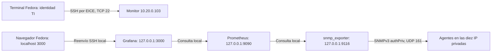

# Checkpoint 4 · Diseño de SNMP y monitoreo

**Estado: opción B con SNMPv3 aprobada por el humano mediante «b».** Se abrió el checkpoint 5 para implementar agentes, Prometheus y exporter. Este documento conserva el diseño previo; la implementación y pruebas AWS ya están recibidas en [el cierre del checkpoint 5](P4_snmp_checkpoint5.md), pendiente de aprobación humana. Grafana se instalará después del cierre de SNMP, en su checkpoint. Operación actual: [P4_snmp_operacion.md](P4_snmp_operacion.md).

El equipo cliente del humano es **Fedora**. Las menciones anteriores a Windows, PowerShell o WSL no se usan para este despliegue: CloudShell seguirá administrando los servidores, la terminal nativa de Fedora mantendrá el túnel privado y el navegador local mostrará Grafana.

## 1. Qué se propone

- Instalar un agente Net-SNMP en las diez instancias previstas, con usuario de solo lectura y SNMPv3 `authPriv`.
- Recoger las métricas desde `zp-monitor-01`, `10.20.0.103`, en TI.
- Recomendar la opción B: Prometheus y `snmp_exporter`; incorporar Grafana después del cierre de SNMP, en el checkpoint 6.
- Reutilizar el monitor existente y las reglas F-07/F-08 entregadas por P3, verificándolas antes del despliegue.

El CSV [P4_snmp_objetivos.csv](P4_snmp_objetivos.csv) contiene nombres e IP del plan; **no es un inventario actual de AWS**. Los scripts futuros consultarán recursos por nombre, comprobarán hostname/IP/SO y fallarán ante diferencias. Los servicios indicados son candidatos y deben confirmarse antes de configurar su conteo. Las diez filas incluyen al monitor como agente de sí mismo; no incluyen EICE, NAT ni recursos de AWS sin sistema operativo administrado por P4.

La configuración de P1 y el inventario histórico identifican el monitor como Ubuntu 24.04, `t3.small`, con disco previsto de 16 GiB. La última salida real del humano lo muestra detenido; el JSON antiguo lo muestra encendido. Se usará una consulta actual antes de decidir su encendido, tamaño, espacio libre y paquetes; no se cambia su tipo por este diseño.

## 2. Opciones para elegir

| Opción | Componentes | Ventaja para este proyecto | Trabajo adicional |
|---|---|---|---|
| A | `snmpget`/`snmpwalk`, recolección y CSV | Menos servicios para cumplir SNMP y obtener evidencia. | Graficar e historizar requiere trabajo posterior; no completa por sí sola el objetivo de Grafana. |
| **B, recomendada** | **Prometheus + `snmp_exporter` + Grafana** | Permite series históricas, paneles y estado/alerta con las métricas SNMP solicitadas. | Tres servicios en el monitor, módulos de OIDs y ventana de instalación. |
| C | Telegraf SNMP + InfluxDB + Grafana | Alternativa del reparto original con base de series de tiempo. | Configurar otro motor de almacenamiento y sus credenciales. |

La recomendación B responde al pedido de hacer también Grafana. La arquitectura del exporter central y su configuración multiobjetivo están documentadas por el [proyecto oficial](https://github.com/prometheus/snmp_exporter). La comparación es una decisión de diseño del proyecto, no una medición de consumo real.

## 3. Flujo y puertos de la opción B



Grafana, Prometheus y el exporter residen en el monitor. El bloque del túnel desemboca en Grafana de ese mismo host; no representa una segunda instancia. No se solicitan puertos 3000, 9090 ni 9116 en SG/NACL.

| Servicio | Escucha propuesta | Acceso |
|---|---|---|
| Agente `snmpd` | UDP 161, solo IP privada del host | Origen TI según SG/NACL, usuario v3 de solo lectura y cifrado obligatorio. |
| `snmp_exporter` | TCP 9116 en `127.0.0.1` del monitor | Solo procesos locales del monitor. |
| Prometheus | TCP 9090 en `127.0.0.1` del monitor | Grafana y validación local. |
| Grafana, checkpoint 6 | TCP 3000 en `127.0.0.1` del monitor | Reenvío SSH desde el equipo autorizado de TI. |
| SSH | TCP 22 existente desde EICE | Administración y túnel; no se expone SSH público. |

La [configuración de Grafana](https://grafana.com/docs/grafana/latest/setup-grafana/configure-grafana/) permite fijar `http_addr`; dejarlo vacío equivale a todas las interfaces y no cumple este diseño. Prometheus y el exporter también quedarán en loopback. Su API puede desencadenar consultas a destinos y requiere protección, según el [modelo de seguridad de Prometheus](https://prometheus.io/docs/operating/security/).

No se usarán traps ni UDP 162. La disponibilidad y los cambios se obtendrán por consultas periódicas.

## 4. SNMPv3, origen y secretos

Propuesta: usuario de laboratorio de **solo lectura**, nivel `authPriv`, autenticación **SHA-256** y privacidad **AES-128**, con dos contraseñas distintas. `SHA256` es el nombre del algoritmo en el exporter; el nombre de Net-SNMP se verificará con la versión instalada. No se reducirá a v2c ni a otro algoritmo automáticamente si falta soporte.

La vista VACM se limitará a los árboles de métricas de la sección 5. No se expondrán parámetros de procesos ni comandos extendidos arbitrarios. No se configurarán comunidades v1/v2c, `public`, permisos de escritura, origen `default`, ni escucha `0.0.0.0`/IPv6 global.

**Distinción necesaria:** `rouser` de SNMPv3 controla usuario, nivel de seguridad y vista; no tiene el parámetro `SOURCE` de `rocommunity` v2c. No se inventará una restricción por CIDR dentro de `rouser`. La limitación a `10.20.0.96/28` se comprobará como conjunto de IP privada de escucha + SG/NACL de P3 + autenticación v3. Se verificará que las interfaces del SG `zenite-ti` correspondan a la subred TI; si no es así, se devolverá el conflicto a P3 antes de instalar. Véase el [manual de Ubuntu/Net-SNMP](https://manpages.ubuntu.com/manpages/noble/man5/snmpd.conf.5.html).

El instalador futuro debe detectar configuraciones previas, conservar un respaldo privado y detenerse ante conflicto. Los usuarios USM deben crearse en la ubicación persistente de Net-SNMP prevista por el paquete, con el servicio detenido durante ese paso; las claves derivadas son sensibles y no se versionan. La recuperación no debe editar ni reiniciar LDAP, Nginx u OpenVPN para instalar SNMP.

Las credenciales se guardarán solo en el `.env` privado del humano y archivos de servicio privados, nunca en este CSV, comandos mostrados, YAML versionado, capturas o chat. El mecanismo de distribución privado se preparará en el checkpoint 5; aquí no se generan ni solicitan contraseñas. Para el exporter se usarán variables o un archivo privado con permisos mínimos, según las capacidades verificadas de la versión elegida. El formato `auths` y los algoritmos están descritos en el [generador oficial](https://github.com/prometheus/snmp_exporter/tree/main/generator).

v2c queda como alternativa solo ante recorte aprobado, con comunidad distinta de `public`, solo lectura y origen del monitor restringido; no se elige en este diseño recomendado.

## 5. Métricas, frecuencia y estado

| Medición | OID o familia prevista | Tratamiento |
|---|---|---|
| Disponibilidad | Éxito de consulta SNMP y `up` del job SNMP | Identificar por nombre/IP; distinguir fallo del exporter de falta de respuesta del agente. |
| Tiempo del agente | `sysUpTime.0`: `1.3.6.1.2.1.1.3.0` | TimeTicks a segundos; corresponde al subsistema SNMP, no necesariamente al arranque del host. |
| CPU | `hrProcessorLoad`: `1.3.6.1.2.1.25.3.3.1.2`, y `ssCpuRaw*` en `1.3.6.1.4.1.2021.11` | HR es media aproximada de un minuto; los contadores UCD permiten calcular uso por tasas. La implementación usa UCD como fuente base porque HR CPU no apareció en la integración local. |
| Memoria y disco | `hrStorageTable`: `1.3.6.1.2.1.25.2.3`; `dskTable`: `1.3.6.1.4.1.2021.9` | RAM por tipo, bytes = unidades × tamaño/usado. Disco raíz declarado con `disk /`, totales/usado en KiB y porcentaje UCD. No fijar índices iguales para todos los hosts. |
| Interfaces | `ifTable` y `ifXTable`: `1.3.6.1.2.1.2.2`, `1.3.6.1.2.1.31.1.1` | Nombre, estado, contadores de entrada/salida de 64 bits; tasa de octetos/s a bits/s. Excluir loopback del tráfico mostrado. |
| Procesos clave | `prTable`: `1.3.6.1.4.1.2021.2` | Conteo y error solo para procesos declarados y confirmados por host, por ejemplo `slapd`, `nginx`, `openvpn` y `chronyd`. |

Fuentes de los objetos: [HOST-RESOURCES-MIB](https://www.net-snmp.org/docs/mibs/host.html), [IF-MIB](https://www.net-snmp.org/docs/mibs/ifMIBObjects.html), [UCD-SNMP-MIB](https://www.net-snmp.org/docs/mibs/ucdavis.html). La disponibilidad real de cada OID se probará en ambos sistemas antes de aceptar una fila SNMP-02.

Propuesta de adquisición: cada **30 s**, timeout global de scrape **15 s**, esperas/reintentos SNMP acotados para caber dentro de ese límite. Se recorrerán familias seleccionadas, no todo `.1`. Las métricas del estado del exporter se comprobarán por separado. Las etiquetas serán host, IP, grupo e interfaz/almacenamiento donde corresponda; no incluirán claves ni URLs con secretos.

Propuesta para este laboratorio: retención de **48 h**, límite de bloques de **1 GiB**, más espacio libre para WAL, compactación, sistema y Grafana. El límite de retención no es un tope del tamaño total del directorio. Se verificarán espacio y memoria antes de instalar; estas cifras son una propuesta, no una prueba de que el monitor soporte la carga. La sintaxis de retención se fijará con la versión seleccionada, pues cambia entre versiones; [almacenamiento oficial](https://prometheus.io/docs/prometheus/latest/storage/).

Panel previsto para el checkpoint 6: disponibilidad por host, CPU, RAM, disco raíz, tráfico por interfaz y procesos clave. Estado de alerta visible tras falta de respuesta sostenida, por ejemplo 60 s. La alerta describirá **sin respuesta SNMP**; solo una detención EC2 controlada permite afirmar que el host está apagado. Si cae el exporter, se mostrará fallo de recolección. No se enviarán correos ni mensajes externos.

## 6. Acceso desde Fedora

La parte de instalación remota continúa en CloudShell con `P3_eice.sh`. Para mostrar Grafana, el túnel debe iniciarse en la **terminal de Fedora**, porque el `localhost` del navegador es el del equipo local, no el de CloudShell.

Fedora necesitará un cliente OpenSSH, AWS CLI v2 y autenticación AWS autorizada para TI. La sesión web de CloudShell no configura automáticamente esas credenciales en Fedora. Se comprobará el método de autenticación disponible sin copiar credenciales por el chat. La [AWS CLI admite Fedora de 64 bits](https://docs.aws.amazon.com/cli/latest/userguide/getting-started-install.html); no se necesita WSL.

El acceso del checkpoint 6 usará SSH con `ProxyCommand` y `ec2-instance-connect open-tunnel`, mecanismo descrito por [AWS para EICE](https://docs.aws.amazon.com/AWSEC2/latest/UserGuide/connect-using-eice.html). El reenvío local escuchará únicamente en `127.0.0.1:3000`. Se abrirá `http://127.0.0.1:3000` en el navegador local, con el tráfico hacia AWS dentro de SSH. No se creará un enlace público alternativo.

Falta confirmar cliente/arquitectura, perfil AWS y permisos IAM de TI, y que el hardening SSH permita reenvío. El rol que puede abrir EICE determina quién puede usar ese acceso; loopback por sí solo no demuestra identidad TI. Se coordinará con el responsable IAM sin modificar políticas desde P4. No se copiará una llave privada desde CloudShell; la llave de conexión local se generará y conservará localmente.

Comprobación opcional de solo lectura, en la **terminal de Fedora**, sin instalar ni configurar nada:

```bash
uname -m
command -v aws || true
command -v ssh || true
```

Estos comandos muestran arquitectura y disponibilidad, no prueban autenticación AWS ni acceso al monitor. La guía ejecutable del túnel se preparará en el checkpoint 6 después de completar SNMP.

## 7. Instalación y coordinación de red

La solicitud lista para coordinar está en [P4_solicitud_red_monitoreo.md](P4_solicitud_red_monitoreo.md).

Antes del despliegue: describir las diez instancias por nombre, su estado, tipo, IP, arquitectura, interfaces y SG; revisar rutas, NAT y ACL efectivos; comprobar paquetes/configuración si las máquinas ya están encendidas. No se toma el estado del CSV ni el JSON histórico como actual.

Paquetes confirmados en documentación: Ubuntu `snmpd` y `snmp`; Amazon Linux 2023 `net-snmp` y `net-snmp-utils`. Las versiones disponibles en los repositorios de **cada instancia** siguen por verificar, igual que la versión compatible de Prometheus/exporter. Fuentes: [Ubuntu snmpd](https://packages.ubuntu.com/noble/snmpd), [Ubuntu snmp](https://packages.ubuntu.com/noble/snmp), [Amazon Linux](https://docs.aws.amazon.com/linux/al2023/release-notes/all-packages-AL2023.12.html).

P1 coordina NAT para las instancias privadas; P3 coordina la ventana de acceso a repositorios desde TI y restaura su ACL al terminar. Web/VPN tienen salida prevista por sus EIP. No se ejecutará desde P4 una reversión de ACL, creación de NAT o cambio de ruta. Las ventanas antiguas del calendario de P1 no se consideran vigentes sin confirmación nueva. Se avisará al equipo con la anticipación que pide su calendario.

Se prefiere un permiso temporal acotado por P3 si es viable. Revertir toda una ACL podría cambiar otras restricciones, por lo que su alcance exacto debe presentarse y aprobarse por separado. Tras cualquier cambio se comprueban EICE y las restricciones restauradas.

El primer despliegue será un piloto en monitor y un agente acordado; después se completa el resto. SNMP-02 exige evidencia de todas las instancias, no solo del piloto. El encendido de las diez y la parada de un cliente para simular caída se mostrarán con sus comandos antes de ejecutarlos. Propuesta para el host de prueba de caída: `zp-ventas-02`, previa coordinación con P1.

No se agregan instancias, EIP, dominios, servicios gestionados ni almacenamiento por este diseño. La ventana NAT y el tiempo de instancias existentes tienen costo; P1 verifica presupuesto disponible y cierre, sin dar por vigentes las estimaciones históricas como precios actuales. Al cerrar cada ventana, P1 elimina el NAT temporal y confirma su cierre; se detienen las instancias acordadas. No se dejan recursos encendidos esperando aprobación.

## 8. Pruebas y evidencias previstas

**Tabla histórica de criterios previstos en checkpoint 4, no resultados de ejecución.** SNMP ya tiene salidas reales en [el cierre del checkpoint 5](P4_snmp_checkpoint5.md) y sus filas para P5; Grafana sigue pendiente. Los nombres siguientes eran propuestas; usar el índice actual para los archivos realmente recibidos.

| ID | Criterio verificable | Evidencia prevista |
|---|---|---|
| SNMP-01 | Agente activo en las diez instancias; escucha solo IP privada; usuario v3 y configuración revisada sin revelar claves. | `FINAL_SNMP-01_agentes.txt` y capturas de hostname/hora/servicio/puerto. |
| SNMP-02 | Monitor obtiene uptime, CPU, memoria, disco e interfaces de los diez hosts; incluye procesos declarados. | `FINAL_SNMP-02_monitor.txt`, export de métricas sin secretos. |
| SNMP-03 | Credenciales incorrectas fallan desde un origen permitido; se muestra también un control válido. | `FINAL_SNMP-03_autenticacion.txt`. |
| SNMP-04 | Detener cliente de prueba acordado; recoger pérdida de respuesta y recuperación al encenderlo. | `FINAL_SNMP-04_caida.txt`, hora de estado EC2 y observación del monitor. |
| SNMP-05 / FW-05 | Monitor consulta correctamente; Ventas y Visitantes no obtienen respuesta; se comprueba ausencia de exposición pública. | `FINAL_SNMP-05_origenes.txt`; entregar fragmento con hora a P3 para FW-05. |
| GRAF-01, checkpoint 6 | Al menos cuatro paneles con métricas reales y etiquetas de host; se proponen seis. | `FINAL_GRAF-01_dashboard.png` y export público del dashboard sin secretos. |
| GRAF-02, checkpoint 6 | Acceso local por túnel autorizado TI; loopback en monitor; Ventas no llega a IP privada:3000; SG sin puertos nuevos. | `FINAL_GRAF-02_acceso.txt` y captura del navegador. |
| GRAF-03, checkpoint 6 | Estado de host sin respuesta visible y coherente con prueba de caída controlada. | `FINAL_GRAF-03_caida.png` y TXT con hora. |

Un fallo desde otro origen solo por credenciales erróneas no demuestra bloqueo de red. Para SNMP-05 se correlacionarán reglas y un intento comparable al control positivo; los detalles privados se prepararán sin exponer contraseñas. Un escaneo UDP `open|filtered` no es prueba concluyente por sí solo. Se usará una instancia con IP pública para la prueba exterior si está disponible y se registrará cualquier limitación de origen Internet.

No se modifica la matriz de P5. P4 prepara resultados y P5 los incorpora. Plan B de demo: consultas a OIDs concretos y salidas/capturas de corridas reales identificadas como guardadas; no sustituir una prueba pendiente por datos de ejemplo.

## 9. Pausa de revisión

1. **Hecho:** inventario de diseño, opciones A/B/C, recomendación B con v3, métricas, puertos, acceso Fedora, coordinación y criterios de evidencia.
2. **Archivos:** este documento, `P4_snmp_objetivos.csv`, `P4_solicitud_red_monitoreo.md`, bitácora P4 y actualización del estado aprobado del cierre LDAP.
3. **Revisión:** comprobar las diez filas del CSV, las opciones, escucha en loopback, fuente TI y dependencias P1/P3. No hay nada nuevo instalado que probar todavía.
4. **Capturas:** no hay ejecución SNMP que capturar aún; los nombres y contenido están definidos en la sección 8.
5. **Pendientes:** estado actual y paquetes de los hosts, ventana NAT/repositorios, soporte criptográfico, perfil IAM local de Fedora y compatibilidad/recursos reales del monitor.
6. **Decisión recibida:** el humano eligió **B con SNMPv3 authPriv, SHA-256/AES y Grafana por túnel EICE**, usando el monitor existente. No se elige v2c automáticamente ni se solicita otra aprobación de plataforma.
7. **Coordinación:** entregar la solicitud adjunta a P1/P3 y al responsable IAM. Ellos confirman sus cambios y ventanas; el asistente no envía mensajes externos.
8. **Propuesta de commit humano**, desde el repositorio en Fedora:

   ```bash
   git add -- FaseFinal/configuracion/P4_snmp_diseno.md \
     FaseFinal/configuracion/P4_snmp_objetivos.csv \
     FaseFinal/configuracion/P4_solicitud_red_monitoreo.md \
     FaseFinal/configuracion/P4_ldap_checkpoint3.md \
     FaseFinal/configuracion/P4_ldap_demo.md \
     FaseFinal/configuracion/P4_ldap_password_local.md \
     FaseFinal/bitacora/P4.md
   git diff --cached
   git commit -m "docs(snmp): proponer monitoreo v3 y acceso privado a Grafana"
   ```

El humano aprobó esta transición mediante «b». La siguiente pausa de cierre será al completar el checkpoint 5 con resultados reales de SNMP; antes de cada cambio operativo se muestra su alcance y se respeta la coordinación de ventana.
