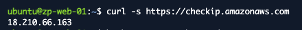
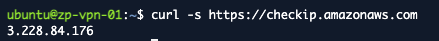
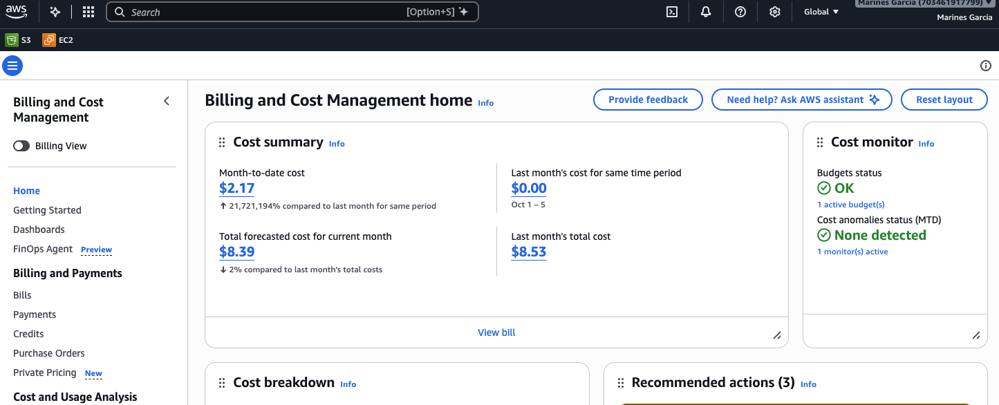

# Infraestructura pública en AWS: DMZ, VPN, Elastic IP, dominio y control de costos

*Sección del reporte de la fase final · Persona 1 · corresponde a la base pública que sostiene el resto de la fase: rutas a Internet para la DMZ y la VPN,
Elastic IP, Security Groups base, instancias nuevas, dominio y DNS, y control del gasto.*

## 1. Objetivo de esta parte

Dejar lista en AWS la base pública que necesitan los demás paquetes de la fase final (web pública con HTTPS, VPN, firewall, SNMP y monitoreo, integración):

- **Rutas a Internet** para la DMZ y para la subred de la VPN, que hasta Fase 3 solo tenían ruta local o salían por el NAT.
- **Dos Elastic IP** (web y VPN), asociadas a sus instancias, como único punto de entrada desde Internet.
- **Tres instancias nuevas** con las direcciones del plan de Fase 1: `zp-web-01`, `zp-vpn-01` y `zp-monitor-01`.
- **Security Groups base** `zenite-dmz` y `zenite-vpn`.
- **Dominio y DNS** para que la web se alcance por nombre.
- **Control de costos**: la cuenta no tiene créditos, así que todo recurso encendido se cobra, y las dos Elastic IP cobran aunque las instancias estén apagadas.

## 2. Recursos que se agregan a la VPC

| Recurso | Nombre | Detalle |
|---|---|---|
| Route table | `rt-zenite-dmz` | Se agrega `0.0.0.0/0 → igw-zenite-fase3` (`igw-00f6efb87a444f270`). Hasta Fase 3 solo tenía la ruta local. |
| Route table (nueva) | `rt-zenite-vpn` | `rtb-0c4e169f00a248de8`. `0.0.0.0/0 → igw-zenite-fase3`. Se le reasocia `subnet-zenite-vpn`, que antes usaba `rt-zenite-interna` (ruta por el NAT). |
| Elastic IP | `eip-zenite-web` | `18.210.66.163`, asociada a `zp-web-01`. |
| Elastic IP | `eip-zenite-vpn` | `3.228.84.176`, asociada a `zp-vpn-01`. |
| Security Group | `zenite-dmz` | `sg-06c3d521d3586f2b5`. Entrada: solo TCP/22 desde `zenite-eice` (80 y 443 los agrega P3). |
| Security Group | `zenite-vpn` | `sg-044aad87e64e20906`. Entrada: solo TCP/22 desde `zenite-eice` (UDP/1194 lo agrega P3). |

| Instancia | Instance ID | Tipo | IP privada | Subred | Security Group | IP pública |
|---|---|---|---|---|---|---|
| `zp-web-01` | `i-06b59507240cfa8e7` | t3.micro | `10.20.0.116` | DMZ | `zenite-dmz` | `18.210.66.163` |
| `zp-vpn-01` | `i-050e09727e2a06139` | t3.micro | `10.20.0.132` | VPN | `zenite-vpn` | `3.228.84.176` |
| `zp-monitor-01` | `i-00e786cb51a422c36` | t3.small, disco 16 GiB | `10.20.0.103` | TI | `zenite-ti` | ninguna |

Las tres usan Ubuntu 24.04 (`ami-0d6dd9e8265d48906`, usuario `ubuntu`), IMDSv2 obligatorio, sin llave SSH y créditos de CPU en modo `standard`. Etiquetas: `Project=ZenitePrestige`, `Phase=Final`, `Environment=Prototype`, `Owner=Grupo30`, `Role`.

Dominio: `zenite.dernait.com` → `18.210.66.163` (web) y `zenite-vpn.dernait.com` → `3.228.84.176` (VPN), registros `A` sin proxy en el DNS de Cloudflare de `dernait.com`.

## 3. Decisiones

| Decisión | Justificación |
|---|---|
| Firewall nativo de AWS (Security Groups y ACL) en lugar de pfSense | Es el servicio administrado para esa función y reduce el riesgo de la demostración (D1). |
| Una sola instancia en la DMZ que termina TLS, sin proxy `.117` | Menos piezas que mantener y que demostrar; la web pública y la Intranet quedan separadas por reglas de red (D2). |
| Elastic IP directa en web y VPN, sin balanceador | Un balanceador cobra por hora y no aporta nada a un prototipo de una sola instancia (D3). |
| Dominio propio de un integrante del equipo (`dernait.com`, Cloudflare) | El plan inicial era el dominio gratuito del GitHub Student Pack (aprobado el 5 nov; los beneficios se activan a las 72 h, cerca del 8 nov, demasiado cerca del congelamiento del 9 nov). Se usó un subdominio de un dominio existente: costo cero y disponible el mismo día. Respaldos documentados: `.me` del Student Pack y DuckDNS (D4). |
| Registros DNS sin proxy de Cloudflare (nube gris) | Con el proxy activo, Cloudflare responde con sus propias IP y Let's Encrypt validaría contra Cloudflare y no contra `zp-web-01`; además el proxy no pasa UDP/1194 de la VPN. |
| Presupuesto: alerta en US$15 y tope de equipo de US$20 | AWS Budgets avisa pero no corta el gasto; el tope es una regla del equipo (D5). Ya existía «My Monthly Cost Budget» de US$15 con alertas al 85 % y 100 %. |
| Solo dos excepciones a `0.0.0.0/0`: TCP/80 y 443 en `zenite-dmz`, UDP/1194 en `zenite-vpn` | Es la superficie pública mínima; cualquier otra regla es por Security Group de origen o por CIDR interno (D10). |
| Ubuntu 24.04 en las instancias nuevas | Igual que `zp-ldap-01` de Fase 3, y OpenVPN, Nginx y Grafana están en sus repositorios (D11). |
| Monitor `t3.small` con disco de 16 GiB | Grafana y sus datos no caben bien en 1 GiB de RAM ni en 8 GiB de disco; cuesta ≈ US$0.64 más al mes. |
| `--revertir` no termina instancias y las Elastic IP solo se liberan con `liberar-eip` | Una instancia o una IP pública borradas por accidente rompen el DNS y el trabajo de otras personas; hay que hacerlo a propósito. |
| Instancias sin IPv4 pública automática | La única IP pública llega por la Elastic IP; así el barrido DMZ-03 puede probar que no hay otra. |

## 4. Implementación

Todo se hizo con scripts de AWS CLI ejecutados en AWS CloudShell (`us-east-1`), sin guardar credenciales. Siguen el estilo de Fases 2 y 3: comprobaciones previas sin cambios,
idempotencia, búsqueda de recursos por nombre, confirmación (`si`), modo de solo validación y registro en `~/final-config/`.

- `P1_dmz_infra.sh`: `crear`, `--validar`, `--validar-apagado`, `liberar-eip` y `--revertir`.
  - `crear`: comprobación previa de solo lectura (IP libres, rutas ajenas, IGW, SG, AMI); ruta de la DMZ al IGW; `rt-zenite-vpn` con su ruta y reasociación de `subnet-zenite-vpn`;
    Security Groups con solo SSH desde `zenite-eice`; las tres instancias; las dos Elastic IP asociadas en cuanto están `running`; espera de los status checks y validación.
  - `--validar`: rutas, SG (incluye «entradas `0.0.0.0/0` fuera de las excepciones D10»), cada instancia (estado, subred, IP, tipo, IMDSv2, etiquetas), asociación de las Elastic IP,
    prueba de TCP/22 cerrado desde CloudShell (DMZ-04) y barrido de IP públicas (DMZ-03).
  - `--validar-apagado`: cierre de sesión (0 NAT, ninguna `zp-*` encendida, solo nuestras Elastic IP).
- `P1_dns_check.sh`: DNS-01 y DNS-02 contra `8.8.8.8` y `1.1.1.1` (con `dig`, o DNS sobre HTTPS con `curl` si no hay `dig`).
- `P1_costos.sh`: lo que cobra ahora en `us-east-1` (instancias, NAT, Elastic IP, discos) con estimación por hora y día, barrido de las demás regiones, gasto real del mes y presupuestos con sus alertas.

Los tres se probaron antes contra un AWS simulado local con estado. Esas pruebas encontraron fallos que se corrigieron antes de ejecutar en AWS: `P1_dns_check.sh` salía con código 0
aunque hubiera `[FALLA]` y marcaba DNS-02 como correcto cuando ningún resolutor respondía. La ejecución real de `P1_dmz_infra.sh` no requirió cambios.

**Sesión del 5 de noviembre de 2026** (hora UTC; Guatemala es UTC−6, así que 00:08 UTC del 6 nov son las 18:08 del 5 nov):

| Hora | Acción |
|---|---|
| 21:50 | `P1_dmz_infra.sh --validar` antes de crear: solo faltan los recursos nuevos (esperado). |
| ≈ 21:51 – 21:56 | `P1_dmz_infra.sh crear`: rutas, Security Groups, tres instancias y dos Elastic IP. |
| 21:56 | `--validar`: `RESULTADO: todo correcto.` (running ok/ok, DMZ-03 y DMZ-04 en `[OK]`). |
| Después de 21:56 | Instancias detenidas mientras se esperaba el dominio; solo cobran las Elastic IP y los discos. |
| 00:03 | Con los registros ya creados por el dueño del dominio, `P1_dns_check.sh`: DNS-01 y DNS-02 en `[OK]`. |
| ≈ 00:05 – 00:08 | Encendido de las tres instancias. El primer intento con el comando de Fase 3 sin nombres falló con `InsufficientInstanceCapacity` (sección 5); se encendieron por nombre. |
| 00:08 | `--validar` en `[OK]` (guardado como evidencia). |
| 00:09 – 00:29 | `curl` de `checkip.amazonaws.com` en la web y la VPN por EICE; `P1_costos.sh --todo` (00:24). |

## 5. Pruebas y evidencia

DMZ-01 y DMZ-04 (SSH) se probaron **dentro de las instancias**, entrando por EC2 Instance Connect Endpoint, porque `--validar` no ejecuta comandos dentro de ellas.

| ID | Servicio | Origen → destino | Esperado | Obtenido | Hora (UTC) | Estado | Fig. |
|---|---|---|---|---|---|---|---|
| DMZ-01 | Salida a Internet | `zp-web-01` y `zp-vpn-01` → `https://checkip.amazonaws.com` | Cada una devuelve su Elastic IP | `18.210.66.163` y `3.228.84.176` | 2026-11-06 00:09 – 00:29 | PASS | DMZ-01 |
| DMZ-02 | Rutas | `rt-zenite-dmz`, `rt-zenite-vpn`, `subnet-zenite-vpn` | Ruta al IGW activa en ambas; subred VPN en `rt-zenite-vpn` | `igw-00f6efb87a444f270 active` en ambas; subred en `rtb-0c4e169f00a248de8` | 00:08 | PASS | DMZ-01 a 04 (txt) |
| DMZ-03 | IP pública | Barrido de las `zp-*` | Solo web y VPN con IP pública | Ninguna otra; el monitor sin IPv4 pública | 00:08 | PASS | DMZ-01 a 04 (txt) |
| DMZ-04 | Acceso SSH | CloudShell → TCP/22 de las dos Elastic IP; SSH por EICE | Puerto 22 cerrado; SSH solo por EICE | Cerrado en ambas; sesión por EICE como `ubuntu` en las dos | 00:08 | PASS | DMZ-01 a 04 (txt) |
| DNS-01 | DNS | `zenite.dernait.com` | Devuelve la Elastic IP de la web | `18.210.66.163` | 00:03 | PASS | DNS-01 y 02 (txt) |
| DNS-02 | DNS | `@8.8.8.8` y `@1.1.1.1` | Misma respuesta | Ambos `18.210.66.163` | 00:03 | PASS | DNS-01 y 02 (txt) |
| COST-01 | Presupuesto | Billing y `P1_costos.sh --todo` | Presupuesto, alerta y estimación documentados | Presupuesto de US$15/mes con alertas al 85 % y 100 % reales y 100 % de pronóstico; gasto del mes US$2.17; pronóstico US$8.39 | 00:25 | PASS | COST-01 |

*Figura DMZ-01 (web). Terminal de `zp-web-01` (`ubuntu@zp-web-01`): `checkip.amazonaws.com` devuelve `18.210.66.163`, la Elastic IP `eip-zenite-web`.*

*Figura DMZ-01 (VPN). Terminal de `zp-vpn-01`: `checkip.amazonaws.com` devuelve `3.228.84.176`, la Elastic IP `eip-zenite-vpn`.*

*Figura COST-01. Billing and Cost Management: gasto del mes US$2.17, pronóstico US$8.39, un presupuesto activo en estado OK y sin anomalías de costo.*

Salidas de texto: `FINAL_DMZ-01_04_validacion_base_publica.txt` (DMZ-02 a DMZ-04), `FINAL_DNS-01_02_resolucion_dernait.txt` (DNS-01 y 02) y `FINAL_COST-01_costos.txt` (COST-01).

### Fallos y correcciones

| Prueba o paso | Error encontrado | Acción correctiva | Repetición |
|---|---|---|---|
| DMZ-01 (informe) | Se informó como cumplida con la salida de `--validar`, que no entra a las instancias y por tanto no prueba la salida a Internet. | Se marcó como pendiente y se probó con `curl` dentro de cada instancia por EICE. | DMZ-01 (2): PASS |
| Encendido de instancias | `P1_instancias.sh encender` sin nombres enciende **todas** las `zp-*` (10) y AWS devolvió `InsufficientInstanceCapacity`; no arrancó ninguna. | Se verificó que todas seguían `stopped` y se encendieron las tres nuevas por nombre. Desde entonces los comandos llevan nombres explícitos. | Éxito al reintentar |
| `--validar` (1) | Se corrió 2 minutos después de encender: status checks en `initializing`. | Esperar 3 minutos y repetir. | `--validar` (2): `todo correcto` |
| DNS | `zenite.dernait.com` ya resolvía a IP de Cloudflare (`104.21.x`, `172.67.x`): el dominio tiene un comodín con proxy. | Se pidió registros explícitos `zenite` y `zenite-vpn` con la nube gris. | DNS-01 (2): PASS |
| `P1_costos.sh` | Mostró `100.0 (valor)` en las alertas: la API omite `ThresholdType` cuando es porcentaje y el script lo leyó como valor absoluto. | Se trató el campo ausente como porcentaje y se volvió a correr. | Alertas «% del límite» |
| Descarga de los JSON | El botón de CloudShell falló con dos de los cuatro archivos. | Se comprimieron en un `.tgz` y se descargó uno solo. | Descargados |

## 6. Control de costos

| Concepto | Resultado |
|---|---|
| Instancias nuevas encendidas | `t3.micro` ≈ US$0.0104/h (×2) y `t3.small` ≈ US$0.0208/h: ≈ US$0.042/h. |
| Dos Elastic IP | ≈ US$0.005/h cada una, **también con las instancias apagadas**: ≈ US$0.24 al día. |
| Discos (88 GiB en total, 10 volúmenes) | ≈ US$7.04 al mes ≈ US$0.23 al día, con las instancias apagadas. |
| **Todo encendido** | **≈ US$0.052/h ≈ US$1.24 al día** (sin discos); con discos ≈ US$1.47 al día. |
| **Todo apagado** (solo IP y discos) | **≈ US$0.47 al día.** |
| NAT Gateway (cuando existe) | ≈ US$0.10 por ventana de 2 h; olvidado cuesta ≈ US$1.20 al día. |
| Gasto real al 5 nov (Cost Explorer) | US$2.17 en el mes (EC2 Compute US$1.52, EC2 Other US$0.65); pronóstico del mes US$8.39, con el presupuesto de US$15 en estado OK. |
| Otras regiones | Barrido sin instancias, NAT, Elastic IP ni volúmenes. |

Los precios unitarios son estimaciones de `us-east-1` del equipo; manda el gasto real de Billing, que tarda hasta un día en reflejar el consumo. Procedimiento de control: `bash P1_costos.sh` al cerrar cada
sesión (debe terminar en `RESULTADO: sin hallazgos.`) y `bash P1_dmz_infra.sh --validar-apagado`; `bash P1_costos.sh --gasto` para el gasto del mes.

## 7. Limitaciones y observaciones

- Todo está en una sola zona de disponibilidad (`us-east-1a`), igual que el resto del prototipo; no hay alta disponibilidad. Que AWS devuelva `InsufficientInstanceCapacity` al encender es un riesgo real para la demo (ver el runbook).
- La web y la VPN dependen de que las Elastic IP **no cambien**: si alguien las libera o recrea, el DNS de `dernait.com` apunta a una IP ajena y hay que pedir a su dueño que actualice el registro.
- El dominio es de un integrante del equipo; si lo borra o activa el proxy de Cloudflare por error, la web deja de resolver a nuestra IP. Hay plan de respaldo documentado (`P1_dominio_guia.md`).
- Con las rutas nuevas, `P1_gateways.sh --validar` y `--validar-apagado` de Fase 3 marcan `[FALLA]` esperadas (ruta por defecto en `rt-zenite-dmz` y Elastic IP en la cuenta ≠ 0). El cierre válido de la fase final es `P1_dmz_infra.sh --validar-apagado`.
- Los Security Groups `zenite-dmz` y `zenite-vpn` nacen solo con SSH desde el EICE; ni la web ni la VPN son accesibles desde Internet hasta que P3 abra 80/443 y UDP/1194.
- `zp-monitor-01` está en la subred TI, sin Internet por su ACL; instalar paquetes exige un NAT y revertir temporalmente la ACL (lo ejecuta P3).
- Pendiente de confirmar: a qué correo llegan las alertas del presupuesto, y qué se hace con las Elastic IP y las instancias después de la entrega (D12).

## 8. Documentación consultada

- AWS, *Elastic IP addresses*: https://docs.aws.amazon.com/AWSEC2/latest/UserGuide/elastic-ip-addresses-eip.html
- AWS, *Internet gateways*: https://docs.aws.amazon.com/vpc/latest/userguide/VPC_Internet_Gateway.html
- AWS, *Route tables*: https://docs.aws.amazon.com/vpc/latest/userguide/VPC_Route_Tables.html
- AWS, *Connect using EC2 Instance Connect Endpoint*: https://docs.aws.amazon.com/AWSEC2/latest/UserGuide/connect-using-eice.html
- AWS, *Amazon VPC pricing* (IPv4 pública y NAT Gateway): https://aws.amazon.com/vpc/pricing/
- AWS, *Managing your costs with AWS Budgets*: https://docs.aws.amazon.com/cost-management/latest/userguide/budgets-managing-costs.html
- Cloudflare, *Proxy status* (nube gris y naranja): https://developers.cloudflare.com/dns/proxy-status/
- GitHub Education, *Student Developer Pack*: https://education.github.com/pack

*Las direcciones se tomaron de la documentación oficial; conviene comprobar que sigan vigentes antes de entregar el reporte. La oferta del GitHub Student Pack cambia y no se canjeó.*

## 9. Archivos y evidencias de esta parte

| Archivo | Contenido |
|---|---|
| `FaseFinal/configuracion/P1_dmz_infra.sh` | Rutas, Security Groups, instancias y Elastic IP (`crear`, validaciones, `liberar-eip`, `--revertir`). |
| `FaseFinal/configuracion/P1_dns_check.sh` | Comprobación de DNS-01 y DNS-02. |
| `FaseFinal/configuracion/P1_costos.sh` | Control de costos y barrido de regiones. |
| `FaseFinal/configuracion/P1_handoff_1.md` | Handoff a P2, P3, P4 y P5: IP, IDs, Security Groups y qué hace cada quien. |
| `FaseFinal/configuracion/P1_dominio_guia.md` | Dominio elegido, registros DNS y alternativas. |
| `FaseFinal/configuracion/P1_calendario_nat.md` | Ventanas propuestas del NAT. |
| `FaseFinal/configuracion/P1_matriz_filas.md` | Filas de la matriz de pruebas de P1. |
| `FaseFinal/configuracion/P1_demo_final.md` | Plan de encendido y guion de la parte de infraestructura. |
| `FaseFinal/configuracion/addresses.json`, `route-tables.json`, `security-groups.json`, `instancias-final.json` | Exportaciones de AWS del 5 nov (00:08 UTC del 6 nov). |
| `FaseFinal/evidencias/01_infra_dmz_dominio/` | Validaciones y capturas de DMZ-01 a 04, DNS-01 y 02, y COST-01. |
