# Web pública, HTTPS e Intranet: portal de gestiones en la DMZ

*Sección del reporte de la fase final · Persona 2 · servicio público de la empresa: portal de gestiones de clientes con dominio, certificado y solo HTTPS, aislamiento de la DMZ y cierre de las pruebas pendientes de la Intranet de Fase 3.*

## 1. Objetivo de esta parte

- Publicar en Internet un **portal de gestiones de clientes** (solicitud de cotización, prueba de manejo y consulta del estado) desde `zp-web-01`, en la subred DMZ.
- Servirlo por un **dominio público** (`zenite.dernait.com`), **solo por HTTPS** con certificado de Let's Encrypt, y **redirigir todo acceso por HTTP a HTTPS**.
- Demostrar que la **DMZ está aislada**: desde el servidor público no se llega a la Intranet, LDAP, NTP ni TI.
- Cerrar las pruebas **WEB-01 a WEB-05** de la Intranet de Fase 3, que nunca se registraron en el repositorio.

## 2. Recursos y servicios

| Elemento | Detalle |
|---|---|
| Servidor | `zp-web-01` · `i-06b59507240cfa8e7` · t3.micro · Ubuntu 24.04 · `10.20.0.116` · subred DMZ (`10.20.0.112/28`) · Security Group `zenite-dmz` (`sg-06c3d521d3586f2b5`) |
| IP pública y dominio | Elastic IP `18.210.66.163` ↔ `zenite.dernait.com` (registro `A` sin proxy, DNS de Cloudflare). Los creó la Persona 1. |
| Reglas de entrada de `zenite-dmz` | TCP 443 desde `0.0.0.0/0` (`sgr-0c9e35a5478b4aa05`), TCP 80 desde `0.0.0.0/0` (`sgr-03d9b58c8ed70de85`) y TCP 22 solo desde el grupo del EICE (`sgr-0a49734ab3861a8ba`). Las dos primeras son las excepciones autorizadas por la decisión D10. |
| Servidor web | Nginx: termina TLS, aplica límites y cabeceras, sirve `/static/` y reenvía el resto a gunicorn |
| Aplicación | Flask con gunicorn (2 procesos) en `127.0.0.1:8000`, usuario de sistema `zenite-portal` sin shell, servicio `zenite-portal` de systemd |
| Datos | SQLite en `/var/lib/zenite-portal/` (permisos 750), solo datos ficticios |
| Certificado | Let's Encrypt, emisor `YE2`, para `zenite.dernait.com`; emitido el 8 nov 2026 a las 23:13:10 UTC y vigente hasta el 6 feb 2027; renovación automática con `certbot.timer` |

## 3. Decisiones

| Decisión | Justificación |
|---|---|
| Una sola instancia en la DMZ que termina TLS (D2) | El proxy TLS `.117` de Fase 1 se funde con el servidor web: menos recursos y menos costo; la función de cifrado se conserva. |
| Elastic IP directa, sin balanceador (D3) | Un balanceador cuesta cerca de US$16 al mes y no aporta valor para un prototipo. |
| Portal con backend mínimo (Flask + SQLite) en vez de página estática | Permite demostrar una gestión completa (envío, código de seguimiento y consulta) sin depender de servicios externos. |
| El backend escucha solo en `127.0.0.1:8000` | Nunca se expone directamente: toda petición pasa por Nginx. |
| La consulta por código no muestra nombre ni correo | Minimiza la exposición de datos personales; solo devuelve tipo, vehículo, estado y fecha. |
| Sitio público con solo los vehículos disponibles | Reservados y en preparación son información interna. |
| CSP con `script-src 'none'` | El portal no usa JavaScript; así se elimina una clase completa de ataques. |
| `certonly --webroot` en vez de `certbot --nginx` | Certbot no reescribe la configuración de Nginx; la configuración queda versionada en el repositorio. |
| TLS 1.2 y 1.3 solamente | TLS 1.0 y 1.1 están obsoletos; se comprobó que se rechazan (PUB-05). |
| **Sin HSTS** | Es difícil de deshacer y el equipo prefirió no activarlo en un prototipo; queda como mejora (ver sección 7). |
| Puertos 80 y 443 abiertos a Internet | Es la única excepción a «sin entrada desde `0.0.0.0/0`» para este servicio. El 80 solo redirige y atiende el desafío de Let's Encrypt. |

## 4. Implementación

1. **Instalación (`P2_web_publica.sh instalar`, dentro de `zp-web-01`).** Verifica el host y la IP, instala `nginx`, `python3-flask` y `gunicorn`, crea el usuario `zenite-portal`, copia la aplicación a `/opt/zenite-portal`, instala el servicio y el sitio de Nginx (primero por HTTP, para pruebas) y valida. El modo `--validar` es de solo lectura.
2. **Portal.** Páginas de inicio (vehículos disponibles), gestiones (formulario con validación en el servidor) y consulta. Cada gestión recibe un código `ZP-` más 8 caracteres aleatorios (alfabeto sin I, O, 0 ni 1). Consultas SQL parametrizadas, plantillas con escape automático y límite de 8 KB por solicitud. La aplicación se probó antes con el cliente de pruebas de Flask: 21 comprobaciones aprobadas (páginas, validación de cada campo, código y consulta, ausencia de datos personales en la consulta, escape de HTML y límite de tamaño).
3. **Reglas de entrada.** Se abrieron TCP 80 y 443 desde `0.0.0.0/0` en `zenite-dmz` (ver la desviación en la sección 5.2).
4. **Certificado.** Con el portal por HTTP y el dominio resolviendo a la Elastic IP, Certbot emitió el certificado con el método `webroot` (`/var/www/certbot`, servidor de producción de Let's Encrypt).
5. **HTTPS y redirección.** `zenite-portal-https.conf`: el puerto 80 solo atiende `/.well-known/acme-challenge/` y responde `301` a `https://zenite.dernait.com`; el puerto 443 usa TLS 1.2 y 1.3, el certificado de Let's Encrypt, las cabeceras de seguridad, el límite de peticiones y el reenvío a gunicorn. *Nota:* el instalador solo instala la versión HTTP; la activación de la versión HTTPS en la instancia se hizo por separado y no quedó registrada con captura (por confirmar el procedimiento exacto).
6. **Renovación.** `certbot.timer` activo y un gancho de renovación (`zenite-reload-nginx.sh`) que valida la configuración y recarga Nginx.
7. **Cabeceras y límites.** `X-Content-Type-Options`, `X-Frame-Options: DENY`, `Referrer-Policy: no-referrer`, `Content-Security-Policy` restrictiva, `server_tokens off`, `limit_req` de 10 solicitudes por minuto por IP (ráfaga de 5) solo para POST, y bloqueo de archivos ocultos.

## 5. Pruebas y evidencia

Las horas son UTC (Guatemala es UTC−6). Las pruebas desde Internet se hicieron fuera de AWS (celular con datos móviles y Mac); las de aislamiento, dentro de `zp-web-01`, con el prompt `ubuntu@zp-web-01` visible.

### 5.1 Resultados

| ID | Servicio | Origen → destino | Esperado | Obtenido | Hora (UTC) | Estado | Fig. |
|---|---|---|---|---|---|---|---|
| PUB-00 | Instalación | `zp-web-01` | Instalación y validación correctas | `RESULTADO: todo correcto.` con todas las comprobaciones en `[OK]` (host, servicios, gunicorn solo en localhost, 5 rutas 200, cabeceras, permisos). Por HTTP, desde la Mac: `200 OK` con las cabeceras de seguridad | HTTP: 00:03:24 | PASS | PUB-00 |
| PUB-01 | Portal | Celular (LTE) → `https://zenite.dernait.com` | Carga y una gestión de prueba queda registrada | Consulta del código `ZP-22DW79PR` en el portal: «Solicitud de cotización», Mercedes-Benz Clase C 200, estado «Recibida», registrada 2026-11-09 00:19 UTC | 00:19 | PASS | PUB-01 |
| PUB-02 | Redirección | Mac → `http://zenite.dernait.com` | `301` a `https://` | `HTTP/1.1 301 Moved Permanently`, `Location: https://zenite.dernait.com/`; y `https://` responde `200 OK` | 00:15:40 y 00:16:06 | PASS | PUB-02 |
| PUB-03 | Certificado | Navegador → `zenite.dernait.com` | Válido, emitido por Let's Encrypt | Emitido por Let's Encrypt (YE2) a `zenite.dernait.com`; válido del 8 nov 2026 17:13:10 al 6 feb 2027 17:13:09 (hora de Guatemala). Certbot: «Successfully received certificate» | 23:13 del 8 nov (emisión) | PASS | PUB-03 |
| PUB-04 | TLS | Mac → `zenite.dernait.com:443` | TLS 1.2 o 1.3 y cadena completa | Protocolo TLSv1.3, cifrado `AEAD-AES256-GCM-SHA384`, `Verify return code: 0 (ok)`. La captura está recortada y no muestra la sección de cadena de certificados | 00:25:57 | PASS (cadena no visible) | PUB-04 |
| PUB-05 | TLS | Mac → `:443` con `-tls1` y `-tls1_1` | TLS 1.0 y 1.1 rechazados | Ambos fallan con `tlsv1 alert protocol version` (alerta 70) y `no peer certificate available` | 00:27:19 y 00:27:25 | PASS | PUB-05 |
| PUB-06 | Aislamiento DMZ | `zp-web-01` → Intranet `10.20.0.71:80` | Sin conexión | `Timeout was reached` a los 5002 ms (repetido a las 00:44:27). Control: la Intranet responde `200 OK` por `127.0.0.1` en `zp-intranet-01` (00:42:47) | 00:36:28 | PASS | PUB-06 |
| PUB-06 | Aislamiento DMZ | `zp-web-01` → LDAP `10.20.0.69:389` y `:636` | Sin conexión | «TIEMPO AGOTADO — sin conexion» en ambos. Control: `slapd` escucha en 389 y 636 (00:47:11) | 00:48:11 | PASS | PUB-06 |
| PUB-06 | Aislamiento DMZ | `zp-web-01` → NTP `10.20.0.68` UDP 123 | Sin respuesta | «TIEMPO AGOTADO — sin respuesta NTP». Control: `chronyd` escucha en `0.0.0.0:123` (00:49:39) | 00:50:44 | PASS | PUB-06 |
| PUB-06 | Aislamiento DMZ | `zp-web-01` → TI `10.20.0.102:22` | Sin conexión | «TIEMPO AGOTADO — sin conexion». Control: `sshd` escucha en el puerto 22 de `zp-ti-01` (00:52:24) | 00:53:18 | PASS | PUB-06 |
| PUB-07 | Superficie pública | Mac → `18.210.66.163:22` | Sin respuesta | `nc: connectx to 18.210.66.163 port 22 (tcp) failed: Operation timed out` | 00:54:55 | PASS | PUB-07 |
| PUB-08 | Renovación | `zp-web-01` | Simulación correcta y temporizador activo | `certbot.timer` activo (próxima ejecución 05:55:12 UTC). `certbot renew --cert-name zenite.dernait.com --dry-run --run-deploy-hooks`: «all simulated renewals succeeded» | ≈ 00:23 (calculada a partir del temporizador) | PASS | PUB-08 |
| WEB-01 | Intranet | `zp-ventas-01` → `http://10.20.0.71/` | HTTP 200 | `200 OK`, 8456 bytes | 02:03:48 | PASS | WEB-01 (por subir) |
| WEB-02 | Intranet | `zp-ti-01` → `http://10.20.0.71/` | HTTP 200 | `200 OK`, 8456 bytes | 01:23:13 | PASS | WEB-02 |
| WEB-03 | Intranet | `zp-ntp-01` (Servidores) → `http://10.20.0.71/` | HTTP 200 | `200 OK`, 8456 bytes (se usó `zp-ntp-01` en lugar de `zp-ldap-01`: ambas están en Servidores) | 01:25:57 | PASS | WEB-03 (por subir) |
| WEB-04 | Intranet | `zp-visitantes-01` → `http://10.20.0.71/` | Bloqueado | `Connection timed out after 5002 milliseconds`, código de salida 28 | 02:04:22 | PASS | WEB-04 (por subir) |
| WEB-05 | Intranet | Internet → Intranet | Inaccesible | El Security Group de Servidores (`sg-0bd52634dd2e6bb61`) no tiene reglas con rangos de IP (ni `0.0.0.0/0`); `curl` desde la Mac a `10.20.0.71` agota el tiempo a los 8 s. Falta la captura de `zp-intranet-01` sin IPv4 pública | por completar | PASS parcial (falta captura) | WEB-05 (por subir) |

Las pruebas de WEB-01 a WEB-04 se ejecutaron **dentro de cada instancia** (prompt con `zp-...` y `uname -n`). La de WEB-05 es estructural: `10.20.0.71` es una dirección privada y no existe en Internet, así que lo que se demuestra es que no tiene IP pública ni reglas de entrada que la expongan.

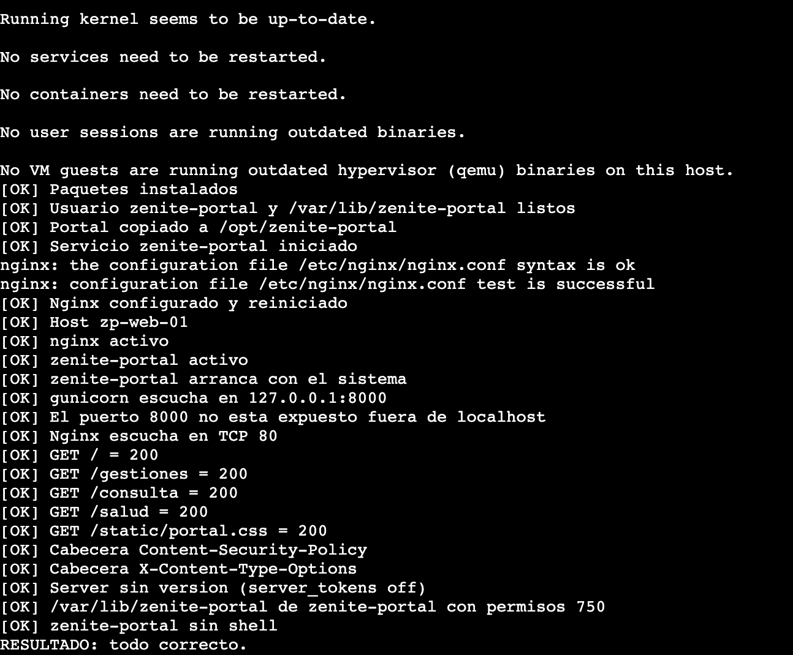

*Figura PUB-00 (a). Salida de `P2_web_publica.sh instalar` en `zp-web-01`: todas las comprobaciones en `[OK]` y `RESULTADO: todo correcto.`*

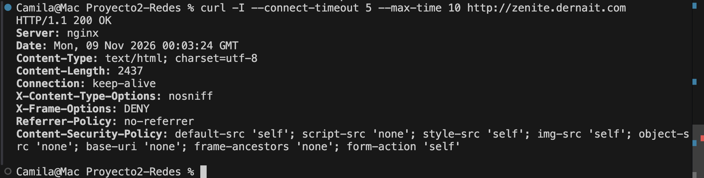

*Figura PUB-00 (b). `curl -I http://zenite.dernait.com` desde la Mac antes de activar la redirección: `200 OK` con las cabeceras de seguridad.*

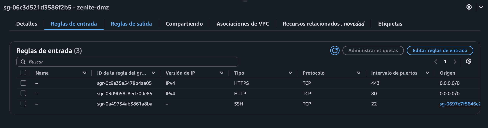

*Figura PUB-00 (c). Reglas de entrada de `zenite-dmz`: TCP 443 y 80 desde `0.0.0.0/0` y SSH solo desde el grupo del EICE.*

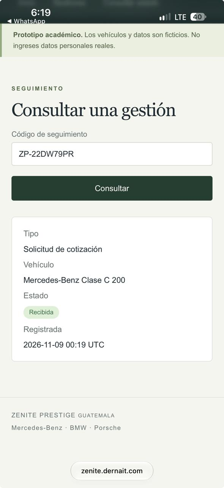

*Figura PUB-01. Portal desde un celular con datos móviles: consulta del código de seguimiento de una gestión de prueba.*

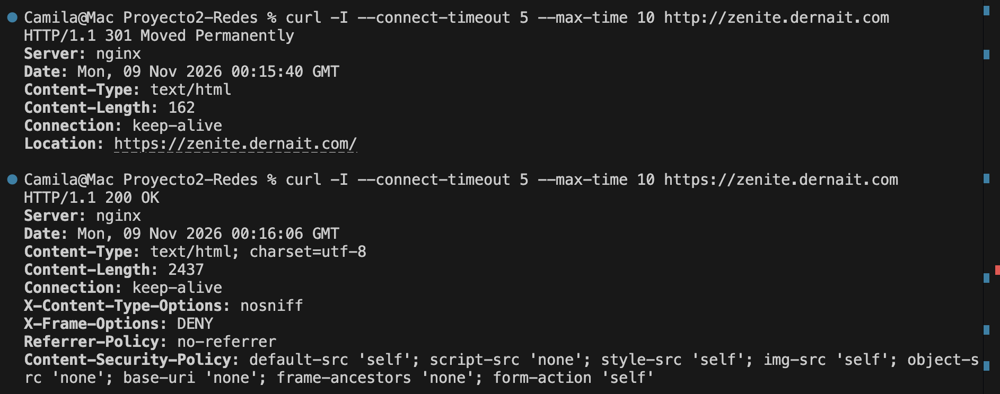

*Figura PUB-02. `301 Moved Permanently` hacia `https://zenite.dernait.com/` y `200 OK` por HTTPS.*

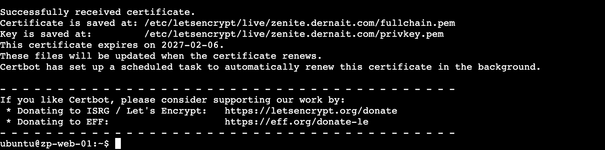

*Figura PUB-03 (a). Certbot en `zp-web-01`: certificado recibido, con vencimiento el 2027-02-06 y renovación automática.*

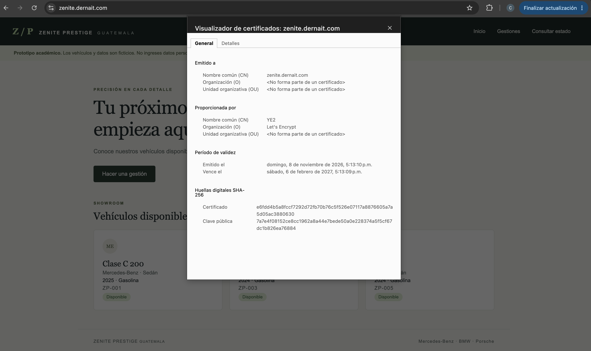

*Figura PUB-03 (b). Visor de certificados del navegador: emitido a `zenite.dernait.com` por Let's Encrypt, con su período de validez.*

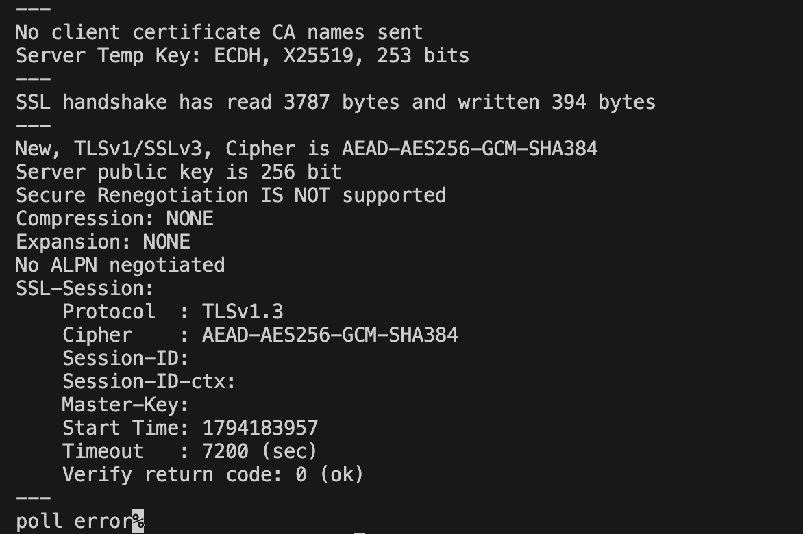

*Figura PUB-04. `openssl s_client`: TLSv1.3, `AEAD-AES256-GCM-SHA384` y `Verify return code: 0 (ok)`.*

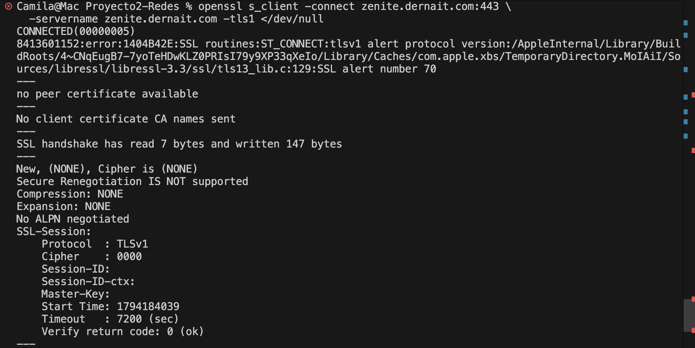

*Figura PUB-05 (a). `-tls1` rechazado con la alerta de versión de protocolo.*

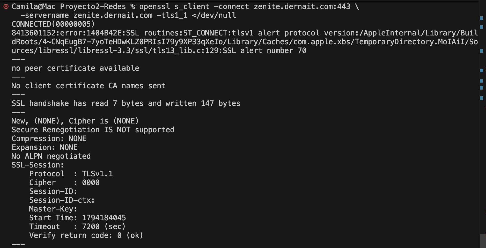

*Figura PUB-05 (b). `-tls1_1` rechazado con la misma alerta.*

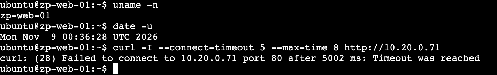

*Figura PUB-06 (a). Desde `zp-web-01`, la Intranet no responde (tiempo agotado).*

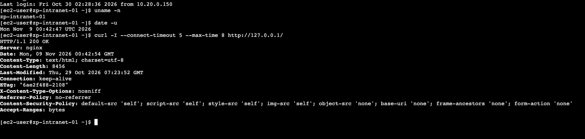

*Figura PUB-06 (b). Control: la Intranet sí responde `200 OK` desde sí misma, y la repetición de la prueba desde `zp-web-01` (00:44:27) vuelve a agotar el tiempo.*

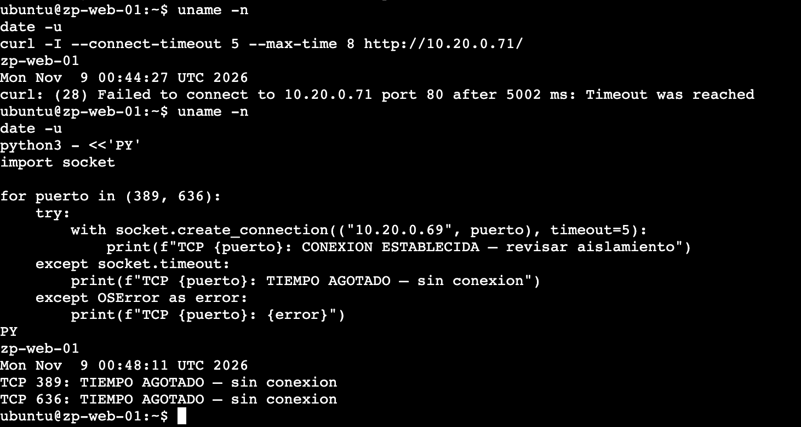

*Figura PUB-06 (c). LDAP 389 y 636 sin conexión desde la DMZ.*

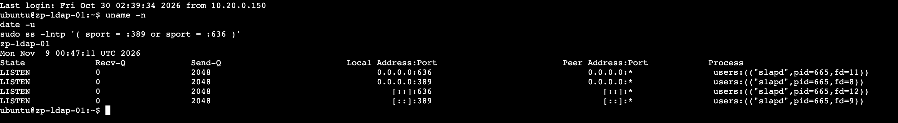

*Figura PUB-06 (d). Control: `slapd` escucha en 389 y 636 en `zp-ldap-01`.*

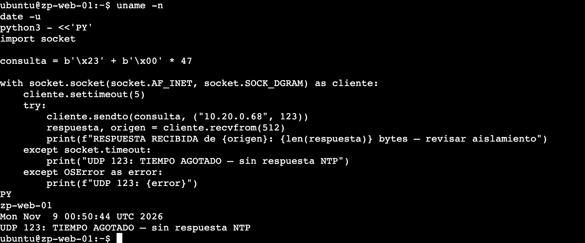

*Figura PUB-06 (e). UDP 123 sin respuesta desde la DMZ.*

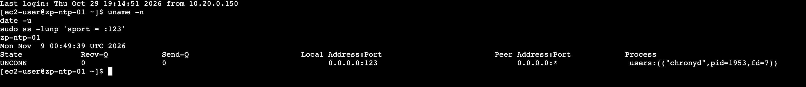

*Figura PUB-06 (f). Control: `chronyd` escucha en UDP 123 en `zp-ntp-01`.*

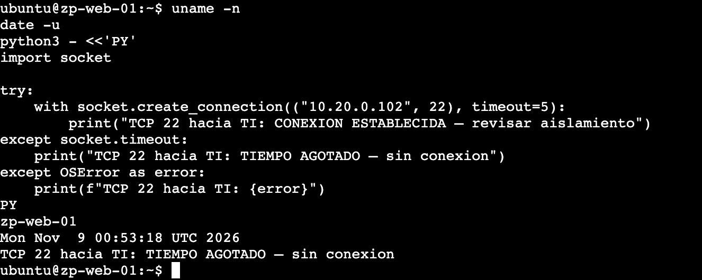

*Figura PUB-06 (g). TCP 22 hacia TI sin conexión desde la DMZ.*

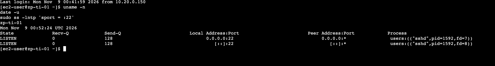

*Figura PUB-06 (h). Control: `sshd` escucha en el puerto 22 de `zp-ti-01`.*

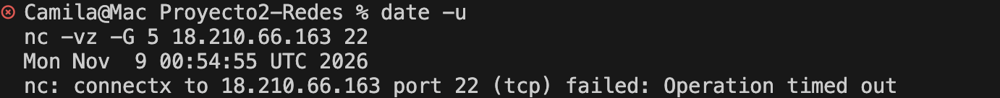

*Figura PUB-07. El puerto 22 de la IP pública no responde.*

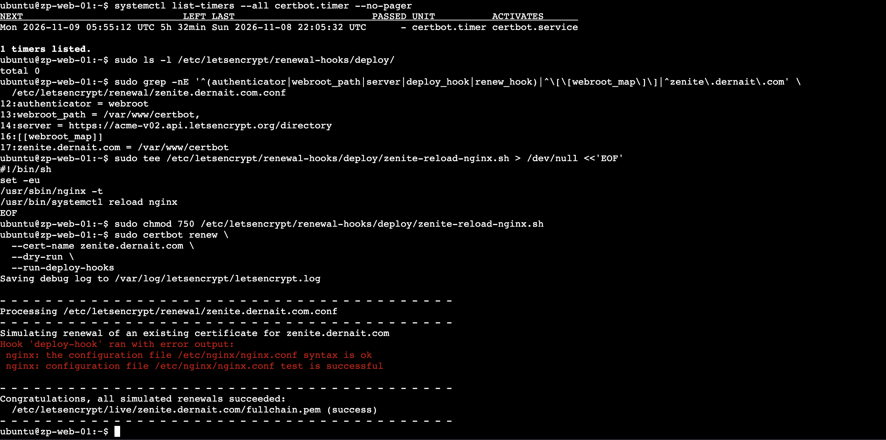

*Figura PUB-08. Temporizador de Certbot activo, gancho de renovación y simulación de renovación exitosa.*

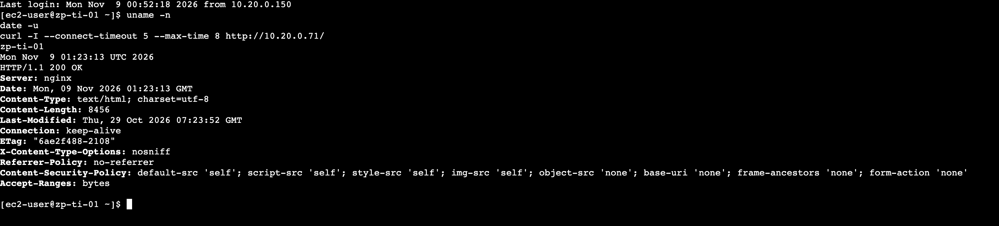

*Figura WEB-02. `zp-ti-01` recibe `200 OK` de la Intranet.*

*(Las figuras WEB-01, WEB-03, WEB-04 y WEB-05 se agregan cuando se suban las capturas.)*

### 5.2 Fallos, correcciones y desviaciones

| Prueba o paso | Error o desviación | Acción correctiva | Repetición |
|---|---|---|---|
| Instalación (8 nov, ≈ 21:46 UTC) | El instalador se detuvo con `Falta .../web/app/app.py`: los archivos se habían subido planos dentro de `web/` y el script espera subcarpetas. No cambió nada en la instancia. | Se reorganizaron con `git mv` en `app/`, `app/templates/`, `app/static/` y `nginx/` (commit `8538134`). | Instalación posterior: `RESULTADO: todo correcto.` (PUB-00) |
| Instalación | `git clone` falló porque la carpeta del repositorio ya existía en la instancia. | Se usó `git pull` dentro de la copia existente. | – |
| PUB-08 | La simulación de renovación muestra en rojo «Hook 'deploy-hook' ran with error output», pero el texto es la salida normal de `nginx -t` («syntax is ok», «test is successful»), que Certbot imprime por la salida de error. No es un fallo: el resultado final es «all simulated renewals succeeded». | Documentado; no requiere cambios. | – |
| Reglas de `zenite-dmz` | La Persona 2 abrió TCP 80 y 443 desde `0.0.0.0/0` **sin la autorización previa de la Persona 3**, dueña del firewall, porque no respondía y el certificado dependía de ello. Son exactamente las excepciones que autoriza la decisión D10 y no se tocó ninguna otra regla. | Se informó a la Persona 3 para que su script de firewall las reconozca y no las quite ni las duplique. | – |

## 6. Costos

La Persona 2 no creó recursos propios de AWS: el servidor `zp-web-01` y su Elastic IP son de la Persona 1 y sus costos se registran en su sección. Las instancias de la subred Ventas, TI, Servidores y Visitantes (y la Intranet) se encendieron temporalmente solo para WEB-01 a WEB-05 y PUB-06, sin NAT; se apagan al terminar (horas exactas por confirmar). El certificado de Let's Encrypt es gratuito. El gasto real se confirma en Billing, que tarda hasta 24 horas en reflejarse.

## 7. Limitaciones y observaciones

- **Sin HSTS.** Es una decisión consciente; como mejora, activarlo con `max-age` corto y ampliarlo cuando todo esté estable.
- **Cifrados.** `ssl_ciphers HIGH:!aNULL:!MD5` es menos estricto que el perfil «intermedio» de Mozilla; con solo TLS 1.2 y 1.3 el riesgo es bajo, pero puede endurecerse.
- **Aislamiento verificado para los destinos probados** (Intranet 80, LDAP 389 y 636, NTP UDP 123 y TI 22). No se probaron otros puertos ni ICMP. Las evidencias no permiten decir si el bloqueo lo aplica el Security Group o la ACL; por el diseño de Fase 3 se espera que ambos lo hagan (por verificar contra las reglas vigentes).
- **Renovación probada solo en simulación** (`--dry-run`); el primer certificado real vence el 6 feb 2027 y el temporizador intentará renovarlo antes.
- **El puerto 80 debe seguir abierto** a Internet: lo necesita la redirección y el desafío HTTP-01 de la renovación.
- **El dominio pertenece a otra persona del equipo** (`dernait.com`, DNS en Cloudflare, registros sin proxy). Si se borra el registro o se activa el proxy, el sitio y la renovación dejan de funcionar.
- **Sin alta disponibilidad ni copias de seguridad.** Una sola instancia y una sola base SQLite con datos ficticios.
- **La Intranet sigue en HTTP**, como en Fase 3 (solo accesible desde redes internas).
- **Pendiente:** acceso de la VPN a la Intranet. Requiere que la Persona 3 entregue la VPN, agregar `10.20.0.128/28` al `allow` de Nginx de la Intranet y TCP 80 desde `zenite-vpn` hacia `zenite-servidores`. No se probó.
- **`P2_web_publica.sh --validar`** comprueba que las rutas devuelvan `200` por HTTP en `127.0.0.1`; con la redirección activa devolverá `301`. Para revisar el estado actual se usan `curl -I https://zenite.dernait.com` y `certbot certificates`.

## 8. Documentación consultada

*Referencias de apoyo; verificar su vigencia antes de entregar.*

- Certbot: https://certbot.eff.org/
- Let's Encrypt, documentación y límites de emisión: https://letsencrypt.org/docs/ y https://letsencrypt.org/docs/rate-limits/
- Let's Encrypt, entorno de pruebas: https://letsencrypt.org/docs/staging-environment/
- Mozilla SSL Configuration Generator: https://ssl-config.mozilla.org/
- Nginx, módulo `ngx_http_ssl_module`: https://nginx.org/en/docs/http/ngx_http_ssl_module.html
- Nginx, módulo `ngx_http_limit_req_module`: https://nginx.org/en/docs/http/ngx_http_limit_req_module.html
- Flask: https://flask.palletsprojects.com/
- AWS, *Security groups*: https://docs.aws.amazon.com/vpc/latest/userguide/vpc-security-groups.html
- AWS, *Elastic IP addresses*: https://docs.aws.amazon.com/AWSEC2/latest/UserGuide/elastic-ip-addresses-eip.html

## 9. Archivos y evidencias de esta parte

| Archivo | Contenido |
|---|---|
| `FaseFinal/configuracion/P2_web_publica.sh` | Instalador y validador del portal (`instalar`, `--validar`). |
| `FaseFinal/configuracion/web/app/` | Aplicación Flask: `app.py`, `templates/` (6) y `static/portal.css`. |
| `FaseFinal/configuracion/web/nginx/zenite-portal-http.conf` y `zenite-portal-https.conf` | Configuración de Nginx de pruebas (HTTP) y definitiva (HTTPS y redirección). |
| `FaseFinal/configuracion/web/zenite-portal.service` | Servicio de systemd de gunicorn. |
| `FaseFinal/configuracion/web/zenite-reload-nginx.sh` | Gancho de renovación de Certbot. |
| `FaseFinal/evidencias/02_web_publica/` | Capturas FINAL_PUB-00 a PUB-08 y WEB-01 a WEB-05. |
| `FaseFinal/reporte/P2_matriz_filas.md` | Filas para la matriz global (Persona 5). |
| `FaseFinal/reporte/P2_guion_demo_web.md` | Guion de la demostración de la web. |
| `FaseFinal/bitacora/P2.md` | Bitácora de la Persona 2. |