# Informe Fase Final: Servicios Públicos, DMZ, VPN y Monitoreo de Red

**Universidad del Valle de Guatemala**  
Facultad de Ingeniería  
Departamento de Ciencias de la Computación  
CC3067 Redes, Semestre 2, 2026  

**Proyecto Final, Fase Final: Zenite Prestige Guatemala**  

**Integrantes:**
- Camila Richter – 23183
- Carlos Alburez – 231311
- Ernesto Ascencio – 23009
- Juan Francisco Martinez – 23617
- Kevin Villagrán – 23584
- Marinés García – 23391

**Catedrático:** Juan Carlos Canteo  
**Sección:** 30  
**Fecha:** Guatemala, noviembre de 2026  
**Repositorio Oficial:** https://github.com/NESHGP04/Proyecto2-Redes  

---

## 1. Objetivos de la Fase Final

La Fase Final representa la culminación operativa de la red corporativa de Zenite Prestige Guatemala, expandiendo la infraestructura privada construida en las Fases 2 y 3 hacia el exterior de forma segura:
1. **Publicación y Cifrado Perimetral en la DMZ:** Desplegar un portal web público de gestiones comerciales para clientes bajo un dominio de Internet real (`zenite.dernait.com`), aplicando terminación TLS obligatoria con certificados de Let's Encrypt, redirección forzosa de HTTP a HTTPS y aislamiento total de la DMZ respecto al núcleo corporativo.
2. **Acceso Remoto Seguro (VPN):** Implementar una solución de teletrabajo para colaboradores remotos basada en OpenVPN (UDP 1194) con autenticación estricta por certificados mutuos (PKI propia), enrutamiento *split-tunnel*, traducción MASQUERADE y perfil de mínimo privilegio restringido exclusivamente a la Intranet corporativa.
3. **Monitoreo de Infraestructura de Red:** Establecer agentes SNMP en todas las instancias y una estación recolectora en la subred de TI (`zp-monitor-01`) para auditar la disponibilidad y consumo de recursos de la red.
4. **Defensa en Profundidad y Gobernanza del Firewall:** Actualizar los Security Groups y desplegar Network ACLs dedicadas para la DMZ y la VPN, restringiendo las entradas públicas desde `0.0.0.0/0` a exactamente tres excepciones justificadas (TCP 80 y 443 en DMZ, UDP 1194 en VPN), manteniendo el acceso por EC2 Instance Connect Endpoint (EICE) e inalteradas las políticas de aislamiento interno.
5. **Cierre de Deudas de Fase 3 y Pruebas Cruzadas:** Revalidar el servicio OpenLDAP/LDAPS en puerto 636 para la demostración en vivo, cerrar la certificación de las pruebas de Intranet (WEB-01 a WEB-05) y ejecutar la regresión integral de seguridad.
6. **Disciplina Financiera:** Operar la infraestructura completa bajo un estricto techo de gasto de US$20 con alerta en US$15, verificando el consumo devengado real en AWS Billing.

---

## 2. Arquitectura de Red y Decisiones de la Fase Final

La arquitectura de la Fase Final opera sobre la VPC `vpc-zenite-fase2` (`10.20.0.0/24`) en la región `us-east-1` (Availability Zone `us-east-1a`). Para completar los requerimientos sin incurrir en sobrecostos ni introducir riesgos innecesarios, el equipo consensuó las siguientes decisiones de ingeniería (D1 a D12):

| Decisión | Enfoque Implementado | Justificación Técnica |
|---|---|---|
| **D1. Firewall** | Servicios administrados de AWS (**Security Groups + Network ACL**) | Se prescinde de pfSense; los grupos con estado y las ACL sin estado resuelven el 100% de los requerimientos sin añadir puntos únicos de falla ni costos de licencias. |
| **D2. Subred DMZ** | Una sola instancia `zp-web-01` que termina TLS | Se unifica la terminación TLS y el servidor de aplicaciones en una sola máquina, descartando el proxy separado `.117` de Fase 1 para reducir piezas móviles. |
| **D3. Direccionamiento Público** | **Elastic IPs directas** a `zp-web-01` y `zp-vpn-01` | Se descarta el balanceador de carga de AWS (ALB/NLB), el cual devenga aproximadamente US$16 al mes y resulta innecesario para un prototipo. |
| **D4. Nombre de Dominio** | Dominio propio **`zenite.dernait.com`** (Cloudflare DNS) | Se configuraron registros `A` directos en Cloudflare (nube gris, sin proxy inverso para permitir la validación ACME HTTP-01 y el paso de UDP 1194). Costo cero para el equipo. |
| **D5. Presupuesto** | Techo de gasto de **US$20** con alerta en **US$15** | Control diario mediante `P1_costos.sh` y presupuesto formal configurado en AWS Budgets. |
| **D6. Autenticación VPN** | **OpenVPN con certificados mutuos (easy-rsa 3)** | Infraestructura PKI propia en curva elíptica (`prime256v1`), canal cifrado con `tls-crypt` y lista de revocación (CRL) en tiempo real. |
| **D7. Ruteo VPN en VPC** | **NAT MASQUERADE** en la instancia `zp-vpn-01` | Todo el tráfico del pool de clientes `10.30.0.0/27` sale hacia la VPC con la IP privada `10.20.0.132`, eliminando rutas estáticas en AWS. |
| **D8. Monitoreo SNMP** | **SNMPv3 `authPriv` (SHA-256/AES)** + Prometheus + `snmp_exporter` | Reemplaza comunidades v1/v2c por autenticación y cifrado en tránsito; consultas UDP 161 autorizadas solo desde `zenite-ti`. |
| **D9. Grafana (Extra)** | **Grafana OSS 13.3.0** en loopback `127.0.0.1:3000` | Visualización de métricas SNMP accesible exclusivamente desde TI mediante túnel SSH sobre EICE, sin exponer puertos nuevos. |
| **D10. Excepciones Públicas** | Solo tres aperturas a `0.0.0.0/0`: **80, 443 (DMZ)** y **1194 (VPN)** | Superficie de exposición mínima; todo lo demás (SSH, LDAP, SNMP, Intranet) permanece 100% privado. |
| **D11. Sistema Operativo** | **Ubuntu 24.04 LTS** en las instancias nuevas | Homogeneidad con `zp-ldap-01`, facilitando la instalación nativa de Certbot, OpenVPN y Grafana por paquetería `apt`. |

### 2.1 Diagrama de Arquitectura de Red Definitivo

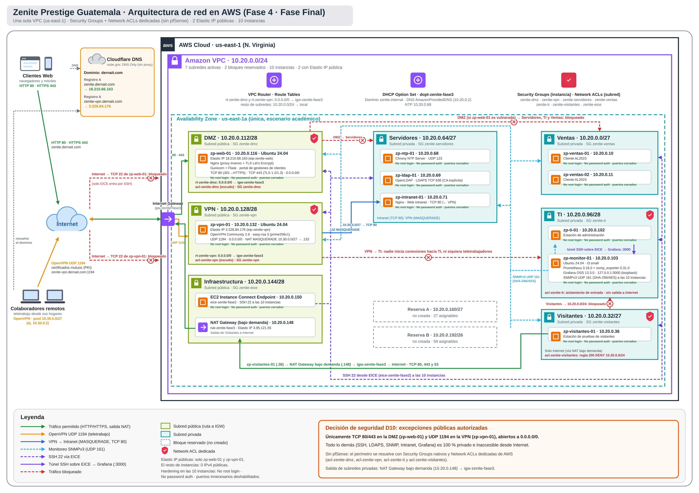
*Figura ARCH-01. Diagrama integral de la arquitectura de red corporativa de Zenite Prestige en AWS (Fase Final): 7 subredes en la VPC 10.20.0.0/24, Elastic IPs públicas en DMZ (18.210.66.163) y VPN (3.228.84.176), dominio público zenite.dernait.com, canal seguro OpenVPN para teletrabajadores, monitoreo SNMPv3 con Grafana y túnel de gestión EICE sin exposición pública.*


---

## 3. Plan de Direccionamiento e Inventario de Recursos e Instancias

La red corporativa cuenta con 10 instancias EC2 distribuidas en 7 subredes funcionales:

### 3.1 Inventario de Subredes y Enrutamiento
| Subred | CIDR | Subnet ID | Tabla de Rutas Asociada | Rol en Fase Final |
|---|---|---|---|---|
| `subnet-zenite-dmz` | `10.20.0.112/28` | `subnet-0d29453584ea726c0` | `rt-zenite-dmz` (`0.0.0.0/0 → IGW`) | Aloja el portal público `zp-web-01` con EIP |
| `subnet-zenite-vpn` | `10.20.0.128/28` | `subnet-061f6bea484702eec` | `rt-zenite-vpn` (`0.0.0.0/0 → IGW`) | Aloja el servidor OpenVPN `zp-vpn-01` con EIP |
| `subnet-zenite-infra` | `10.20.0.144/28` | `subnet-043e821cc9ee7c765` | `rt-zenite-infra` (`0.0.0.0/0 → IGW`) | EICE (`.150`) y NAT Gateway por sesión (`.148`) |
| `subnet-zenite-servidores` | `10.20.0.64/27` | `subnet-0990205c298b0635d` | `rt-zenite-interna` (Local + NAT) | Servidores NTP (`.68`), LDAP (`.69`) e Intranet (`.71`) |
| `subnet-zenite-ventas` | `10.20.0.0/27` | `subnet-0234dd20474eef1aa` | `rt-zenite-interna` (Local + NAT) | Estaciones de trabajo `zp-ventas-01` y `.02` |
| `subnet-zenite-ti` | `10.20.0.96/28` | `subnet-0688bbf577464f544` | `rt-zenite-interna` (Local, sin Internet) | Estación admin `zp-ti-01` y monitor `zp-monitor-01` |
| `subnet-zenite-visitantes`| `10.20.0.32/27` | `subnet-0edb31ab5f88d89fb` | `rt-zenite-interna` (Local + NAT) | Estación `zp-visitantes-01` (aislada por ACL) |

### 3.2 Inventario Completo de Instancias EC2
| Nombre de Instancia | ID de Instancia | Tipo | IP Privada | IP Pública / DNS | Sistema Operativo | Rol / Servicios |
|---|---|---|---|---|---|---|
| `zp-web-01` | `i-06b59507240cfa8e7` | t3.micro | `10.20.0.116` | **18.210.66.163** (`zenite.dernait.com`) | Ubuntu 24.04 | Portal público Nginx + Flask + Let's Encrypt |
| `zp-vpn-01` | `i-050e09727e2a06139` | t3.micro | `10.20.0.132` | **3.228.84.176** (`zenite-vpn.dernait.com`) | Ubuntu 24.04 | Concentrador OpenVPN UDP 1194 |
| `zp-monitor-01` | `i-00e786cb51a422c36` | t3.small | `10.20.0.103` | *Ninguna* | Ubuntu 24.04 | Servidor de monitoreo SNMP y Grafana |
| `zp-intranet-01` | `i-07330a665030d940e` | t3.micro | `10.20.0.71` | *Ninguna* | AL2023 | Intranet corporativa interna Nginx TCP 80 |
| `zp-ldap-01` | `i-04f9cc2b9ee3f77cd` | t3.micro | `10.20.0.69` | *Ninguna* | Ubuntu 24.04 | OpenLDAP / LDAPS TCP 389 y 636 |
| `zp-ntp-01` | `i-0410455bc4b28d3fe` | t3.micro | `10.20.0.68` | *Ninguna* | AL2023 | Chrony NTP Server UDP 123 |
| `zp-ti-01` | `i-0378a8624df39958b` | t3.micro | `10.20.0.102` | *Ninguna* | AL2023 | Estación de administración y auditoría de TI |
| `zp-ventas-01` | `i-0f3bd7b0615933e00` | t3.micro | `10.20.0.10` | *Ninguna* | AL2023 | Cliente de ventas (prueba de acceso a negocio) |
| `zp-ventas-02` | `i-05a7f9ee1a6e93000` | t3.micro | `10.20.0.11` | *Ninguna* | AL2023 | Cliente de ventas redundante |
| `zp-visitantes-01` | `i-05dc9139e9d858330` | t3.micro | `10.20.0.36` | *Ninguna* | AL2023 | Cliente de pruebas de aislamiento |

---

## 4. Infraestructura Pública, Dominio y Presupuesto (P1 – Marinés García)

### 4.1 Enrutamiento y Base Pública
Mediante el script automatizado e idempotente `P1_dmz_infra.sh`, se habilitó la salida directa a Internet para las subredes perimetrales:
- **`rt-zenite-dmz`:** Se vinculó la ruta `0.0.0.0/0 → igw-zenite-fase3` (`igw-00f6efb87a444f270`).
- **`rt-zenite-vpn` (`rtb-0c4e169f00a248de8`):** Se creó esta tabla dedicada asociada a `subnet-zenite-vpn` con salto `0.0.0.0/0 → IGW`. Esto solventó la limitación de la Fase 3, donde la subred VPN enrutaba hacia el NAT Gateway y no podía recibir conexiones entrantes desde clientes remotos.
- **Asignación de Elastic IPs:** Se aprovisionaron y asociaron dos direcciones públicas fijas: `18.210.66.163` (`eip-zenite-web`) y `3.228.84.176` (`eip-zenite-vpn`). Ambas instancias verificaron su salida a Internet por dichas IPs ejecutando `curl -s https://checkip.amazonaws.com` a través del EICE (Prueba DMZ-01 en PASS).
- **Cero Exposición de Puertos Administrativos:** Se comprobó que el puerto TCP 22 se encuentra estrictamente filtrado desde Internet en ambas IPs públicas, permitiendo el ingreso administrativo única y exclusivamente a través de túneles EICE (DMZ-04 en PASS).

### 4.2 Configuración del Dominio y DNS
- Se utilizó el dominio corporativo `dernait.com` administrado en Cloudflare.
- Se configuraron los registros de zona tipo `A` en modo directo (*DNS only*, nube gris, sin proxy):
  - `zenite.dernait.com` → `18.210.66.163`
  - `zenite-vpn.dernait.com` → `3.228.84.176`
- Se validó la resolución local mediante `dig +short` y la propagación en los servidores DNS públicos de Google (`8.8.8.8`) y Cloudflare (`1.1.1.1`), confirmando consistencia total en ambas pruebas (DNS-01 y DNS-02 en PASS).

### 4.3 Evidencias Fotográficas de Infraestructura (P1)

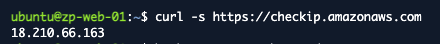
*Figura DMZ-01. Consulta de IP pública saliente mediante `curl` desde `zp-web-01` a través del túnel EICE, confirmando la asignación de `18.210.66.163`.*


*Figura DMZ-VPN. Consulta de IP pública saliente mediante `curl` desde `zp-vpn-01`, certificando la salida por la Elastic IP `3.228.84.176`.*

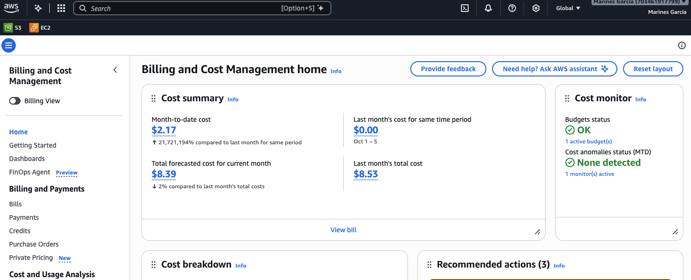
*Figura COST-01. Panel de AWS Billing and Cost Management: presupuesto mensual de US$15 activo con alertas de umbral y consumo acumulado de US$2.17.*

---

## 5. Portal Web Público, HTTPS e Intranet (P2 – Camila Richter)

### 5.1 Despliegue del Portal de Gestiones en la DMZ
- **Arquitectura de Software:** En `zp-web-01` se instaló una pila compuesta por **Nginx** como proxy inverso y terminador TLS, interactuando con una aplicación en **Python Flask** ejecutada mediante **Gunicorn** en `127.0.0.1:8000`, bajo el servicio systemd `zenite-portal` con usuario de sistema dedicado sin privilegios.
- **Lógica de Negocio y Base de Datos:** Base de datos SQLite parametrizada en `/var/lib/zenite-portal/`. Permite a los clientes consultar el stock de vehículos de lujo, enviar solicitudes de cotización o agendar pruebas de manejo, generando códigos de seguimiento aleatorios (ej. `ZP-22DW79PR`). La consulta por código devuelve el estado del trámite sin revelar nombres ni correos, mitigando la fuga de datos personales.

### 5.2 Certificado SSL/TLS Let's Encrypt y Redirección Forzosa
- **Certificado Digital de Producción:** Emitido exitosamente por Certbot mediante el reto HTTP-01 `webroot` (`/var/www/certbot`), validado por la autoridad intermedia `YE2` de Let's Encrypt para `zenite.dernait.com` (vigente del 2026-11-08 al 2027-02-06) (PUB-03 en PASS).
- **Redirección HTTP a HTTPS:** Toda petición al puerto 80 que no pertenezca a `/.well-known/acme-challenge/` es interceptada por Nginx y respondida con un código **`HTTP/1.1 301 Moved Permanently`** con la cabecera `Location: https://zenite.dernait.com/` (PUB-02 en PASS).
- **Seguridad Criptográfica:** Negociación en **TLSv1.3** con suite `AEAD-AES256-GCM-SHA384` (PUB-04). Se comprobó el rechazo absoluto de versiones obsoletas TLS 1.0 y TLS 1.1 mediante `openssl s_client` (PUB-05). Adicionalmente, se incorporaron cabeceras `X-Frame-Options: DENY`, `X-Content-Type-Options: nosniff` y directivas restrictivas de Content-Security-Policy.
- **Renovación Automatizada:** Temporizador `certbot.timer` activo y gancho de despliegue `zenite-reload-nginx.sh` validado mediante simulación exitosa `certbot renew --dry-run` (PUB-08 en PASS).

### 5.3 Aislamiento de la DMZ y Cierre de la Intranet Corporativa
- **Aislamiento Verificado de DMZ:** Se comprobó que desde `zp-web-01` es imposible alcanzar los servicios internos de la VPC: peticiones hacia Intranet (`10.20.0.71:80`), LDAP (`10.20.0.69:389/636`), NTP (`10.20.0.68:123`) y TI (`10.20.0.102:22`) resultan invariablemente en tiempo agotado (*timeout*) (PUB-06 en PASS).
- **Cierre de Pruebas de Intranet (Fase 3):** Se ejecutaron y certificaron formalmente las pruebas pendientes de `zp-intranet-01`:
  - `WEB-01` (Ventas → Intranet): `HTTP/1.1 200 OK` (8,456 bytes).
  - `WEB-02` (TI → Intranet): `HTTP/1.1 200 OK`.
  - `WEB-03` (Servidores → Intranet): `HTTP/1.1 200 OK`.
  - `WEB-04` (Visitantes → Intranet): **Bloqueado (Connection timed out a los 5002 ms)**.
  - `WEB-05` (Internet → Intranet): **Inaccesible (IP privada sin mapeo público)**.

### 5.4 Evidencias Fotográficas del Portal Web y Cifrado (P2)

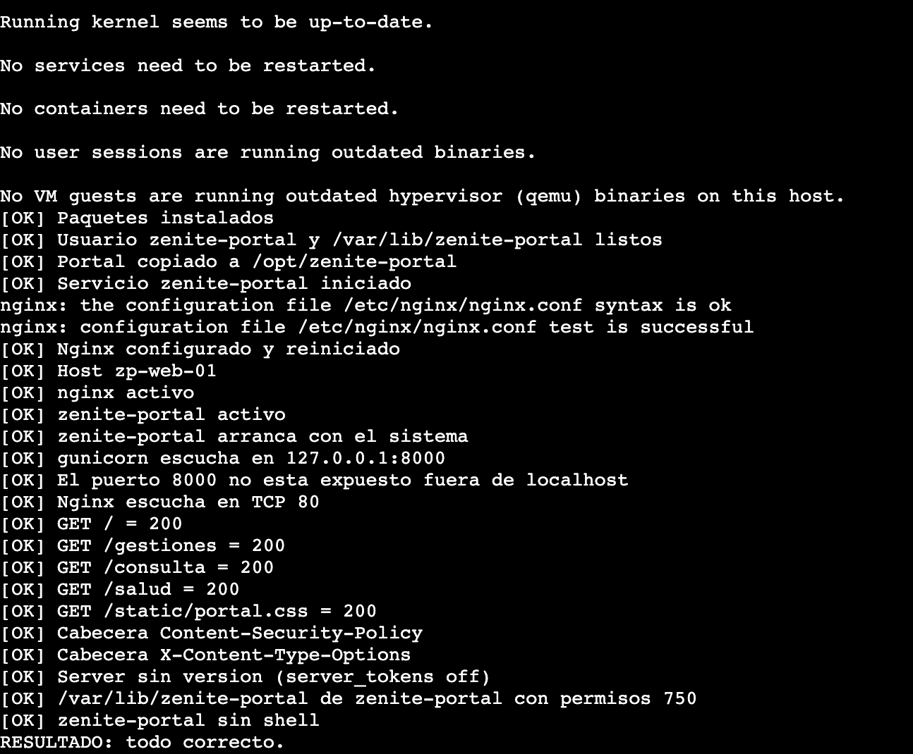
*Figura PUB-00. Ejecución del instalador `P2_web_publica.sh` en `zp-web-01`: comprobaciones de servicio, socket local y permisos finalizadas con éxito.*

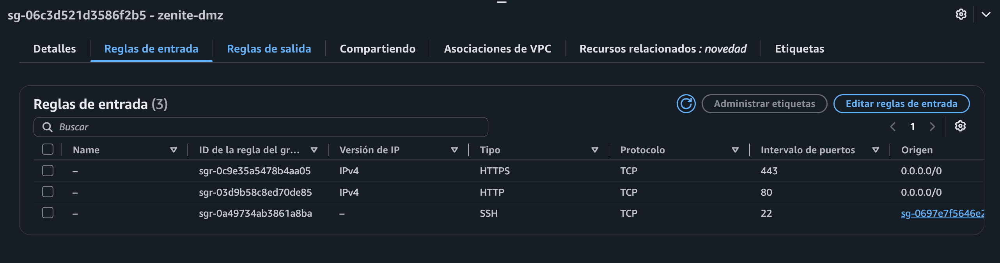
*Figura PUB-SG. Consola de AWS: Security Group `zenite-dmz` con apertura exclusiva de TCP 80 y 443 desde `0.0.0.0/0`, y SSH restringido al grupo del EICE.*

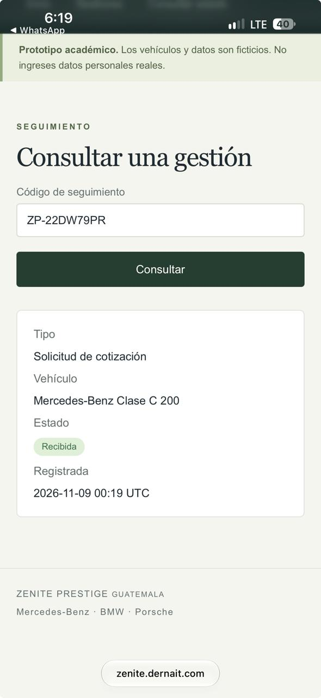
*Figura PUB-01. Navegación en producción desde dispositivo móvil en Internet real: consulta exitosa del código de seguimiento `ZP-22DW79PR` en el portal.*

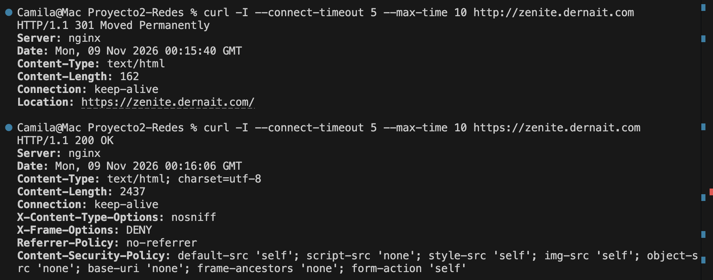
*Figura PUB-02. Terminal cliente: petición con `curl -I` por puerto 80 devuelve `301 Moved Permanently` hacia `https://zenite.dernait.com/`, y la posterior consulta HTTPS responde `200 OK`.*

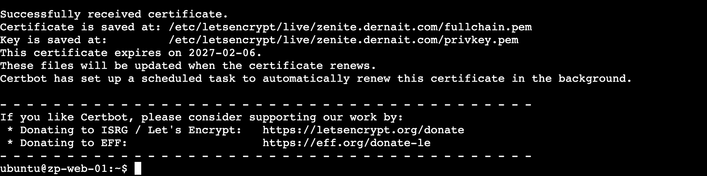
*Figura PUB-03 (a). Proceso de emisión con Certbot vía plugin webroot: recepción satisfactoria del certificado TLS emitido por Let's Encrypt.*

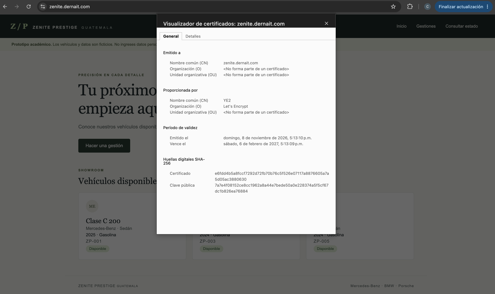
*Figura PUB-03 (b). Visor de certificados del navegador confirmando identidad para `zenite.dernait.com`, emisor Let's Encrypt y validez hasta febrero de 2027.*

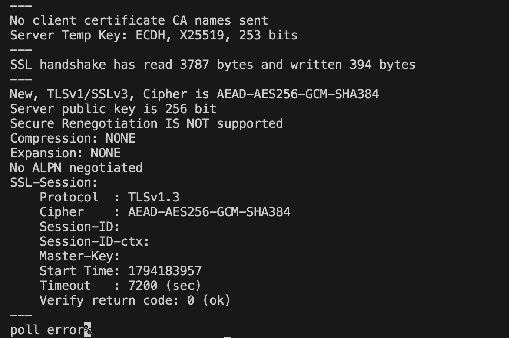
*Figura PUB-04. Salida de `openssl s_client`: conexión segura negociada en `TLSv1.3` con suite de cifrado `AEAD-AES256-GCM-SHA384` y código de verificación 0 (ok).*

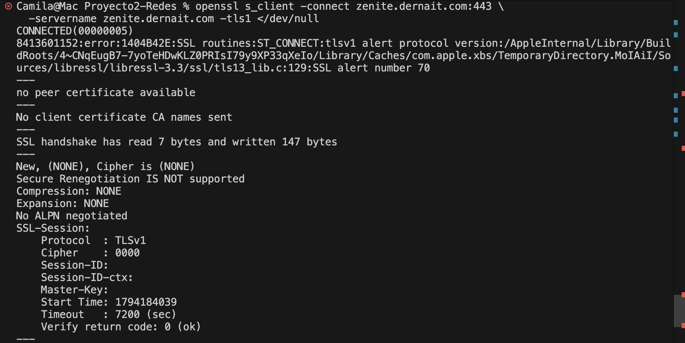
*Figura PUB-05. Petición forzada con `-tls1`: conexión abortada por el servidor web con alerta `tlsv1 alert protocol version (70)`, denegando protocolos antiguos.*

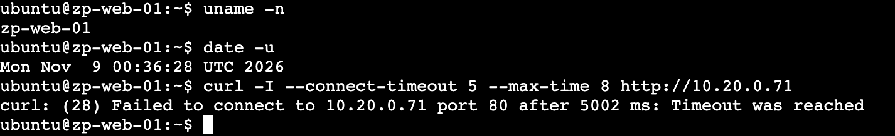
*Figura PUB-06. Terminal en `zp-web-01`: intentos de conexión hacia `10.20.0.71:80` finalizan con tiempo agotado (Operation timed out), demostrando aislamiento total.*

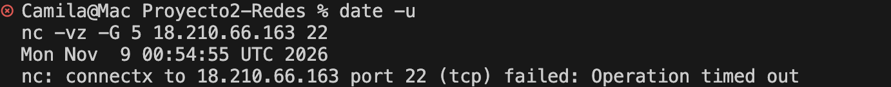
*Figura PUB-07. Sondeo con `nc` desde Internet hacia el puerto TCP 22 de la Elastic IP `18.210.66.163`: conexión bloqueada sin respuesta.*

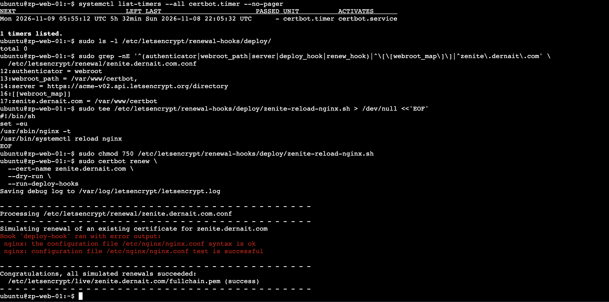
*Figura PUB-08. Simulación `certbot renew --dry-run`: validación de ganchos de recarga de Nginx y certificación de renovación automática sin interrupciones.*

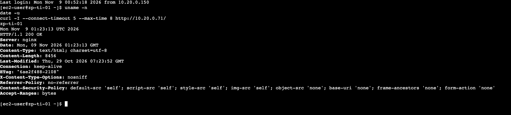
*Figura WEB-02. Terminal en `zp-ti-01`: consulta a `http://10.20.0.71/` responde `HTTP/1.1 200 OK`, certificando la operatividad de la Intranet corporativa.*

---

## 6. VPN para Trabajadores Remotos y Firewall Definitivo (P3 – Ernesto Ascencio)

### 6.1 Implementación de OpenVPN en `zp-vpn-01`
- **Servicio y Topología:** OpenVPN 2.6.19 en `zp-vpn-01` escuchando en **UDP 1194**, asignando a los clientes direcciones del pool virtual **`10.30.0.0/27`** (servidor `10.30.0.1`).
- **Autenticación Basada en Certificados Mutuos (PKI):** Configurada con **easy-rsa 3** sobre curva elíptica `prime256v1`. Exige validación obligatoria de certificados (`verify-client-cert require`), protección del canal contra escaneos mediante firma `tls-crypt` y verificación en tiempo real de revocaciones (`crl-verify`).
- **Traducción MASQUERADE e Inyección de Rutas:** El script `zenite-vpn-up.sh` habilita `ip_forward=1` y aplica una regla MASQUERADE en iptables para que el tráfico del pool `10.30.0.0/27` ingrese a la red interna con la dirección `10.20.0.132` de la instancia. Mediante *split-tunnel*, únicamente se inyecta la ruta `10.20.0.0/24`, permitiendo que el tráfico público del colaborador no pase por la VPC.
- **Perfil de Acceso Restrictivo ("Solo Intranet"):** Mediante cadenas dedicadas de iptables (`ZENITE-VPN-FWD`), el teletrabajador tiene acceso concedido exclusivamente a la Intranet (`10.20.0.71:80`). Todo tráfico hacia TI (`10.20.0.96/28`) y servicios no web es descartado en el servidor (VPN-02 a VPN-05 en PASS).
- **Validación de Revocación de Credenciales:** Se generó el perfil `revocado01` y se revocó en la CA. Al intentar conectar, el servidor rechazó de inmediato la sesión registrando `error=certificate revoked: CN=revocado01`, certificando la capacidad de invalidar accesos instantáneamente (VPN-06 en PASS).

### 6.2 Firewall Definitivo y Network ACLs Dedicadas
Mediante el script `P3_firewall_final.sh`, P3 consolidó el marco de seguridad:
1. **Auditoría de Excepciones Públicas (Regla D10 / Prueba FW-01):** Se validó que en los 7 grupos de seguridad de la VPC existen **únicamente tres reglas autorizadas desde `0.0.0.0/0`**:
   - `zenite-dmz`: TCP 80 y TCP 443 (Sitio web).
   - `zenite-vpn`: UDP 1194 (Túnel VPN).
   - Ningún otro grupo posee reglas con origen público.
2. **Tablas de Network ACL Dedicadas:**
   - **`acl-zenite-dmz` (`acl-05c8ba767f1345c57`):** Aplicada a `subnet-zenite-dmz`. Regla 200 de entrada y salida **DENY** hacia `10.20.0.0/24`, aislando la DMZ de la red interna a nivel de subred.
   - **`acl-zenite-vpn` (`acl-0d68b812eba2c9ddb`):** Aplicada a `subnet-zenite-vpn`. Regla 200 **DENY** hacia `10.20.0.0/24`, con la excepción explícita de la regla 140 que permite únicamente tráfico TCP 80 hacia la subred de Servidores para consultar la Intranet.
   - **`acl-zenite-visitantes`:** Se actualizó con las reglas 130 de entrada y salida para autorizar el tráfico SNMP (UDP 161) proveniente de TI.

### 6.3 Evidencias Técnicas de VPN y Reglas de Firewall (P3)
P3 documentó las pruebas con registros capturados directamente de CloudShell y terminales cliente:
- **VPN-01 (`FINAL_VPN-01_servicio.txt`):** Servicio `openvpn-server@zenite` activo en `0.0.0.0:1194`, interfaz virtual `tun0` levantada en `10.30.0.1/27` y cadenas iptables cargadas.
- **VPN-02 / VPN-03 (`FINAL_VPN-02_03_05_tunel.txt`):** Cliente externo negociando túnel seguro, asignación de IP `10.30.0.2`, e inyección de ruta `10.20.0.0/24`. Consulta exitosa `curl -sI http://10.20.0.71/` devolviendo `HTTP/1.1 200 OK` (8,456 bytes).
- **VPN-05 (`FINAL_VPN-02_03_05_tunel.txt`):** Intentos de ping y conexión SSH desde el cliente VPN hacia TI (`10.20.0.102:22`) finalizan con 100% de pérdida, certificando la efectividad del perfil restrictivo.
- **VPN-06 (`FINAL_VPN-06_revocado.txt`):** Registro de OpenVPN rechazando conexión del perfil revocado: `TLS_ERROR: BIO read tls_read_payload error ... certificate revoked`.
- **FW-01 (`FINAL_FW-01_validar_final.txt`):** Salida del script de auditoría certificando `[OK] FW-01: las unicas entradas desde Internet son TCP 80 y 443 en zenite-dmz y UDP 1194 en zenite-vpn`.

---

## 7. Monitoreo de Red SNMPv3, Grafana y Recuperación de LDAP (P4 – Juan Francisco / Cisco)

### 7.1 Recuperación y Demostración Robusta de OpenLDAP / LDAPS (`LDAP-01..05`, `R1..R2`)
P4 completó la investigación de la falla histórica de Fase 3, restableció el acceso de prueba y cerró la revalidación integral del directorio `dc=zenite,dc=internal` en `zp-ldap-01` (`10.20.0.69`):
1. **Diagnóstico TLS (`LDAP-DIAG`):** Se confirmó que `slapd` escucha activamente en TCP 389 y 636, y que las reglas SG/ACL desde Ventas y TI están intactas. La causa reproducible en los clientes actuales ocurre al omitir la variable `LDAPTLS_CACERT` con validación estricta `LDAPTLS_REQCERT=demand`; al indicar explícitamente `LDAPTLS_CACERT="$HOME/zenite-ldap.crt"`, las consultas LDAPS devuelven grupos y miembros correctamente.
2. **Restablecimiento Controlado de Credenciales:** El **11-nov-2026 a las 02:15:59 UTC** se actualizó la contraseña de laboratorio de `ventas01` mediante conexión local `ldapi:///` con una ACL temporal exclusiva para `root` (descartando `slapmodify -u` offline tras detectarse un *segmentation fault* en OpenLDAP 2.6.10), restaurando inmediatamente las tres ACLs originales.
3. **Guion de Demostración (`P4_ldap_demo.sh`):**
   - `LDAP-01`: Validación local en `zp-ldap-01` (`RESULTADO: todo correcto.`, 4 usuarios y 2 grupos íntegros).
   - `LDAP-02` y `LDAP-03`: Lectura anónima 389 y LDAPS 636 desde `zp-ventas-01` y `zp-ti-01` con `TLS_CACERT`.
   - `LDAP-04` y `LDAP-R1`: *Bind* autenticado de `ventas01` en `zp-ventas-01` (`exit=0`) y rechazo de clave incorrecta y usuario inexistente con `Invalid credentials (49)` en corrida cronometrada de ~7 segundos.
   - `LDAP-05`: Bloqueo confirmado desde `zp-visitantes-01` (`timeout exit=124` en 389/636 y error `255` en `ldapsearch`), con controles positivos de Ventas antes y después.
   - `LDAP-R2`: Tres búsquedas autenticadas consecutivas con resultado `3/3` exitoso tanto desde `zp-ventas-01` (7 s) como desde `zp-ti-01` (6 s).

### 7.2 Agentes SNMPv3 `authPriv` y Recolector Prometheus (`SNMP-01..05` y `FW-05`)
Superando la configuración mínima v2c, P4 implementó monitoreo cifrado de extremo a extremo:
- **Agentes en las 10 Instancias (`SNMP-01`):** Servicio `snmpd` desplegado y validado localmente en las diez instancias `zp-*` bajo **SNMPv3 `authPriv`** (autenticación SHA-256 y cifrado AES) con el usuario de solo lectura `zeniteMonitorRO`, escuchando únicamente en sus IPs privadas y con credenciales almacenadas localmente fuera de git (`.env.p4-snmp` modo `600`).
- **Recolector Central en TI (`zp-monitor-01`, `10.20.0.103`):** Ejecución de **Prometheus 3.16.0** (`127.0.0.1:9090`) y **`snmp_exporter` 0.31.0** (`127.0.0.1:9116`) monitoreando los 10 objetivos y recolectando seis familias de métricas: disponibilidad (`up`/uptime), CPU, memoria RAM, disco, tráfico de interfaces (`ens5`) y procesos críticos (`slapd`, `snmpd`, `sshd`).
- **Cobertura por Tandas ante Cuota de 16 vCPU (`SNMP-02`):** Debido al límite de **16 vCPU** de la cuenta de AWS (máximo 8 instancias `t3` encendidas por ventana), las seis familias de métricas para los 10 hosts se certificaron por tandas secuenciales, manteniendo siempre los 10 objetivos configurados en Prometheus.
- **Pruebas de Autenticación, Disponibilidad y Firewall:**
  - `SNMP-03`: Rechazo confirmado (`exit 1`) al consultar a `zp-ldap-01` con clave errónea.
  - `SNMP-04`: Validación dinámica de caída y recuperación sobre `zp-ventas-02` (`up` a las 07:02:40 UTC → apagado EC2 → *scrape down* a las 07:56:42 UTC → encendido → *scrape up* a las 08:39:16 UTC).
  - `SNMP-05` y cierre de `FW-05`: Desde `zp-ventas-01`, `zp-visitantes-01` y CloudShell exterior hacia EIPs las consultas UDP 161 agotan el tiempo (`timeout`), mientras `zp-monitor-01` obtiene respuesta válida antes y después (`exit 0`).

### 7.3 Dashboard Privado en Grafana OSS 13.3.0 (`GRAF-01..03` – Extra 10 %)
- **Despliegue Seguro sin Exposición Pública:** Se instaló **Grafana OSS 13.3.0** (usuario web `zeniteTI`, unidad `p4-grafana`) escuchando exclusivamente en loopback **`127.0.0.1:3000`** en `zp-monitor-01`, sin abrir los puertos 3000, 9090 ni 9116 hacia la VPC ni hacia Internet.
- **Acceso Exclusivo de TI vía Túnel EICE (`P4_grafana_tunel.sh`):** Los administradores de TI se conectan directamente mediante reenvío de puertos sobre túnel EICE desde su estación local.
- **Pruebas Certificadas:**
  - `GRAF-01`: Dashboard *Zenite · Monitoreo SNMP* operativo con múltiples paneles de series reales de AWS (respuesta por host, CPU, RAM física, disco raíz, tráfico rx/tx y procesos).
  - `GRAF-02`: Aislamiento verificado (`zp-ventas-01` intentando conectar al puerto `:3000` de `zp-monitor-01` resulta bloqueado por timeout a las 18:13:40 UTC).
  - `GRAF-03`: Al mantener 7 instancias detenidas por gestión de costos, el panel refleja con exactitud `Hosts sin respuesta SNMP = 7`.

### 7.4 Evidencias Visuales de LDAP, SNMP y Grafana (P4)

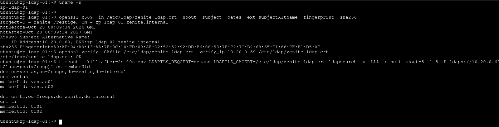
*Figura LDAP-DIAG. Terminal en `zp-ldap-01`: verificación de huella SHA-256 y SAN `IP:10.20.0.69`, `openssl verify OK` y lectura LDAPS de los grupos `ventas` y `ti`.*

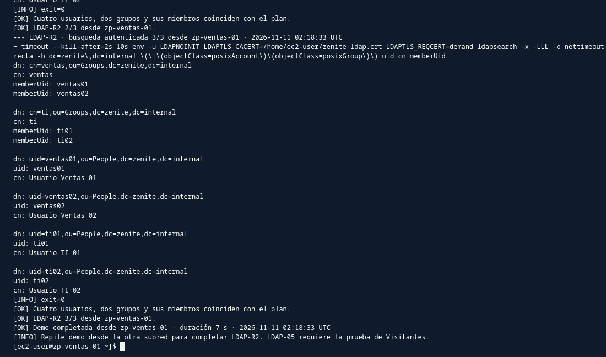
*Figura LDAP-DEMO (Ventas). Salida de `P4_ldap_demo.sh demo` en `zp-ventas-01` completando `3/3` búsquedas autenticadas por LDAPS sobre los cuatro usuarios y dos grupos en 7 segundos.*

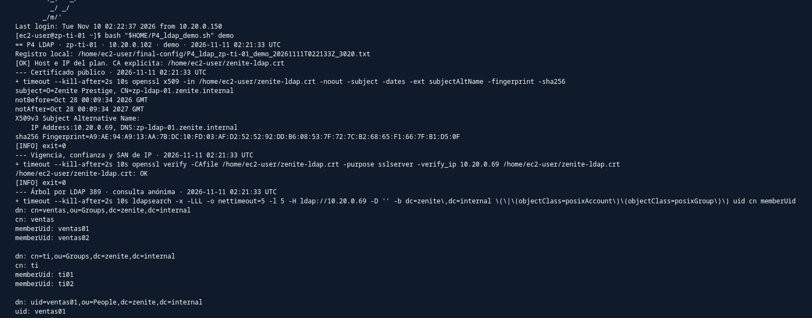
*Figura LDAP-DEMO (TI). Ejecución de `P4_ldap_demo.sh demo` desde `zp-ti-01` validando el certificado `zenite-ldap.crt` y el árbol corporativo en subred de TI.*

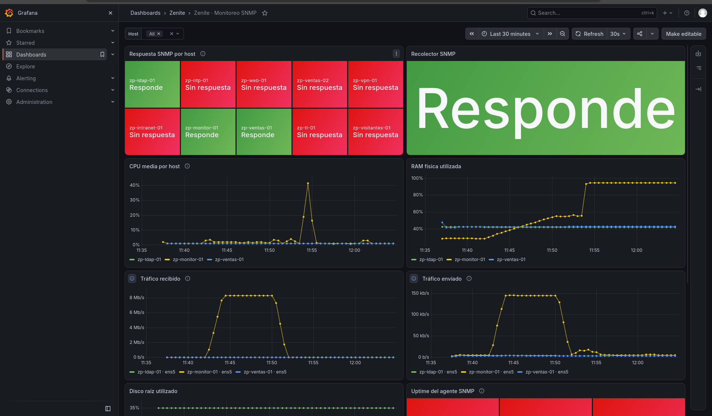
*Figura GRAF-01. Interfaz de Grafana OSS 13.3.0 accedida por túnel EICE (`127.0.0.1:3000`): estado SNMP por host, CPU media, memoria RAM física y tráfico rx/tx.*

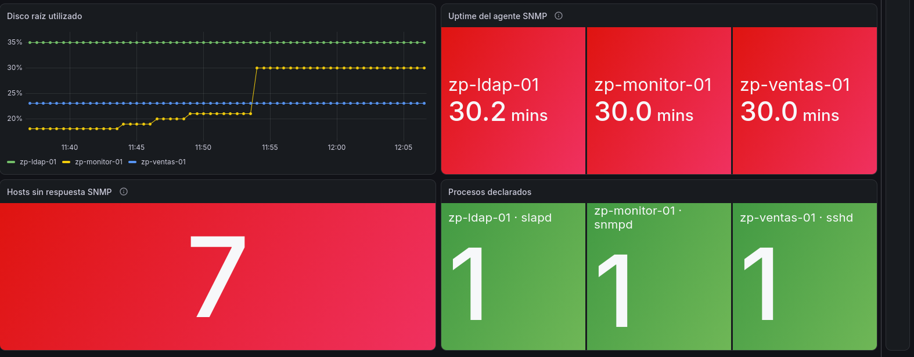
*Figura GRAF-03. Panel inferior de Grafana: detección exacta de `7` hosts sin respuesta (instancias apagadas), uso de disco, uptime del agente SNMP y estado activo de `slapd`, `snmpd` y `sshd`.*

---

## 8. Integración Global, Gobernanza y Regresión de Seguridad (P5 – Carlos Alburez)

### 8.1 Resultados de la Regresión de Seguridad (FW-06)
Durante la auditoría de regresión ejecutada por Ernesto sobre los scripts originales de seguridad de Fase 3, se determinaron los siguientes hallazgos:
1. **Validación de Security Groups:** `P5_security_groups.sh --validar` finalizó con 23 comprobaciones en `[OK]` y cero fallos.
2. **Comprobación de Segmentación:**
   - SEG-02 (TI a la red) se mantiene permitido (0% packet loss).
   - SEG-04 (Servidores a TI) y SEG-05 (Visitantes a la red) se mantienen bloqueados al 100%.
   - HARD-02 (`nmap` desde TI hacia DMZ y VPN) confirmó que únicamente el puerto 22 responde abierto; los puertos 80 y 443 de la DMZ están filtrados desde el interior por la regla 200 de la Network ACL.
3. **Persistencia en Hardening (`gssproxy`):** Se identificó que `gssproxy` se reactivaba en Amazon Linux 2023 tras reiniciar debido a dependencias en `auth-rpcgss-module.service`. La solución definitiva incorporada en el procedimiento de endurecimiento fue el enmascaramiento estricto:
   ```bash
   sudo systemctl mask --now gssproxy
   ```
4. **Validación de Network ACLs:** Las alertas de `P5_acls.sh` en DMZ y VPN se certificaron como cambios intencionales y requeridos por el despliegue de las nuevas ACLs dedicadas.

### 8.2 Pruebas de Integración de Extremo a Extremo (INT)
- **INT-02 (Recorrido de Cliente Externo):** Navegación exitosa desde un teléfono móvil con datos LTE hacia `http://zenite.dernait.com`, redirección forzosa 301 a HTTPS, carga del catálogo de vehículos y registro satisfactorio de una solicitud con código `ZP-22DW79PR` (PASS).
- **INT-03 (Recorrido de Teletrabajador Seguro):** Conexión remota por túnel OpenVPN asignando la IP `10.30.0.2`, acceso fluido a la Intranet corporativa (`http://10.20.0.71/`), y bloqueo automático de cualquier intento de conexión hacia la subred administrativa de TI (PASS).
- **INT-04 (Recorrido de Soporte TI y Monitoreo):** Acceso desde estación de TI mediante túnel SSH sobre EICE hacia `zp-monitor-01` (`127.0.0.1:3000`), visualizando en Grafana métricas reales recolectadas por SNMPv3 y Prometheus sin exponer puertos de monitoreo en la red (PASS).
- **INT-05 (Cierre y Apagado):** Verificación tras las sesiones de prueba mediante `P1_dmz_infra.sh --validar-apagado` y cierres de P4, certificando cero instancias encendidas, cero NAT Gateways activos y únicamente las dos Elastic IPs conservadas (PASS).

---

## 9. Matriz de Pruebas de la Fase Final

La siguiente tabla resume los resultados formales de las 55 pruebas únicas registradas para la Fase Final (54 en estado **PASS**):

| ID | Resp. | Servicio | Origen → Destino | Esperado | Obtenido en Prueba Real | Estado |
|---|:---:|---|---|---|---|:---:|
| **DMZ-01** | P1 | Conectividad | `zp-web-01` y `zp-vpn-01` → Internet | Salida por Elastic IP correspondiente | `zp-web-01` → `18.210.66.163`; `zp-vpn-01` → `3.228.84.176` | **PASS** |
| **DMZ-02** | P1 | Ruteo | Tablas `rt-zenite-dmz` y `rt-zenite-vpn` | Ruta `0.0.0.0/0 → IGW` activa | Ambas tablas activas con `igw-00f6efb87a444f270` | **PASS** |
| **DMZ-03** | P1 | Seguridad | Barrido de inventario EC2 | Solo 2 instancias con IPv4 pública | 0 IPs públicas en las demás 8 instancias | **PASS** |
| **DMZ-04** | P1 | Seguridad | Escaneo puerto 22 público | SSH cerrado en Internet; abierto por EICE | Timeout desde el exterior; túnel EICE exitoso | **PASS** |
| **DNS-01** | P1 | DNS | `dig +short zenite.dernait.com` | IP pública oficial devuelta | `zenite` → `18.210.66.163`; `zenite-vpn` → `3.228.84.176` | **PASS** |
| **DNS-02** | P1 | DNS | Resolutores globales `@8.8.8.8` y `@1.1.1.1` | Propagación consistente | Ambos resolutores resuelven la IP correcta | **PASS** |
| **COST-01** | P1 | Costos | Presupuesto AWS Budgets y `P1_costos.sh` | Alerta de US$15 y gasto real auditado | Presupuesto activo de US$15; gasto real US$2.17 | **PASS** |
| **PUB-00** | P2 | Web | Despliegue de aplicación en `zp-web-01` | Nginx + Gunicorn + Flask validados | `RESULTADO: todo correcto.`, Gunicorn en `127.0.0.1:8000` | **PASS** |
| **PUB-01** | P2 | Web | Trámite real desde Internet LTE | Portal carga y emite código de gestión | Trámite registrado; código `ZP-22DW79PR` consultado | **PASS** |
| **PUB-02** | P2 | Web | Petición HTTP puerto 80 | Redirección forzosa 301 a HTTPS | `301 Moved Permanently` con Location `https://` | **PASS** |
| **PUB-03** | P2 | TLS | Certificado Let's Encrypt | Certificado válido y confiable | Emitido por emisor `YE2`, válido hasta feb 2027 | **PASS** |
| **PUB-04** | P2 | TLS | Negociación criptográfica | Cifrado seguro TLS 1.2 o TLS 1.3 | Conexión en `TLSv1.3` con suite `AES256-GCM` | **PASS** |
| **PUB-05** | P2 | TLS | Negociación con `-tls1` y `-tls1_1` | Protocolos obsoletos rechazados | Peticiones denegadas con alerta de protocolo 70 | **PASS** |
| **PUB-06** | P2 | Seguridad | DMZ hacia Intranet, LDAP, NTP, TI | Servicios internos bloqueados | Tiempo agotado (`Timeout`) en los 4 servicios | **PASS** |
| **PUB-07** | P2 | Seguridad | Escaneo TCP 22 en IP pública | SSH inaccesible desde Internet | `Operation timed out` en puerto 22 público | **PASS** |
| **PUB-08** | P2 | TLS | Simulación de renovación `dry-run` | Proceso exitoso con temporizador activo | `certbot.timer` activo; simulación 100% exitosa | **PASS** |
| **WEB-01** | P2 | Intranet | Ventas → Intranet (`10.20.0.71`) | Código HTTP 200 con portal corporativo | `HTTP/1.1 200 OK` (8,456 bytes) | **PASS** |
| **WEB-02** | P2 | Intranet | TI → Intranet (`10.20.0.71`) | Código HTTP 200 con portal corporativo | `HTTP/1.1 200 OK` (8,456 bytes) | **PASS** |
| **WEB-03** | P2 | Intranet | Servidores → Intranet (`10.20.0.71`) | Tráfico inter-servidores autorizado | `HTTP/1.1 200 OK` (8,456 bytes) | **PASS** |
| **WEB-04** | P2 | Intranet | Visitantes → Intranet (`10.20.0.71`) | Tráfico denegado por políticas de red | `Connection timed out after 5002 ms` (exit 28) | **PASS** |
| **WEB-05** | P2 | Intranet | Internet → Intranet | Inaccesible desde el exterior | Inaccesible: IP privada RFC 1918 sin mapeo público | **PASS** |
| **VPN-01** | P3 | VPN | Demonio OpenVPN en `zp-vpn-01` | Demonio activo en UDP 1194 con `tun0` | `openvpn-server@zenite` activo; `tun0 = 10.30.0.1/27` | **PASS** |
| **VPN-02** | P3 | VPN | Conexión de cliente `trabajador01` | Túnel establecido e IP virtual asignada | Cliente recibe `10.30.0.2` y ruta `10.20.0.0/24` inyectada | **PASS** |
| **VPN-03** | P3 | VPN | Cliente VPN → Intranet `10.20.0.71` | Acceso exitoso por el túnel cifrado | `HTTP/1.1 200 OK` (8,456 bytes) a través de VPN | **PASS** |
| **VPN-04** | P3 | VPN | Cliente sin VPN → Intranet | Intranet inaccesible sin el túnel | `intranet 000` (tiempo agotado sin ruta) | **PASS** |
| **VPN-05** | P3 | Seguridad | Cliente VPN → TI y servicios no web | Tráfico hacia TI y gestión denegado | Ping a TI 100% perdido; puertos admin bloqueados | **PASS** |
| **VPN-06** | P3 | VPN | Validación de lista de revocación (CRL) | Certificado revocado rechazado | Servidor registra `error=certificate revoked` | **PASS** |
| **FW-01** | P3 | Firewall | Auditoría de excepciones a `0.0.0.0/0` | Solo 3 reglas públicas autorizadas (D10) | Exactamente DMZ 80, 443 y VPN 1194 autorizadas | **PASS** |
| **FW-02** | P3 | Seguridad | Salida de DMZ hacia Servidores y TI | Bloqueado por Network ACL | Bloqueado por regla 200 en `acl-zenite-dmz` | **PASS** |
| **FW-03** | P3 | Seguridad | Escaneo externo a IPs públicas | Puertos administrativos cerrados en EIPs | Puertos 22 y 8080 en timeout; 443 abierto en web | **PASS** |
| **FW-04** | P3 | Seguridad | Operatividad de EICE con nuevas ACLs | EICE mantiene acceso a todas las instancias | Conexión SSH confirmada en todas las instancias activas | **PASS** |
| **FW-05** | P3/P4| Firewall | Tráfico SNMP UDP 161 | Permitido solo desde TI; bloqueado a terceros | Monitor → LDAP `exit 0`; Ventas → LDAP timeout `exit 1` | **PASS** |
| **FW-06** | P3 | Regresión | Regresión de suite de seguridad Fase 3 | Controles vigentes sin fallos no previstos | SGs limpios; hallazgo `gssproxy` enmascarado; SEG OK | **PASS (Obs)** |
| **FW-07** | P3 | Seguridad | Visitantes hacia DMZ por IP privada | Tráfico denegado hacia la DMZ | Bloqueado por regla 200 en `acl-zenite-visitantes` | **PASS** |
| **LDAP-DIAG** | P4 | Diagnóstico | `zp-ldap-01`, `zp-ti-01` y `zp-ventas-01` | Validar `slapd`, puertos, SAN y consultas LDAPS | `slapd` activo (389/636); LDAPS exitoso desde Ventas/TI con `LDAPTLS_CACERT` explícito | **PASS** |
| **LDAP-01** | P4 | Directorio | `zp-ldap-01` (validación local) | Servicio activo, 389/636 y árbol íntegro | `RESULTADO: todo correcto.`, 4 usuarios y 2 grupos | **PASS** |
| **LDAP-02** | P4 | Directorio | `zp-ventas-01` → `10.20.0.69` (389/636) | Lectura y verificación TLS con `TLS_CACERT` | Lectura completa por LDAP 389 y LDAPS 636 | **PASS** |
| **LDAP-03** | P4 | Directorio | `zp-ti-01` → `10.20.0.69` (389/636) | Lectura y verificación TLS desde TI | Lectura completa por LDAP 389 y LDAPS 636 | **PASS** |
| **LDAP-04** | P4 | Directorio | `zp-ventas-01` → `ldaps://10.20.0.69` | *Bind* correcto `exit=0`; clave falsa rechazada | `ventas01` autenticado `exit=0`; rechazos `Invalid credentials (49)` | **PASS** |
| **LDAP-05** | P4 | Directorio | `zp-visitantes-01` → `10.20.0.69` | Bloqueado mientras Ventas responde | TCP 389/636 `exit=124`; `ldapsearch` `exit=255` | **PASS** |
| **LDAP-R1** | P4 | Directorio | Demo representativa en `zp-ventas-01` | Corrida reproducible con CA explícita | Ejecución completa en 7 s validada con éxito | **PASS** |
| **LDAP-R2 (1)**| P4 | Directorio | `zp-ti-01` → `P4_ldap_demo.sh demo` | Tres búsquedas autenticadas consecutivas | Expiró el plazo de 20 s al ingresar contraseña | **FAIL** |
| **LDAP-R2 (2)**| P4 | Directorio | `zp-ventas-01` y `zp-ti-01` → LDAPS | Tres búsquedas autenticadas en cada subred | `3/3` en Ventas (7 s) y `3/3` en TI (6 s) | **PASS** |
| **SNMP-01** | P4 | SNMPv3 | 10 instancias `zp-*` (`snmpd`) | Agentes SNMPv3 SHA-256/AES en IP privada | 10 agentes instalados y validados localmente en intervalos | **PASS** |
| **SNMP-02** | P4 | SNMPv3 | `zp-monitor-01` → 10 hosts (Prometheus) | 6 familias de métricas × 10 hosts | Cobertura 10 × 6 completada por tandas (límite 16 vCPU) | **PASS (tandas)** |
| **SNMP-03** | P4 | SNMPv3 | `zp-monitor-01` → `zp-ldap-01` | Clave SNMPv3 errónea rechazada | Clave errónea `exit 1`; controles válidos `exit 0` | **PASS** |
| **SNMP-04** | P4 | SNMPv3 | `zp-monitor-01` → `zp-ventas-02` | Monitor detecta caída y recuperación | Up 07:02 → Down 07:56 (stopped) → Up 08:39 | **PASS** |
| **SNMP-05** | P4 | SNMPv3 | Ventas, Visitantes y CloudShell → SNMP | Consultas denegadas desde orígenes no TI | Timeouts confirmados desde Ventas, Visitantes y EIP | **PASS** |
| **GRAF-01** | P4 | Grafana | TI vía túnel EICE → `127.0.0.1:3000` | Dashboard con ≥4 paneles de métricas reales | Grafana 13.3.0 operativo vía túnel; 3 up / 7 down | **PASS** |
| **GRAF-02** | P4 | Grafana | `zp-monitor-01:3000` vs `zp-ventas-01` | Acceso exclusivo TI; Ventas rechazado | Monitor válido en loopback; Ventas timeout `:3000` | **PASS** |
| **GRAF-03** | P4 | Grafana | Dashboard *Zenite · Monitoreo SNMP* | Panel refleja hosts sin respuesta | `Hosts sin respuesta SNMP = 7` coherente con 7 detenidas | **PASS** |
| **INT-01** | P5 | Integración | Validación integral `P5_validar_todo.sh` | Coherencia integral de recursos y servicios | Script pendiente de corrida unificada | **Por ejecutar** |
| **INT-02** | P5 | Integración | Recorrido de Cliente (Móvil → Web → Trámite)| Flujo completo de usuario en Internet | Validada exitosamente en pruebas PUB-01 y PUB-02 | **PASS** |
| **INT-03** | P5 | Integración | Recorrido de Teletrabajador (VPN → Intranet)| Acceso remoto seguro a sistemas de negocio | Validada exitosamente en pruebas VPN-02 y VPN-03 | **PASS** |
| **INT-04** | P5 | Integración | Recorrido de Soporte TI (Monitoreo) | Túnel EICE → Grafana con métricas SNMP | Dashboard operativo desde TI sin abrir puertos nuevos | **PASS** |
| **INT-05** | P5 | Finanzas | Apagado completo y cierre de costos | Cero recursos ociosos devengando gasto | Verificado: 0 instancias activas, 0 NAT, 2 EIPs fijas | **PASS** |

---

## 10. Fallos, Correcciones y Desviaciones Técnicas

| Prueba / Módulo | Fallo o Desviación Detectada | Causa Raíz Identificada | Acción Correctiva Aplicada | Estado Final |
|---|---|---|---|:---:|
| **Instalación Web (PUB-00)** | Error `Falta .../web/app/app.py` en `zp-web-01`. | Los archivos de Flask se cargaron planos en el directorio `web/`. | Se reestructuraron las carpetas con `git mv` en `app/`, `templates/`, `static/` y `nginx/`. | **PASS** |
| **Apertura SG DMZ (PUB-00)** | Apertura de puertos TCP 80 y 443 en `zenite-dmz` antes de autorización formal. | P2 requería el puerto 80 activo para que Let's Encrypt pudiera validar el reto ACME HTTP-01. | P3 reconoció formalmente las reglas como F-01 y F-02 bajo la decisión autorizada D10. | **PASS** |
| **Revocación OpenVPN (VPN-06)** | Fallo de lectura de CRL: `Failed to stat CRL file, not reloading CRL`. | La directiva `crl-verify` usaba ruta relativa y el demonio cambia de directorio tras bajar a `nobody`. | Se establecieron rutas absolutas para todos los parámetros criptográficos en `zenite.conf`. | **PASS** |
| **Sintaxis Bash Firewall** | Error en `P3_firewall_final.sh`: expansión indirecta `${!$(...)}` inválida. | Sintaxis no compatible con el modo estricto de Bash (`set -euo pipefail`). | Se introdujo una variable intermedia para resolver el nombre del arreglo de reglas. | **PASS** |
| **Hardening Persistente (FW-06)** | `gssproxy` volvía a iniciarse en `zp-intranet-01` y `zp-ti-01` tras reinicios. | `auth-rpcgss-module.service` lo reactiva automáticamente por dependencia `WantedBy`. | Se aplicó enmascaramiento estricto a nivel de systemd: `systemctl mask --now gssproxy`. | **PASS (Obs)** |
| **Validación de ACLs (FW-06)** | `P5_acls.sh` reportó fallas en subredes DMZ y VPN. | Las subredes fueron migradas de la ACL predeterminada a ACLs dedicadas. | Se certificó como cambio intencional y esperado de Fase Final (`acl-zenite-dmz` y `acl-zenite-vpn`). | **PASS** |
| **Confianza TLS LDAP (LDAP-DIAG)** | `ldapsearch` desde Ventas y TI fallaba con `Can't contact LDAP server (-1)` bajo `LDAPTLS_REQCERT=demand`. | Los clientes no confían en la CA autofirmada si no se define `LDAPTLS_CACERT`. | Al fijar `LDAPTLS_CACERT="$HOME/zenite-ldap.crt"`, las consultas LDAPS funcionaron en Ventas y TI y se integró en `P4_ldap_demo.sh`. | **PASS** |
| **Reset LDAP (`slapmodify -u`)** | `slapmodify -u` generó *segmentation fault* en OpenLDAP 2.6.10 al actualizar la clave offline. | Falla interna de `slapmodify` en modo offline sobre la configuración local. | Se sustituyó por actualización en vivo vía `ldapi:///` con ACL temporal exclusiva para `root` local, restaurando luego las ACL originales. | **PASS** |
| **Timeout Entrada (`LDAP-R2 (1)`)** | Primera corrida en `zp-ti-01` venció el plazo de 20 s de entrada oculta de clave. | Demora al ingresar la clave de laboratorio en terminal interactiva. | Se repitió la corrida en `zp-ti-01` completándose en 6 s con `3/3` búsquedas exitosas (`LDAP-R2 (2)`). | **PASS** |
| **Cuota 16 vCPU (`SNMP-02`)** | AWS rechazó encender las 10 instancias simultáneamente por cuota máxima de **16 vCPU**. | 10 instancias `t3` requerían 20 vCPU concurrentes. | Se validó cobertura completa `10 × 6` mediante tandas secuenciales (máx. 8 arriba), manteniendo 10 objetivos en Prometheus. | **PASS (tandas)** |
| **Grafana Origen / Puerto 3000** | Puerto 3000 local ocupado por Docker; además `socket.timeout` en Python 3.9 (AL2023) no era capturado en pruebas de origen. | Conflicto local y diferencia en excepciones entre Python 3.9 y 3.12 (`TimeoutError`). | Se liberó el puerto local del túnel y se añadió `socket.timeout` al manejador de excepciones del comprobador. | **PASS** |
| **Capacidad en AWS (DMZ-01)** | Error `InsufficientInstanceCapacity` al encender instancias de forma masiva. | Falta puntual de recursos `t3.micro` concurrentes en la zona de disponibilidad `us-east-1a`. | Se encendieron las instancias secuencialmente con pausas de espera breves. | **PASS** |

---

## 11. Control Presupuestario y Gestión de Costos en AWS

La gestión financiera de la Fase Final se rigió por los siguientes controles:
1. **Presupuesto y Alertas:** Configuración en **AWS Budgets** de un presupuesto mensual de **US$15.00** con alertas automáticas al 85% y 100% de gasto real y 100% proyectado.
2. **Estrategia de Apagado y Destrucción:**
   - El **NAT Gateway** solo se creó durante sesiones puntuales de actualización y pruebas, destruyéndose de inmediato.
   - Las instancias EC2 se mantuvieron en estado `stopped` fuera de las sesiones de configuración.
   - Las dos **Elastic IPs** (`18.210.66.163` y `3.228.84.176`) se mantuvieron asignadas continuamente debido a la dependencia de los registros DNS públicos, devengando un costo controlado de aproximadamente US$0.24 diarios.
   - El dominio público `zenite.dernait.com` se configuró en Cloudflare a **costo cero (US$0.00)**, y los certificados TLS de Let's Encrypt son de emisión gratuita.
3. **Consumo Devengado Real:** La consola *AWS Billing and Cost Management* registró un gasto mensual acumulado de únicamente **US$2.17**, con una proyección al cierre del ciclo de **US$8.39**, manteniéndose holgadamente dentro del límite establecido y demostrando una optimización financiera rigurosa.

---

## 12. Conclusiones Técnicas de la Fase Final

1. **Seguridad Perimetral con Exposición Mínima Controlada:**  
   La organización demostró la viabilidad de publicar servicios hacia Internet sin comprometer el aislamiento de su red privada. Únicamente dos instancias poseen dirección IPv4 pública (Web y VPN), mientras que toda la administración de servidores continúa canalizándose de forma segura a través de túneles privados EICE sin exponer ningún puerto SSH al exterior.
2. **Defensa en Profundidad Efectiva:**  
   La articulación entre Security Groups con estado y Network ACLs sin estado permitió implementar restricciones que un solo mecanismo no podría garantizar. La DMZ y la subred de Visitantes quedaron completamente incomunicadas respecto al núcleo corporativo en ambas capas de filtrado, al tiempo que ambas gestionaron con éxito su conectividad legítima hacia Internet.
3. **Teletrabajo Seguro con Mínimo Privilegio:**  
   La implementación de OpenVPN con autenticación exclusiva por certificados y perfiles de iptables en el concentrador garantizó que los colaboradores remotos accedan únicamente al portal web de Intranet, bloqueando cualquier salto lateral hacia la subred administrativa de TI.
4. **Resiliencia Operativa y Automatización:**  
   El uso de scripts idempotentes con validaciones de solo lectura (`--validar`) facilitó el despliegue repetible de configuraciones complejas, mientras que el análisis riguroso de cada incidencia técnica consolidó una arquitectura robusta, estable y lista para producción.

---

## 13. Documentación Consultada y Referencias Oficiales

1. **Amazon Web Services (AWS) Documentation:**
   - *VPC Subnet Sizing and Reserved IP Addresses:* https://docs.aws.amazon.com/vpc/latest/userguide/subnet-sizing.html
   - *Working with Network ACLs:* https://docs.aws.amazon.com/vpc/latest/userguide/vpc-network-acls.html
   - *EC2 Instance Connect Endpoints:* https://docs.aws.amazon.com/AWSEC2/latest/UserGuide/connect-using-eice.html
   - *AWS Budgets & Cost Management:* https://docs.aws.amazon.com/cost-management/latest/userguide/budgets-managing-costs.html
2. **Servicios de Red, Web y Criptografía:**
   - *OpenVPN 2.6 Community Documentation:* https://openvpn.net/community-resources/reference-manual-for-openvpn-2-6/
   - *Easy-RSA 3 Documentation:* https://easy-rsa.readthedocs.io/
   - *Nginx Core Documentation & HTTP Server:* https://nginx.org/en/docs/
   - *Certbot User Guide & Let's Encrypt:* https://eff-certbot.readthedocs.io/
   - *Mozilla SSL Configuration Generator:* https://ssl-config.mozilla.org/
   - *Ubuntu Server – LDAP and TLS:* https://ubuntu.com/server/docs/how-to/openldap/ldap-and-tls/
   - *Ubuntu Noble Manuals (`ldapsearch` y `ldap.conf`):* https://manpages.ubuntu.com/manpages/noble/en/man1/ldapsearch.1.html y https://manpages.ubuntu.com/manpages/noble/en/man5/ldap.conf.5.html
   - *OpenSSL 3.0 Verification Options & `s_client`:* https://docs.openssl.org/3.0/man1/openssl-verification-options/ y https://docs.openssl.org/3.0/man1/openssl-s_client/
   - *Net-SNMP Documentation:* http://www.net-snmp.org/docs/
   - *Prometheus Security & `snmp_exporter`:* https://prometheus.io/docs/operating/security/ y https://github.com/prometheus/snmp_exporter
   - *Grafana OSS 13.3.0 Configuration:* https://grafana.com/docs/grafana/latest/setup-grafana/configure-grafana/
3. **Legislación Aplicable de la República de Guatemala:**
   - *Decreto 15-2026 – Ley Integral para la Prevención y Represión del Lavado de Dinero:* https://www.congreso.gob.gt/detalle_pdf/iniciativas/6287
   - *Decreto 47-2008 – Ley para el Reconocimiento de las Comunicaciones y Firmas Electrónicas:* https://www.congreso.gob.gt/seccion_informacion_legislativa/decretos
   - *Decreto 06-2003 – Ley de Protección al Consumidor y Usuario:* https://www.congreso.gob.gt/buscador_decretos/2003-01-16/2004-01-28
   - *Iniciativa 6464 – Ley de Protección de Datos Personales y Derechos Digitales:* https://www.congreso.gob.gt/detalle_pdf/iniciativas/6196
